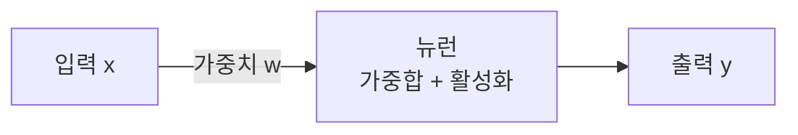

# 용어 해설 작성 가이드

이 저장소의 모든 용어 해설(`explanations/*.md`)은 이 가이드를 따라 **한 사람이 쓴 것처럼** 일관된 문체와 구조로 작성한다. 새 해설을 쓰거나 기존 해설을 다듬을 때 이 문서를 기준으로 삼는다.

> 이 가이드는 『Visual Coding』 문체 가이드의 **의도**(두괄식·비유·오해 짚기·질문으로 자극·정리와 다음 걸음)를 이 용어집에 맞게 옮긴 것이다. 다만 이 저장소는 **GitHub에서 렌더링**되므로 tools.camp 전용 문법(`:::` 콜아웃, `state`/`navigation` 펜스)은 쓰지 않고, GitHub 네이티브 마크다운(blockquote·표·mermaid)으로 같은 의도를 구현한다.

---

## 어투 — 반말 평서문 "~다"

**모든 해설은 평서문 서술체("~다") 반말로 쓴다. 존댓말(합니다체)은 한 문장도 섞지 않는다.**

- 좋음: "경사 하강법은 손실을 줄이는 방향으로 한 걸음씩 내려가는 알고리즘이다."
- 나쁨: "경사 하강법은 손실을 줄이는 방향으로 내려가는 알고리즘입니다."

해라체 평서문("~한다", "~된다", "~이다")으로 고정한다.

---

## 문체 원칙

### 1. 두괄식 — 결론부터, 소제목이 곧 주장
핵심을 맨 앞에 놓는다. **소제목 자체가 하나의 결론 문장**이 되게 하고, 첫 문장에서 핵심을 다시 못 박는다. "~에 대해 알아보자" 같은 유보적 소제목을 쓰지 않는다. 소제목만 훑어도 글의 주장이 읽혀야 한다.

### 2. 비유 먼저, 디테일은 점진적으로
어려운 개념일수록 **핵심을 관통하는 비유를 먼저 던지고** 한 계단씩 깊이 들어간다. 정밀한 정의로 시작하지 않는다. 큰 그림 → 구체 → 예외·심화 순서로 내려간다. 비유는 개념을 처음 꺼낼 때 한 번 확실히 심고, 이후 설명에서 그 비유를 일관되게 재사용한다.

### 3. 흔한 오해를 짚고 바로잡는다
입문자가 **흔히 잘못 떠올리는 그림을 먼저 보여준 뒤 바로잡는다**. 겁먹지 않게 다독이고, 어려운 부분은 범위를 정해 준다.

### 4. 가르치지 말고 자극한다 — 동료의 시선
선생이 아니라 **먼저 경험한 동료**의 목소리로 쓴다. 단정적으로 훈계하지 않고, 필요하면 질문을 던져 독자가 스스로 생각하게 한다.

### 5. 하나의 글에는 하나의 핵심
한 편은 하나의 핵심만 책임진다. 곁가지가 길어지면 덜어낸다. 정확성이 최우선이다 — 틀린 내용, 근거 없는 단정, 존재하지 않는 용어를 넣지 않는다.

### 6. 열고, 닫는다
글 끝은 **"정리하면"류의 짧은 요약**으로 핵심을 다시 묶고, **"함께 읽기"**로 관련 개념 링크를 제시하며 닫는다.

---

## 표준 구조 (권장 골격)

모든 항목이 필수는 아니다. 주제에 맞게 덜어내되, **핵심 한 문장 → 비유/큰 그림 → 정리 → 함께 읽기**는 지킨다.

```markdown
# {영문} ({한글})

> **{한 문장 정의 — 두괄식}.** 이 용어가 무엇인지 한 문장으로 못 박는다.

## {비유 또는 큰 그림 소제목 — 결론형}
비유로 개념을 손에 잡히게 심는다. 왜 이게 필요한지, 어떤 문제를 푸는지.

## {원리·작동 방식 소제목 — 결론형}
한 계단 더 깊이. 필요하면 표·수식·mermaid로 눈으로 보여준다.

## 흔한 오해
> ⚠️ **흔한 오해 — {오해 문장}**
>
> 실제로는 …

## 언제 쓰나 / 장단점   ← 판단 기준이 있는 용어만
표로 대조한다.

## 정리하면
- 3~4개 bullet로 핵심 요약.

## 함께 읽기
- [관련 용어](Related_File.md) — 한 줄로 관계 설명.
```

---

## 표현·포맷 규칙 (GitHub 렌더링 기준)

- **핵심 문장은 굵게.** 각 절에서 가장 중요한 한 문장만 `**...**` 처리한다. 남발하지 않는다.
- **용어는 처음 나올 때 굵게 + 짧은 정의.**
- **비교·대조는 표로.** 장단점, 방식 A vs B, 크기·차이는 표가 가장 잘 보인다.
- **오해·참고·주의는 blockquote로.** GitHub에는 콜아웃 문법이 없으므로 `> ⚠️ **흔한 오해 — ...**`, `> 💡 **참고 — ...**` 같은 blockquote로 대신한다. 이모지는 이 두 가지(⚠️ 오해/주의, 💡 참고/팁) 정도만 절제해서 쓴다.
- **수식은 인라인 코드 또는 코드블록으로.** GitHub 기본 마크다운에서 LaTeX 렌더가 불안정하므로, 짧은 식은 `` `θ = θ - η·∇L` ``처럼 인라인 코드로, 여러 줄은 코드블록으로 쓴다.
- **코드 예시는 언어를 명시**한다(```python 등). 라이브러리·프레임워크 항목은 짧고 실행 가능한 최소 예시를 넣으면 좋다.

### mermaid 다이어그램 규칙 (필수)
구조·흐름·관계가 있는 개념(신경망, 역전파, 트랜스포머, 파이프라인, 탐색 트리 등)에는 mermaid를 넣어 눈을 쉬게 한다. GitHub는 mermaid를 렌더한다. 단 아래 규칙을 **반드시** 지킨다(과거 `Syntax error in text` 방지).

1. **모든 노드 레이블을 큰따옴표로 감싼다.** `A[레이블]` 금지 → `A["레이블"]`. DB 노드도 `DB[("MySQL")]`.
2. **모든 엣지 레이블도 큰따옴표로 감싼다.** `A -->|설명| B` 금지 → `A -->|"설명"| B`.
3. **레이블 안의 괄호 `(`, `)` 는 제거하거나 `·`, ` — ` 로 치환한다.**
4. **줄바꿈은 `<br/>`** (self-closing) 고정. `<br>` 금지.
5. 레이블에 예약어·연산자(`end`, `subgraph`, `-->`, `;`)를 섞지 않는다.

좋은 예:


---

## 상호링크 규칙

- 「함께 읽기」와 본문의 관련 용어 링크는 **같은 폴더의 다른 해설 파일**을 가리킨다: `[Attention](Attention.md)`.
- 링크 대상 파일명은 함께 제공되는 **용어 맵**에 있는 실제 파일명과 정확히 일치해야 한다.
- 용어 맵에 없는 개념은 링크 없이 이름만 언급한다(깨진 링크 금지).
- 각 링크 옆에는 **왜 함께 읽는지 한 줄** 이유를 붙인다.

---

## 체크리스트 (해설을 마치기 전)

- [ ] 소제목만 읽어도 주장이 파악되는가? (두괄식)
- [ ] 첫 줄에 한 문장 정의가 굵게 박혀 있는가?
- [ ] 어려운 개념에 비유를 먼저 던졌는가?
- [ ] 입문자가 흔히 하는 오해를 하나 이상 짚었는가?
- [ ] 어투가 반말 평서문 "~다"로 일관되며 존댓말이 한 문장도 없는가?
- [ ] 내용이 정확한가? 근거 없는 단정·존재하지 않는 용어가 없는가?
- [ ] 끝에 「정리하면」과 「함께 읽기」가 있는가?
- [ ] mermaid를 썼다면 위 규칙(큰따옴표·괄호 치환·`<br/>`)을 지켰는가?
- [ ] 「함께 읽기」 링크가 용어 맵의 실제 파일명과 일치하는가?

---

## 피할 것 (안티패턴)

- 미괄식·유보적 도입("먼저 배경을 살펴보자"). → 결론부터.
- 딱딱한 사전식 정의 나열로 시작. → 비유·큰 그림 먼저.
- AI 티 나는 상투구("~은 매우 중요합니다", "결론적으로", "~의 세계로 떠나봅시다").
- 근거 없는 과장·단정("무조건", "항상 최고"). → 장단점을 함께.
- 굵게·이모지 남발. 강조가 많으면 강조가 사라진다.
- 같은 개념을 글마다 다른 이름으로 부르기. → 용어 맵 기준으로 통일.
