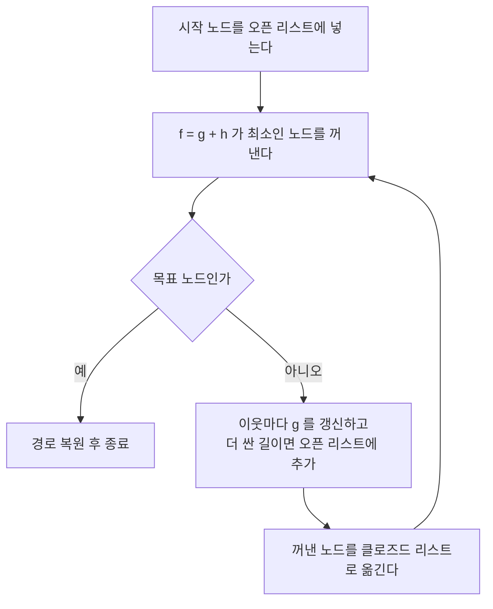

# A* Algorithm (A* 알고리즘)

> **A* 알고리즘은 "여기까지 온 실제 비용"과 "목표까지 남았을 추정 비용"을 더해 가장 유망한 길부터 넓혀 가며 최단 경로를 찾는 탐색 알고리즘이다.**

## 이미 걸은 거리와 남은 거리 어림을 함께 본다

내비게이션이 길을 찾는 상황을 떠올려 보자. 어떤 갈림길을 먼저 살필지 고를 때, 무작정 가까운 곳만 훑으면([다익스트라](Optimization.md)처럼) 목표 반대 방향까지 헛되이 뒤진다. 반대로 목표에 가까워 보이는 곳만 쫓으면(탐욕적 탐색) 눈앞의 지름길에 속아 돌아가는 길을 고른다.

**A*는 두 정보를 더해 이 둘의 장점만 취한다.** 각 노드 `n`을 평가하는 값은 다음과 같다.

```
f(n) = g(n) + h(n)
```

- `g(n)` — 시작점에서 `n`까지 **실제로 든 비용** (이미 확정된 값)
- `h(n)` — `n`에서 목표까지 **남았을 비용의 추정치** ([휴리스틱](Heuristic.md), 예: 직선거리)
- `f(n)` — 이 노드를 거쳐 가는 전체 경로 비용의 예상치

A*는 언제나 `f(n)`이 가장 작은 노드를 먼저 펼친다. "지금까지 싸게 왔고, 앞으로도 싸 보이는" 길을 우선하는 것이다.

## 휴리스틱이 절대 부풀리지 않으면 최단 경로를 보장한다

작동 절차는 우선순위 큐(오픈 리스트)로 정리된다.



핵심은 휴리스틱 `h`의 성질이다.

- **허용 가능성** — `h`가 실제 남은 비용을 **절대 과대평가하지 않으면**(항상 실제 이하로 추정하면), A*가 찾는 경로는 반드시 최단 경로다.
- **일관성** — 이웃으로 갈 때 `h`의 감소량이 그 간선 비용을 넘지 않으면, 한 번 닫은 노드를 다시 열 필요가 없어 더 효율적이다.

`h`를 0으로 두면 A*는 다익스트라 알고리즘과 같아지고, `g`를 무시하면 탐욕적 탐색이 된다. A*는 그 사이의 균형점이다.

> ⚠️ **흔한 오해 — "A*는 휴리스틱 값이 가장 작은 노드를 고른다."**
>
> A*가 고르는 기준은 휴리스틱 `h` 하나가 아니라 `f = g + h`다. `h`만 보고 고르면 이미 얼마나 멀리 돌아왔는지를 무시하게 되어 최단 경로를 놓친다. 이미 걸은 비용 `g`를 반드시 함께 더해야 한다.

## 정리하면

- A*는 `f(n) = g(n) + h(n)`이 최소인 노드부터 펼치는 최단 경로 탐색이다.
- `g`는 실제 지나온 비용, `h`는 목표까지의 어림 비용이다.
- 휴리스틱이 **과대평가하지 않으면** 최적 경로를 보장한다.
- 지도 길찾기, 게임 NPC 이동, 로봇 경로 계획 등 경로 탐색의 표준 도구다.

## 함께 읽기

- [Heuristic](Heuristic.md) — A*의 성능과 최적성을 좌우하는 추정 함수 `h`.
- [Breadth First Search](Breadth_First_Search.md) — `h=0`이고 비용이 균일하면 A*는 사실상 이쪽으로 수렴한다.
- [Depth First Search](Depth_First_Search.md) — 최단성을 보장하지 않는 대비되는 탐색 방식.
- [State Space](State_Space.md) — 노드와 간선으로 이뤄진, A*가 뒤지는 탐색 공간.
- [Optimization](Optimization.md) — 비용을 최소화한다는 점에서 A*는 최적화 탐색의 한 갈래다.
