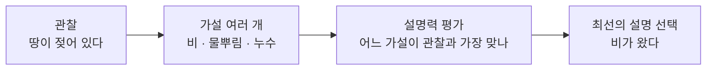

# Abduction (상정논법)

> **상정논법은 관찰된 결과를 놓고 "이걸 가장 잘 설명하는 원인이 뭐지?"를 거꾸로 짚어 가장 그럴듯한 가설을 고르는 추론이다.**

## 명탐정이 단서에서 범인을 좁혀 가는 방식이다

바닥에 젖은 발자국이 있다고 하자. "비가 왔나 보다"라고 떠올리는 순간, 너는 이미 상정논법을 쓴 것이다. 발자국(결과)을 보고, 그것을 가장 잘 설명하는 원인(비)을 역으로 추측했기 때문이다. 셜록 홈스가 진흙 묻은 구두를 보고 "당신은 오늘 아침 강가를 걸었군요"라고 말하는 것도 마찬가지다.

세 가지 추론을 나란히 놓으면 상정논법의 자리가 또렷해진다.

| 추론 | 방향 | 예시 | 결론의 성격 |
|------|------|------|------------|
| 연역(deduction) | 규칙 + 원인 → 결과 | "비가 오면 땅이 젖는다. 비가 왔다. → 땅이 젖었다." | 반드시 참 |
| 귀납(induction) | 사례들 → 규칙 | "비 온 날마다 땅이 젖었다. → 비가 오면 땅이 젖는다." | 개연적 |
| **상정논법(abduction)** | 규칙 + 결과 → 원인 | "비가 오면 땅이 젖는다. 땅이 젖었다. → 비가 왔나 보다." | **가장 그럴듯한 추측** |

**상정논법은 결과에서 원인으로 거슬러 오르므로, 결론이 참이라고 보장하지 못한다.** 땅이 젖은 건 누가 물을 뿌렸기 때문일 수도 있다. 그래서 상정논법은 "증명"이 아니라 "가장 나은 설명 고르기(inference to the best explanation)"라고 부른다.

## 여러 설명 후보 중 가장 잘 맞는 것을 남긴다

상정논법은 대체로 이런 흐름을 탄다.

좋은 설명을 고르는 기준은 대략 이렇다.

- **설명력** — 관찰된 사실을 얼마나 빠짐없이 설명하는가.
- **단순함** — 불필요한 가정을 덜 요구하는 쪽이 낫다(오컴의 면도날).
- **정합성** — 이미 알고 있는 다른 사실과 충돌하지 않는가.

## 흔한 오해

> ⚠️ **흔한 오해 — "상정논법의 결론은 논리적으로 옳은 답이다."**
>
> 아니다. 상정논법은 "가장 그럴듯한" 후보를 고를 뿐, 그 후보가 참임을 보장하지 않는다. 새 증거가 나오면 결론은 언제든 뒤집힐 수 있다. 연역만이 전제가 참일 때 결론의 참을 보장한다.

## 어디서 쓰나

- **의료 진단** — 증상(관찰)에서 병(원인)을 역추적한다.
- **고장 진단·범죄 수사** — 증거를 가장 잘 설명하는 원인을 찾는다.
- **AI 시스템** — [전문가 시스템](Expert_System.md)과 [추론 엔진](Inference_Engine.md)이 불완전한 정보에서 결론을 낼 때, 자연어 이해가 문맥에서 숨은 의미를 채울 때 쓰인다.

## 정리하면

- 상정논법은 **결과 → 원인** 방향의 추론으로, 관찰을 가장 잘 설명하는 가설을 고른다.
- 연역과 달리 결론이 참임을 **보장하지 않는다**. "최선의 설명"일 뿐이다.
- 설명력·단순함·정합성으로 가설을 저울질한다.
- 진단, 수사, 불완전한 정보 아래의 AI 추론에서 핵심 도구다.

## 함께 읽기

- [Inference Engine](Inference_Engine.md) — 규칙과 사실에서 결론을 끌어내는 엔진. 상정논법도 그 추론 전략 중 하나다.
- [Bayesian Inference](Bayesian_Inference.md) — 여러 가설의 "그럴듯함"을 확률로 정량화하면 상정논법이 베이즈 추론과 만난다.
- [Approximate Reasoning](Approximate_Reasoning.md) — 불확실·불완전한 정보 아래서 결론을 내야 한다는 문제의식을 공유한다.
- [Expert System](Expert_System.md) — 진단형 상정논법을 실제로 구현한 대표 사례.
