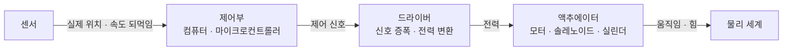

# Actuator (액추에이터)

> **액추에이터는 제어 신호를 실제 물리적 움직임이나 힘으로 바꿔 세상에 작용하는 장치, 즉 시스템의 "손발"이다.**

## 센서가 눈이라면 액추에이터는 손발이다

로봇을 사람에 빗대면 이해가 빠르다. **센서는 세상을 읽어 들이는 눈과 귀**, 두뇌는 무엇을 할지 정하는 판단부, 그리고 **액추에이터는 그 결정을 실제 동작으로 옮기는 손발**이다. 아무리 똑똑하게 판단해도 액추에이터가 없으면 시스템은 세상에 아무 흔적도 남기지 못한다. 모터가 바퀴를 돌리고, 솔레노이드가 밸브를 열고, 유압 실린더가 굴착기 팔을 드는 그 순간이 전부 액추에이터의 일이다.

즉 액추에이터는 **전기·유압·공압 같은 에너지를 받아 회전, 직선 이동, 힘 같은 물리적 출력으로 변환한다.** 입력은 대개 약한 제어 신호이고, 출력은 실제로 무언가를 움직일 만한 물리력이다.

## 제어 신호를 받아 움직임을 만들고, 되먹임으로 다듬는다

핵심 단계는 이렇다.

1. 제어부가 목표 동작을 담은 **제어 신호**를 보낸다.
2. **드라이버**가 그 약한 신호를 액추에이터를 움직일 전력으로 키운다.
3. 액추에이터가 에너지를 **움직임이나 힘**으로 바꾼다.
4. (되먹임 제어가 있으면) 센서가 실제 결과를 재서 제어부로 돌려보내고, 목표와의 오차를 줄이도록 신호를 조정한다.

액추에이터를 평가할 때 보는 값은 **낼 수 있는 힘·토크**, **움직임의 정밀도**, **반응 속도**다. 힘이 세면 무거운 걸 움직이고, 정밀하면 미세하게 제어하며, 빠르면 신호에 즉각 반응한다.

## 흔한 오해

> ⚠️ **흔한 오해 — "액추에이터와 센서는 같은 부류의 장치다."**
>
> 방향이 정반대다. **센서는 물리 세계를 읽어 신호로 바꾸고(입력), 액추에이터는 신호를 받아 물리 세계에 작용한다(출력).** 지능형 에이전트는 이 둘을 모두 갖춰야 세상을 인식하고 또 바꿀 수 있다.

## 흔한 종류

| 종류 | 에너지원 | 대표 출력 |
|------|---------|-----------|
| 전기 모터 | 전기 | 회전 |
| 솔레노이드 | 전기(전자석) | 짧은 직선 운동, 밸브 개폐 |
| 유압 실린더 | 유체 압력 | 큰 힘의 직선 운동 |
| 공압 실린더 | 압축 공기 | 빠른 직선 운동 |

## 정리하면

- 액추에이터는 **제어 신호를 물리적 움직임·힘으로 바꾸는 출력 장치**다.
- 센서(입력)와 짝을 이뤄, 에이전트가 세상을 인식하고 또 세상에 작용하게 한다.
- 힘·정밀도·반응 속도가 핵심 성능 지표이며, 되먹임 제어로 오차를 줄인다.
- 로봇, 자동차, 산업 자동화, 의료 기기 등 물리 세계와 맞닿는 모든 시스템의 필수 요소다.

## 함께 읽기

- [Agent](Agent.md) — 에이전트는 센서로 관찰하고 액추에이터로 행동한다. 액추에이터는 그 "행동" 채널이다.
- [Intelligent Agent](Intelligent_Agent.md) — 인식·판단·행동 고리에서 액추에이터가 맡는 마지막 단계를 보여준다.
- [Internet of Things](Internet_of_Things.md) — 사물인터넷 기기는 센서로 재고 액추에이터로 제어한다.
- [Reinforcement Learning](Reinforcement_Learning.md) — 강화학습 에이전트의 "행동(action)"은 결국 액추에이터를 통해 환경에 가해진다.
