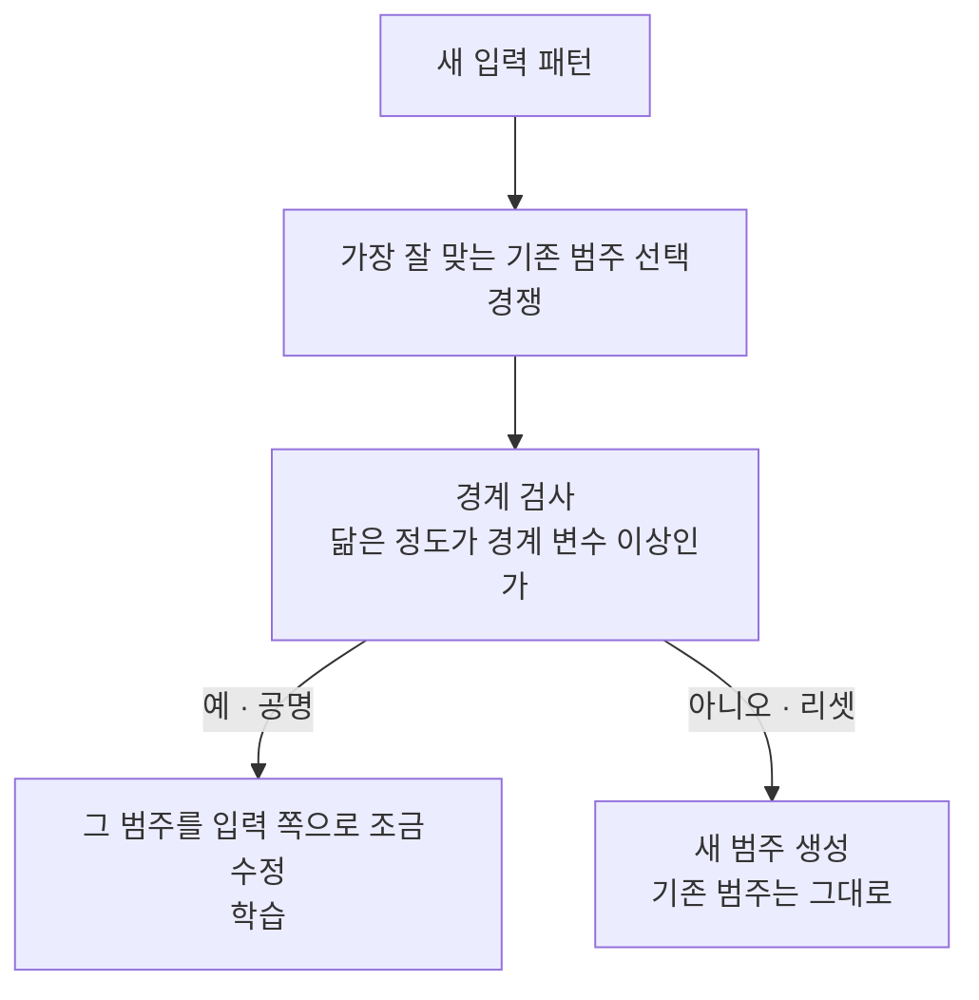

# Adaptive Resonance Theory (적응공명이론)

> **적응공명이론(ART)은 이미 배운 것을 잊지 않으면서(안정성) 새로운 것도 계속 배우는(가소성) 딜레마를 "충분히 닮았을 때만 기존 범주를 고치고, 안 닮으면 새 범주를 연다"는 규칙으로 푼 신경망 학습 이론이다.**

## "새 걸 배우면 옛 걸 잊는" 문제를 정면으로 다룬다

대부분의 신경망은 새 데이터를 학습하면 예전에 배운 것이 조금씩 덮여 사라진다(파국적 망각). 사람으로 치면, 새 친구 이름을 외우느라 옛 친구 이름을 잊는 셈이다. 이걸 **안정성-가소성 딜레마**라 부른다. 너무 고정적이면 새것을 못 배우고(안정성만), 너무 유연하면 옛것을 잃는다(가소성만).

**ART(Grossberg와 Carpenter가 제안)의 핵심 발상은 "새 입력이 기존 범주와 충분히 닮았을 때만 그 범주를 조금 수정하고, 낯선 입력이면 아예 새 범주를 새로 만든다"는 것이다.** 그래서 옛 지식은 건드리지 않은 채 새 지식을 곁에 쌓아 올린다.

## 경계 변수가 "얼마나 닮아야 같은 것으로 볼지"를 정한다

ART의 심장은 **경계 변수(vigilance parameter)**다. 이 값이 "이 정도 닮으면 같은 범주로 인정한다"는 문턱을 정한다.

1. 새 입력이 들어오면, 저장된 범주들 중 **가장 잘 맞는 후보**를 경쟁으로 고른다.
2. **경계 검사**: 그 후보와 입력의 닮은 정도가 경계 변수 이상이면 "공명(resonance)"이 일어난다.
3. 공명하면 그 범주를 입력에 맞게 **살짝 수정**한다(가소성). 이때도 기존 정보를 완전히 지우지 않는다(안정성).
4. 문턱을 못 넘으면 **리셋**하고, 그 범주 대신 **새 범주를 새로 만든다**.

경계 변수를 높이면 잘게 쪼갠 많은 범주가, 낮추면 뭉뚱그린 적은 범주가 생긴다. ART는 이렇게 **미리 범주 개수를 정하지 않고** 데이터에 따라 스스로 범주 수를 늘린다는 점이 [K-means](Kmeans_Algorithm.md) 같은 방법과 다르다.

## 흔한 오해

> ⚠️ **흔한 오해 — "닮은 정도(공명)가 문턱을 넘으면 새 패턴을 만든다."**
>
> 반대다. **충분히 닮아 공명이 일어나면 기존 범주를 고쳐 쓰고(학습), 오히려 낯설어서 문턱을 못 넘을 때 새 범주를 만든다.** ART의 목적이 "익숙한 건 흡수하고 낯선 건 따로 보관"이라는 점을 떠올리면 방향이 잡힌다.

## 정리하면

- ART는 **안정성-가소성 딜레마**, 즉 새것을 배우며 옛것을 잊지 않는 문제를 다룬 학습 이론이다.
- **경계 변수**가 "같은 범주로 볼 문턱"을 정한다. 넘으면 기존 범주 수정, 못 넘으면 새 범주 생성.
- 범주 개수를 미리 정하지 않고 데이터에 따라 스스로 늘리는 **비지도 학습**·군집화 성격을 갖는다.
- 파국적 망각을 피하려는 온라인·평생 학습 연구의 뿌리가 되는 아이디어다.

## 함께 읽기

- [Self-Organizing Map](SelfOrganizing_Map.md) — 마찬가지로 비지도로 입력을 범주에 대응시키는 신경망. 접근이 다르다.
- [Unsupervised Learning](Unsupervised_Learning.md) — ART는 정답 없이 스스로 범주를 찾는 비지도 학습의 한 갈래다.
- [Clustering](Clustering.md) — ART가 하는 일은 결국 온라인 군집화다.
- [Neural Network](Neural_Network.md) — ART가 딛고 선 인공신경망의 기본 틀.
