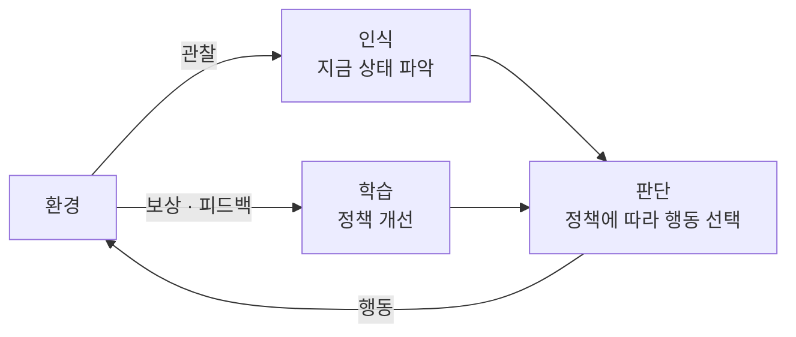

# Agent (에이전트)

> **에이전트는 환경을 관찰하고(perceive), 스스로 판단해, 목표를 향해 행동하는(act) 자율적 주체다.**

## 스스로 보고 판단하고 움직이는 존재다

에이전트를 이해하는 가장 쉬운 그림은 **로봇 청소기**다. 청소기는 센서로 벽과 먼지를 감지하고(관찰), 어디로 갈지 정하고(판단), 바퀴를 굴려 이동한다(행동). 누가 매 순간 조종하지 않아도 "바닥을 깨끗하게"라는 목표를 향해 스스로 움직인다. **이 관찰-판단-행동 고리(perceive–decide–act loop)를 자율적으로 도는 것이 에이전트의 본질이다.**

에이전트를 이루는 요소는 다음과 같다.

| 요소 | 뜻 |
|------|-----|
| 환경(Environment) | 에이전트가 놓여 상호작용하는 외부 세계 |
| 상태(State) | 어느 시점에 환경에 대해 파악한 정보 |
| 행동(Action) | 환경에 가하는 조작 |
| 목표(Goal) 또는 보상(Reward) | 무엇이 좋은 행동인지 알려 주는 기준 |

## 관찰-판단-행동 고리를 반복하며 정책을 다듬는다

에이전트는 **정책(policy)**, 즉 "어떤 상태에서 어떤 행동을 할지"를 정하는 규칙에 따라 움직인다. 행동한 뒤 환경이 돌려주는 보상이나 피드백을 보고 정책을 조금씩 고쳐 더 나은 선택을 하도록 학습한다. 이 학습 방식의 대표가 [강화학습](Reinforcement_Learning.md)이다.

다만 **모든 에이전트가 학습을 하는 것은 아니다.** 단순 반사 에이전트는 "이 조건이면 이 행동"이라는 고정 규칙만으로 움직이고, 목표 기반·효용 기반 에이전트는 앞을 내다보며 계획을 세운다. 학습은 그 위에 얹히는 능력이다.

## 흔한 오해

> ⚠️ **흔한 오해 — "에이전트는 반드시 물리적 로봇이거나 반드시 학습을 한다."**
>
> 둘 다 아니다. 에이전트는 물리 로봇일 수도, 순수 소프트웨어(스팸 필터, 거래 봇, 대화형 LLM 에이전트)일 수도 있다. 또 학습 없이 고정된 규칙만으로 행동하는 것도 엄연한 에이전트다. 핵심은 몸이나 학습이 아니라 **"환경을 인식해 목표를 향해 자율적으로 행동하는가"**다.

## 정리하면

- 에이전트는 **환경을 관찰하고, 판단하고, 행동하는 자율적 주체**다.
- 환경·상태·행동·목표(보상)가 기본 구성 요소이고, 행동은 정책이 정한다.
- 보상 피드백으로 정책을 개선하면 학습형 에이전트이며, 강화학습이 대표적이다.
- 물리 로봇부터 소프트웨어 봇, LLM 기반 에이전트까지 형태는 다양하다.

## 함께 읽기

- [Intelligent Agent](Intelligent_Agent.md) — 자율성·목표 지향성을 더 갖춘 에이전트를 가리키는 좁은 개념.
- [Reinforcement Learning](Reinforcement_Learning.md) — 에이전트가 보상으로 정책을 학습하는 대표 방법.
- [Actuator](Actuator.md) — 에이전트의 "행동"을 물리 세계에서 실행하는 장치.
- [Large Language Model - LLM](Large_Language_Model___LLM.md) — 최근의 "LLM 에이전트"는 언어 모델을 판단부로 삼아 도구를 호출하며 행동한다.
