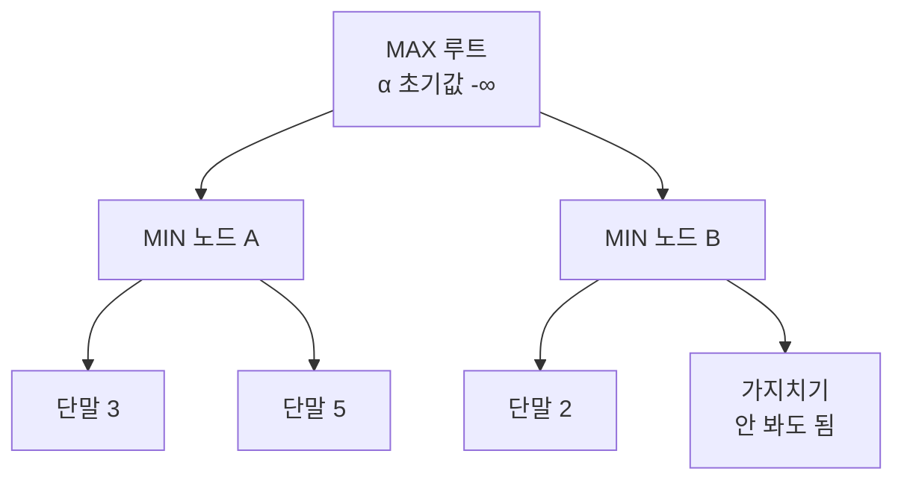

# Alpha-Beta Pruning (알파베타 가지치기)

> **알파베타 가지치기는 미니맥스 탐색에서, 어차피 최종 선택에 영향을 줄 수 없는 가지를 미리 잘라내 같은 답을 훨씬 빠르게 찾는 기법이다.**

## "볼 필요 없는 수"를 건너뛰는 요령이다

두 사람이 번갈아 두는 게임에서 최선의 수를 찾는 기본 알고리즘이 **미니맥스**다. 나는 내 점수를 최대로(MAX), 상대는 그 점수를 최소로(MIN) 만들려 한다고 보고, 게임 트리 끝까지 내다본 뒤 거꾸로 최선의 수를 고른다. 문제는 트리가 너무 커서 전부 보면 시간이 폭발한다는 것이다.

여기서 사람의 직관을 떠올려 보자. 어떤 수를 검토하다 **"이 길로 가면 상대가 나를 이렇게 망칠 수 있다"**는 걸 이미 확인했다면, 그 길의 나머지 가능성은 더 볼 필요가 없다. 어차피 그 길은 안 갈 테니까. **알파베타 가지치기는 바로 이 "더 볼 필요 없음"을 알고리즘으로 만든 것이다.** 미니맥스와 결과는 똑같지만, 쓸데없는 가지를 잘라 탐색량을 크게 줄인다.

## α와 β가 "이미 보장된 점수"를 들고 다니며 가지를 자른다

두 값이 탐색 내내 따라다닌다.

- **α(알파)** — MAX가 지금까지 **확실히 확보한 최선(가장 높은) 점수**. 아래로 내려갈수록 커진다.
- **β(베타)** — MIN이 지금까지 **확실히 확보한 최선(가장 낮은) 점수**. 아래로 내려갈수록 작아진다.

**규칙은 하나다: 어떤 노드에서 `α ≥ β`가 되면, 그 노드의 남은 자식은 탐색하지 않고 잘라낸다.** 그 지점 아래로 아무리 좋은 수가 있어도, 위쪽 부모가 이미 더 나은 선택지를 쥐고 있어 이 가지가 선택될 리 없기 때문이다.

위 예에서 A를 다 보면 MAX는 최소 3을 확보한다(α = 3). 이제 B로 가서 첫 단말이 2라면, MIN인 B는 2 이하를 고를 게 확실하다(β = 2). `α(3) ≥ β(2)`이므로 **B의 나머지 자식은 볼 필요 없이 잘린다** — B는 어차피 A보다 나쁘니까.

가지치기 효과는 **좋은 수를 먼저 살펴볼수록 커진다.** 수 순서가 이상적이면 미니맥스가 보는 노드 수의 제곱근 수준까지 줄어, 같은 시간에 두 배 깊이를 내다볼 수 있다.

## 흔한 오해

> ⚠️ **흔한 오해 — "가지치기를 하면 미니맥스보다 답이 부정확해진다."**
>
> 아니다. 알파베타 가지치기가 잘라내는 것은 **최종 선택을 절대 바꿀 수 없는** 가지뿐이다. 따라서 결과는 미니맥스와 **정확히 같고**, 다만 더 빠를 뿐이다. 이 점이 탐색 깊이를 아예 줄이는 근사 기법과 다르다.

## 정리하면

- 알파베타 가지치기는 **미니맥스와 같은 답을 더 빠르게** 내는 최적화다.
- α는 MAX가 확보한 하한, β는 MIN이 확보한 상한이며, **`α ≥ β`면 가지를 자른다.**
- 좋은 수를 먼저 탐색할수록 잘라내는 양이 커진다(수 순서가 성능을 좌우).
- 체스·오목 등 2인 게임 AI에서 깊은 탐색을 가능하게 하는 표준 기법이다.

## 함께 읽기

- [Game Theory](Game_Theory.md) — MAX와 MIN이 맞서는 구도는 게임이론의 대립 구조와 맞닿는다.
- [Heuristic](Heuristic.md) — 끝까지 못 볼 때는 중간 국면을 평가 함수(휴리스틱)로 점수 매긴다.
- [Depth First Search](Depth_First_Search.md) — 알파베타는 게임 트리를 깊이 우선으로 훑으며 가지를 자른다.
- [State Space](State_Space.md) — 게임 트리는 상태공간 탐색의 한 형태다.
