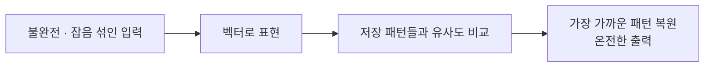

# Associative Memory (연상메모리)

> **연상메모리는 "주소"가 아니라 "내용"으로 기억을 꺼내는 저장 방식이다. 일부만 주거나 흐릿하게 줘도, 가장 가까운 저장 패턴 전체를 되살려 준다.**

## 흥얼거린 멜로디 몇 소절로 노래 전체를 떠올리는 것과 같다

친구가 노래 앞 소절만 흥얼거려도 우리는 "아, 그 노래!" 하며 제목과 나머지 가사를 통째로 떠올린다. 얼굴 반쪽만 봐도 누구인지 안다. **이렇게 부분·불완전한 단서에서 온전한 기억을 되살리는 것이 연상메모리다.**

보통 컴퓨터 메모리는 "몇 번지에 뭐가 있나"라는 **주소**로 데이터를 찾는다. 반면 연상메모리는 **내용으로 찾는다(content-addressable memory).** "이것과 가장 비슷하게 저장된 게 뭐지?"라고 물으면 답을 준다. 그래서 입력이 일부 손상되거나 잡음이 섞여도, 가장 가까운 저장 패턴으로 **복원**해 낸다.

연상에는 두 종류가 있다.

| 종류 | 저장하는 것 | 예 |
|------|------------|-----|
| 자기연상(autoassociative) | 패턴 자신 | 지워진 얼굴 사진 → 원래 얼굴 복원 |
| 타자연상(heteroassociative) | 서로 다른 짝 | 이름 → 전화번호, 단어 → 뜻 |

## 유사도로 가장 가까운 저장 패턴을 끌어온다

동작의 뼈대는 단순하다.

1. 저장할 패턴(이미지·소리·단어)을 **벡터**로 바꿔 담아 둔다.
2. 새 입력도 벡터로 바꾼다.
3. 저장된 벡터들과의 **유사도**(코사인 유사도, 유클리드 거리 등)를 잰다.
4. 가장 가까운 패턴을 골라 **그 전체를 출력**한다.

대표적 구현이 [홉필드 네트워크](Hopfield_Network.md)다. 홉필드 망은 패턴을 에너지 지형의 골짜기(안정 상태)로 저장해 두고, 흐릿한 입력을 그 골짜기로 굴러 떨어뜨려 원래 패턴을 복원한다. 오늘날 벡터 유사도로 관련 항목을 찾는 [벡터 데이터베이스](Vector_Database.md)도 연상 검색의 현대적 사촌으로 볼 수 있다.

## 흔한 오해

> ⚠️ **흔한 오해 — "연상메모리는 저장한 것 중 정확히 일치하는 항목만 찾아 준다."**
>
> 핵심은 오히려 그 반대다. 연상메모리의 강점은 **정확히 일치하지 않아도**, 부분·왜곡된 단서에서 가장 가까운 패턴을 되살리는 근사 복원 능력에 있다. 완전 일치 검색만 필요하다면 굳이 연상메모리를 쓸 이유가 없다.

## 정리하면

- 연상메모리는 주소가 아니라 **내용으로 기억을 꺼내는** 저장 방식이다.
- 부분·잡음 섞인 단서에서 가장 가까운 저장 패턴을 **복원**하는 것이 핵심 능력이다.
- 자기연상(패턴 자신)과 타자연상(다른 짝)으로 나뉜다.
- 홉필드 네트워크가 고전적 구현이며, 벡터 검색이 그 현대적 확장이다.

## 함께 읽기

- [Hopfield Network](Hopfield_Network.md) — 연상메모리를 신경망으로 구현한 대표 모델.
- [Pattern Recognition](Pattern_Recognition.md) — 입력을 저장된 패턴에 맞춰 알아보는, 연상과 맞닿은 과제.
- [Vector Database](Vector_Database.md) — 벡터 유사도로 가장 가까운 항목을 찾는 연상 검색의 현대판.
- [Neural Network](Neural_Network.md) — 연상메모리를 담아내는 신경망의 일반 틀.
