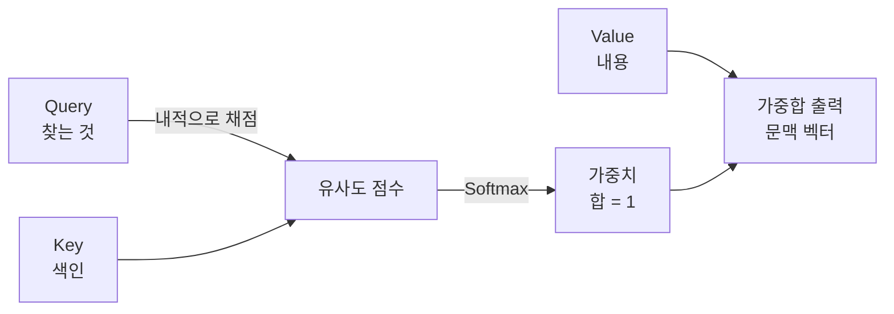

# Attention (주의집중)

> **어텐션은 모델이 입력의 모든 부분을 똑같이 보는 대신, 지금 필요한 부분에 가중치를 더 크게 실어 골라 보게 하는 메커니즘이다.**

## 문장을 읽을 때 눈이 특정 단어로 쏠리는 것과 같다

"그 은행에 강물이 넘쳤다"를 읽을 때, 우리는 "은행"의 뜻을 정하려고 무의식적으로 "강물"이라는 단어에 눈길을 준다. **어텐션은 이 "어디를 볼지 고르는" 과정을 수식으로 옮긴 것이다.** 한 단어를 이해하려고 문장 안의 다른 단어들을 훑되, 관련 있는 단어일수록 더 큰 비중을 둔다.

이 발상이 나오기 전, 순환 신경망([RNN](Recurrent_Neural_Network___RNN.md))은 긴 문장을 하나의 고정 크기 벡터에 욱여넣어야 했다. 문장이 길수록 앞쪽 정보가 뭉개졌다. **어텐션은 "하나로 압축하지 말고, 필요할 때마다 원본 전체를 다시 참조하자"는 해법이다.**

## Query·Key·Value로 "질문하고 골라 담는다"

어텐션의 계산은 세 가지 벡터로 이뤄진다. 도서관 비유가 잘 맞는다.

| 이름 | 역할 | 비유 |
|------|------|------|
| Query (질의) | 지금 찾고 싶은 것 | 검색창에 친 검색어 |
| Key (키) | 각 항목이 무엇에 관한지 알려주는 색인 | 책마다 붙은 索引 태그 |
| Value (값) | 실제로 담아 올 내용 | 책의 본문 |

계산은 세 단계다.

1. **유사도 채점** — Query와 각 Key의 내적으로 "이 Query가 이 Key와 얼마나 맞는가"를 점수로 낸다.
2. **가중치화** — 점수를 [Softmax](Softmax.md)에 넣어 합이 1인 가중치로 바꾼다.
3. **가중합** — 그 가중치로 Value들을 섞어 하나의 출력(문맥 벡터)을 만든다.

식으로는 `Attention(Q, K, V) = softmax(Q·Kᵀ / √d) · V`다. `√d`로 나누는 건 차원이 커질 때 내적 값이 지나치게 커져 Softmax가 한쪽으로 쏠리는 것을 막는 스케일 보정이다.

## 흔한 오해

> ⚠️ **흔한 오해 — "어텐션은 트랜스포머에서 처음 나왔다."**
>
> 어텐션은 트랜스포머보다 먼저, RNN 기반 기계 번역을 보완하려고 나왔다. 트랜스포머의 기여는 어텐션을 곁다리가 아니라 **모델의 뼈대 전체로 삼아** RNN을 아예 걷어낸 것이다("Attention Is All You Need"). 어텐션 자체와 트랜스포머는 다른 층위의 개념이다.

## 정리하면

- 어텐션은 입력의 각 부분에 **동적인 가중치**를 매겨, 중요한 곳에 계산을 집중시킨다.
- 핵심 장치는 **Query·Key·Value**다. Query와 Key로 가중치를 뽑고, 그 가중치로 Value를 섞는다.
- 긴 시퀀스에서 앞 정보가 뭉개지던 RNN의 병목을 풀어, 멀리 떨어진 단어 사이 관계도 직접 잇는다.
- 입력이 자기 자신을 참조하면 [Self-Attention](SelfAttention.md), 여러 관점으로 동시에 보면 [Multi-Head Attention](MultiHead_Attention.md)이다.

## 함께 읽기

- [Self-Attention](SelfAttention.md) — 한 시퀀스가 자기 내부를 참조하는 어텐션. 트랜스포머의 핵심이다.
- [Multi-Head Attention](MultiHead_Attention.md) — 어텐션을 여러 벌 병렬로 돌려 다양한 관계를 동시에 본다.
- [Transformer](Transformer.md) — 어텐션만으로 쌓아 올린 아키텍처.
- [Softmax](Softmax.md) — 유사도 점수를 합이 1인 가중치로 바꾸는 함수.
- [Recurrent Neural Network - RNN](Recurrent_Neural_Network___RNN.md) — 어텐션이 보완하고 끝내 대체한 이전 방식.
