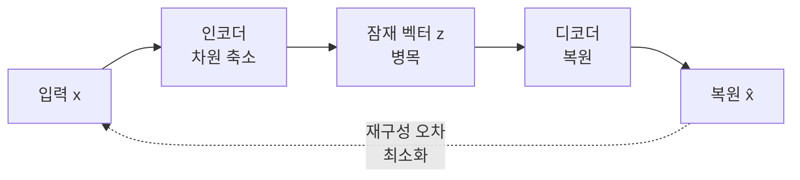

# Autoencoder (오토인코더)

> **오토인코더는 입력을 좁은 병목으로 압축했다가 다시 원본으로 복원하도록 학습하는 신경망이며, 그 과정에서 데이터의 핵심 특징만 스스로 추려 낸다.**

## 그림을 한 문장으로 요약했다가 다시 그리는 화가와 같다

어떤 화가에게 풍경화를 한 문장으로 요약하게 한 뒤, 그 문장만 보고 다시 그리라고 시켰다고 하자. 잘 복원하려면 요약 문장에 **정말 중요한 정보만** 압축해 담아야 한다. "왼쪽 위 노을, 가운데 호수, 아래 소나무 두 그루" 같은 식으로. **오토인코더가 하는 일이 정확히 이것이다.** 입력을 짧게 압축(인코딩)했다가 원본과 최대한 똑같이 복원(디코딩)하도록 스스로 훈련하며, 그 압축본이 곧 데이터의 요약이 된다.

정답 레이블이 따로 없다. **입력 자신이 곧 정답**이므로, 오토인코더는 [비지도 학습](Unsupervised_Learning.md)에 속한다.

## 병목이 압축을 강제하고, 재구성 오차가 학습을 이끈다

구조는 세 부분이다.

- **인코더** — 입력을 점점 좁은 층으로 통과시켜 저차원 표현으로 압축한다.
- **잠재 공간(latent space)** — 가장 좁은 병목. 여기 담긴 벡터가 데이터의 압축된 요약이다.
- **디코더** — 잠재 벡터로부터 원래 형태를 복원한다.

학습 목표는 단순하다. **복원 결과가 입력과 얼마나 다른지(재구성 오차)를 최소화**하는 것이다. 이미지라면 보통 픽셀 차이의 [평균 제곱 오차](Mean_Squared_Error.md)를 쓴다. 병목이 입력보다 좁기 때문에 모델은 모든 것을 통째로 외울 수 없고, 복원에 꼭 필요한 규칙만 남기도록 압박받는다.

## 흔한 오해

> ⚠️ **흔한 오해 — "오토인코더는 새 데이터를 만드는 생성 모델이다."**
>
> 기본 오토인코더는 생성용이 아니다. 잠재 공간에 아무 점이나 찍어 디코더에 넣으면 대개 의미 없는 출력이 나온다. 잠재 공간을 **확률 분포로 정돈해** 샘플링으로 새 데이터를 만들 수 있게 한 것은 변이형 오토인코더(VAE)라는 별도 변형이다. 둘을 뭉뚱그리면 안 된다.

## 어디에 쓰나

| 용도 | 원리 |
|------|------|
| 차원 축소 | 잠재 벡터를 압축된 특징으로 사용 ([차원 축소](Dimensionality_Reduction.md)) |
| 이상 탐지 | 정상만 학습 → 이상 입력은 복원이 크게 어긋난다 |
| 노이즈 제거 | 잡음 섞인 입력에서 깨끗한 원본을 복원하도록 학습 |
| 특징 추출 | 잠재 표현을 다른 모델의 입력으로 재사용 |

## 정리하면

- 오토인코더는 **압축 → 복원**을 학습하며, 병목이 압축을 강제한다.
- 정답이 입력 자신이라 레이블이 필요 없는 **비지도 학습**이다.
- 학습 신호는 입력과 복원본의 차이인 **재구성 오차**다.
- 차원 축소·이상 탐지·노이즈 제거에 강하지만, 생성은 VAE 같은 변형의 몫이다.

## 함께 읽기

- [Dimensionality Reduction](Dimensionality_Reduction.md) — 오토인코더가 비선형적으로 수행하는 대표 작업.
- [PCA](PCA.md) — 선형 차원 축소. 오토인코더는 이를 비선형으로 확장한 것에 가깝다.
- [Unsupervised Learning](Unsupervised_Learning.md) — 레이블 없이 배우는 학습 방식.
- [Generative Adversarial Network - GAN](Generative_Adversarial_Network___GAN.md) — 생성이 목적인 다른 계열의 모델.
- [Mean Squared Error](Mean_Squared_Error.md) — 재구성 오차로 자주 쓰는 손실.
