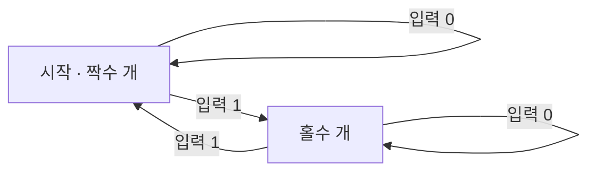

# Automata (오토마타)

> **오토마타는 "상태"와 "상태를 옮기는 규칙"만으로 정의되는 추상적 계산 기계로, 입력을 한 글자씩 읽으며 상태를 바꿔 나가는 수학 모델이다.**

## 자판기가 곧 오토마타다

동전을 넣으면 "0원 → 500원 → 1000원" 상태로 올라가고, 버튼을 누르면 음료를 내주고 다시 "0원"으로 돌아가는 자판기를 떠올려 보자. 자판기는 지금 **어떤 상태**에 있고, 어떤 **입력**(동전, 버튼)이 오면 **어느 상태로 옮겨 갈지**가 정해져 있다. **이 "상태 + 전이 규칙"의 그림이 바로 오토마타다.** 신호등, 개찰구, 엘리베이터 제어도 전부 이 틀로 설명된다.

오토마타를 이루는 조각은 단순하다.

- **상태(state)** — 지금 처한 상황. 유한한 개수를 갖는다.
- **입력(input)** — 한 번에 하나씩 읽어 들이는 기호.
- **전이(transition)** — "이 상태에서 이 입력을 받으면 저 상태로 간다"는 규칙.
- **시작 상태 / 수락 상태** — 어디서 출발하고, 어떤 상태로 끝나야 입력을 "받아들인" 것으로 볼지.

위는 "1이 짝수 번 나온 문자열만 받아들이는" 아주 작은 유한 오토마타다. 입력을 한 글자씩 먹으며 두 상태를 오가고, 끝났을 때 "짝수 개" 상태면 수락한다.

## 기억 능력에 따라 오토마타의 급이 갈린다

오토마타는 **얼마나 많은 것을 기억할 수 있느냐**에 따라 계층을 이룬다. 이 계층은 [촘스키 계층](Chomsky_Hierarchy.md)의 언어 종류와 정확히 짝을 이룬다.

| 오토마타 | 기억(저장) 장치 | 다룰 수 있는 언어 |
|----------|----------------|-------------------|
| 유한 오토마타(FA) | 없음 (상태뿐) | 정규 언어 |
| 푸시다운 오토마타(PDA) | 스택 하나 | 문맥자유 언어 |
| 튜링 기계(TM) | 무한 테이프 | 재귀적 열거 가능 언어 |

기억 장치가 강해질수록 알아볼 수 있는 언어도 넓어지고, 그 정점이 무한 테이프를 가진 [튜링 기계](Turing_Machine.md)다.

> 💡 **참고 — 결정적(DFA)과 비결정적(NFA)**
>
> 한 상태에서 같은 입력에 갈 곳이 **딱 하나면 결정적(DFA)**, 여러 곳일 수 있으면 **비결정적(NFA)**이다. 표현력은 같아서 어떤 NFA든 동등한 DFA로 바꿀 수 있다.

## 흔한 오해

> ⚠️ **흔한 오해 — "오토마타는 실제로 만드는 하드웨어 장치다."**
>
> 오토마타는 물리 장치가 아니라 **계산을 분석하기 위한 추상적 수학 모델**이다. 컴파일러의 어휘 분석, 정규식 매칭, 프로토콜 설계 등에 "적용"될 뿐, 그 자체는 종이 위의 상태-전이 그림이다.

## 정리하면

- 오토마타는 **상태와 전이 규칙**으로 정의되는 추상 계산 기계다.
- 입력을 한 기호씩 읽으며 상태를 바꾸고, 끝 상태로 입력의 수락 여부를 정한다.
- 기억 장치의 세기에 따라 유한 오토마타 → 푸시다운 → 튜링 기계로 계층을 이루며, 촘스키 계층과 대응한다.
- 컴파일러, 정규식, 프로토콜 등 형식 언어를 다루는 모든 곳의 이론적 바탕이다.

## 함께 읽기

- [Chomsky Hierarchy](Chomsky_Hierarchy.md) — 오토마타 계층과 짝을 이루는 형식 언어의 위계.
- [Turing Machine](Turing_Machine.md) — 오토마타 계층의 정점, 계산 가능성의 기준.
- [Halting Problem](Halting_Problem.md) — 가장 강한 오토마타(튜링 기계)조차 못 푸는 한계를 보여 준다.
- [State Space](State_Space.md) — 상태와 전이로 문제를 표현한다는 발상을 공유한다.
