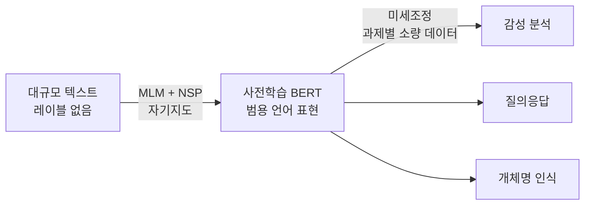

# BERT (양방향 인코더 표현)

> **BERT는 문장의 앞뒤 문맥을 동시에 보며 단어의 의미를 파악하도록 사전학습한 트랜스포머 인코더 모델이며, 여러 언어 이해 과제에 미세조정해 쓰는 것이 핵심이다.**

## 빈칸 채우기로 언어를 익힌 학생과 같다

"오늘 아침 ___를 마셨다"의 빈칸을 채우려면, 앞의 "아침"과 뒤의 "마셨다"를 **양쪽 다** 봐야 "커피"나 "물"을 떠올릴 수 있다. **BERT는 이 빈칸 채우기를 수억 문장에 대해 반복하며 언어를 익힌 학생이다.** 왼쪽에서 오른쪽으로만 읽는 모델과 달리, 한 단어의 의미를 정할 때 좌우 문맥을 한꺼번에 참조한다. 이름의 "양방향(Bidirectional)"이 바로 이 뜻이다.

BERT는 트랜스포머의 **인코더**만 쓴다. 텍스트를 이해하고 표현하는 데 특화됐다는 뜻이고, 그래서 [GPT](GPT.md)처럼 이어질 문장을 술술 생성하는 데는 맞지 않다.

## 두 가지 자기지도 과제로 사전학습한 뒤, 과제별로 미세조정한다

BERT의 힘은 **사전학습 → 미세조정**의 2단계 구조에서 나온다.

**1단계 — 사전학습.** 레이블 없는 대규모 코퍼스(위키피디아, BookCorpus 등)로 두 과제를 자기지도 방식으로 학습한다.

- **Masked Language Modeling (MLM)** — 입력 토큰의 약 15%를 가리고, 가려진 자리에 올 단어를 좌우 문맥으로 맞힌다. 양방향 이해가 여기서 길러진다.
- **Next Sentence Prediction (NSP)** — 두 문장이 실제로 이어지는지 아닌지를 맞힌다. 문장 사이 관계를 배운다.

**2단계 — 미세조정.** 사전학습된 가중치를 출발점으로, 감성 분석·질의응답·개체명 인식 같은 특정 과제에 소량의 레이블 데이터로 추가 학습한다. 밑바닥부터 학습하는 것보다 훨씬 적은 데이터로 높은 성능이 나온다.

## 흔한 오해

> ⚠️ **흔한 오해 — "BERT도 GPT처럼 글을 이어서 생성한다."**
>
> BERT는 인코더 기반의 **이해·표현** 모델이라, 문맥 벡터를 뽑아 분류·추출하는 과제에 강하다. GPT 같은 디코더 모델처럼 다음 토큰을 연달아 뽑아 자유 생성하는 용도가 아니다. 둘은 같은 트랜스포머에서 갈라진, 목적이 다른 갈래다.

## 정리하면

- BERT는 트랜스포머 **인코더**로, 단어 의미를 **양방향 문맥**으로 파악한다.
- 사전학습 과제는 **MLM**(빈칸 채우기)과 **NSP**(문장 이어짐 판별)다.
- 사전학습 후 **미세조정**으로 여러 이해 과제에 적은 데이터로 적응한다.
- 이해·표현이 강점이고, 자유로운 텍스트 생성은 GPT 계열의 몫이다.

## 함께 읽기

- [Transformer](Transformer.md) — BERT의 뼈대. 인코더-디코더 중 인코더를 쓴다.
- [GPT](GPT.md) — 디코더 기반의 생성 모델. BERT와 목적이 대비된다.
- [Self-Attention](SelfAttention.md) — 양방향 문맥을 잇는 핵심 연산.
- [Fine-tuning](Fine_Tuning.md) — 사전학습 모델을 과제에 맞추는 2단계.
- [Self-Supervised Learning](SelfSupervised_Learning.md) — 레이블 없이 빈칸 채우기로 배우는 학습 방식.
