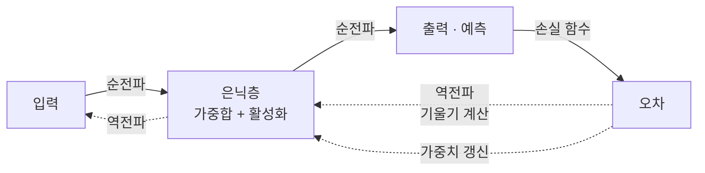

# Backpropagation (역전파)

> **역전파는 출력에서 생긴 오차를 신경망의 층을 거꾸로 훑으며, 각 가중치가 그 오차에 얼마나 기여했는지를 연쇄법칙으로 계산해 내는 알고리즘이다.**

## 요리가 짜게 나왔을 때 어느 재료 탓인지 거슬러 찾는 것과 같다

완성된 국이 너무 짜다. 원인을 찾으려면 마지막 간부터 거꾸로 짚어 올라가야 한다. "소금을 얼마나 넣었지 → 그전 육수는 → 그전 재료는". **역전파가 하는 일이 이 "거꾸로 책임 추적"이다.** 신경망의 최종 오차를 놓고, 출력층에서 입력층 방향으로 거슬러 가며 "이 가중치를 조금 바꾸면 오차가 얼마나 줄까"를 층마다 계산한다.

여기서 반드시 구분할 것이 있다. **역전파는 "기울기를 구하는" 방법이지, 가중치를 실제로 고치는 방법이 아니다.** 고치는 일은 [경사 하강법](Gradient_Descent.md)이 맡는다. 역전파는 방향을 알려주고, 경사 하강법이 그 방향으로 한 걸음 옮긴다.

## 순전파로 오차를 만들고, 연쇄법칙으로 되돌린다

한 번의 학습 반복은 세 국면으로 흐른다.

1. **순전파** — 입력이 층을 지나며 예측을 만든다.
2. **오차 계산** — 예측과 정답의 차이를 [손실 함수](Loss_Function.md)로 수치화한다.
3. **역전파 + 갱신** — 손실을 출력층부터 거꾸로 미분해 각 가중치의 기울기를 구하고, 그 반대 방향으로 가중치를 조정한다.

핵심 도구는 **연쇄법칙(chain rule)**이다. 출력의 오차를 각 가중치로 미분할 때, 그 사이 여러 층의 미분을 곱으로 이어 붙인다. 그래서 이미 구한 뒤쪽 층의 기울기를 앞쪽 층 계산에 재활용할 수 있고, 층이 아무리 많아도 한 번의 역방향 통과로 모든 기울기를 효율적으로 얻는다. 이 재활용이 역전파가 빠른 이유다.

## 흔한 오해

> ⚠️ **흔한 오해 — "역전파가 곧 학습이고, 가중치도 역전파가 바꾼다."**
>
> 역전파는 각 가중치의 **기울기(방향과 크기)를 계산할 뿐**이다. 그 기울기로 가중치를 실제로 갱신하는 것은 [경사 하강법](Gradient_Descent.md)이나 [Adam](Adam.md) 같은 옵티마이저다. "오차를 어떻게 나눠 책임 지울까"(역전파)와 "그래서 얼마나 움직일까"(옵티마이저)는 별개다.

> 💡 **참고 — 기울기 소실**
>
> 층이 아주 깊으면 연쇄법칙의 곱이 계속 작은 값을 곱하며 0에 수렴해, 앞쪽 층이 거의 학습되지 않을 수 있다. 이 기울기 소실 문제 때문에 [ReLU](ReLU.md) 같은 활성화 함수와 [Batch Normalization](Batch_Normalization.md), 잔차 연결 등이 등장했다.

## 정리하면

- 역전파는 오차를 **출력에서 입력 방향으로** 거슬러 전파하며 각 가중치의 기울기를 구한다.
- 무기는 **연쇄법칙**이고, 뒤쪽 기울기를 재활용해 깊은 망에서도 효율적이다.
- 역전파는 기울기 계산까지만 담당하고, 실제 갱신은 옵티마이저의 몫이다.
- 깊은 망에서는 기울기 소실을 조심해야 한다.

## 함께 읽기

- [Gradient Descent](Gradient_Descent.md) — 역전파가 구한 기울기로 실제로 가중치를 내리는 알고리즘.
- [Loss Function](Loss_Function.md) — 역전파가 미분하는 대상, 즉 오차의 정의.
- [Neural Network](Neural_Network.md) — 역전파가 학습시키는 대상.
- [Activation Function](Activation_Function.md) — 미분 가능성이 역전파를 성립시킨다.
- [Optimizer](Optimizer.md) — 기울기를 받아 갱신 규칙을 정하는 장치.
