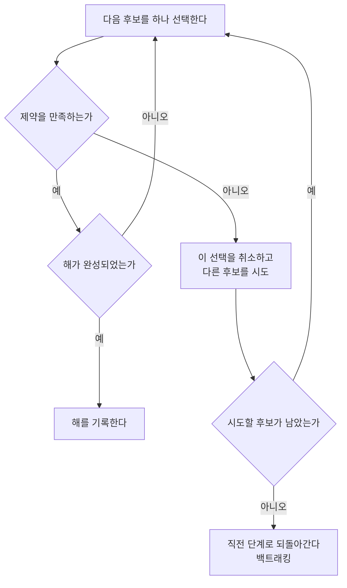

# Backtracking (역추적)

> **백트래킹은 후보를 하나씩 시도해 보다가 "이 길로는 답이 될 수 없다"는 판단이 서면 즉시 직전 갈림길로 되돌아가 다른 선택을 시도하는 완전 탐색 기법이다.**

## 미로에서 막히면 갈림길로 되돌아간다

미로를 손전등 하나로 헤쳐 나간다고 하자. 갈림길에서 한 길을 골라 들어가고, 막다른 벽을 만나면 왔던 길을 되짚어 갈림길로 돌아가 다른 길을 택한다. **백트래킹이 정확히 이 전략이다.** 부분 해를 한 조각씩 쌓아 가다가, 지금까지의 선택이 제약을 어겨 더 이상 완성될 수 없다고 판명되면 마지막 선택을 취소하고 이전 상태로 되돌아간다.

핵심은 **가지치기(pruning)**다. 유망하지 않은 선택은 그 아래를 통째로 탐색하지 않고 잘라낸다. 모든 경우를 끝까지 다 만들어 보는 무차별 대입보다, 될 수 없는 가지를 일찍 버려 탐색량을 줄인다.

## 결정 트리를 깊이 우선으로 훑으며 막히면 되돌린다

백트래킹은 대개 재귀로 구현되며, 가능한 선택들이 이루는 트리를 [깊이 우선](Depth_First_Search.md)으로 내려간다.

N-퀸, [스도쿠](Constraint_Satisfaction_Problem.md), 미로 찾기, 부분집합 합 같은 문제가 전형적인 적용 대상이다. 이들은 모두 "제약을 만족하는 조합을 찾는" 형태여서, 부분 배치가 제약을 어기는 순간 되돌리면 탐색을 크게 아낄 수 있다.

> ⚠️ **흔한 오해 — "백트래킹은 신경망 가중치 학습에도 쓰인다."**
>
> 신경망 학습은 오차를 미분해 연속적으로 가중치를 조정하는 [경사 하강](Gradient_Descent.md)/[역전파](Backpropagation.md)이지, 선택을 취소하고 되돌리는 백트래킹이 아니다. 백트래킹은 이산적인 선택지가 있는 **제약 만족·조합 탐색** 문제의 기법이다. 이름이 비슷한 [역전파](Backpropagation.md)와 혼동하지 않는다.

## 정리하면

- 백트래킹은 부분 해를 쌓다가 **막히면 직전 갈림길로 되돌아가** 다른 선택을 시도한다.
- 될 수 없는 가지를 일찍 **가지치기**해 무차별 대입보다 효율적이다.
- 선택 트리를 **깊이 우선**으로 훑는 방식이며 보통 재귀로 구현한다.
- N-퀸·스도쿠·미로 등 제약 만족·조합 탐색 문제에 강하다.

## 함께 읽기

- [Depth First Search](Depth_First_Search.md) — 백트래킹이 선택 트리를 훑는 바탕 순회 방식.
- [Constraint Satisfaction Problem](Constraint_Satisfaction_Problem.md) — 백트래킹이 가장 잘 어울리는 문제 부류.
- [State Space](State_Space.md) — 부분 해들이 이루는 탐색 공간.
- [Heuristic](Heuristic.md) — 어떤 후보를 먼저 시도할지 정해 백트래킹을 가속하는 지침.
- [Breadth First Search](Breadth_First_Search.md) — 되돌림 대신 층별로 넓히는 대비되는 탐색.
