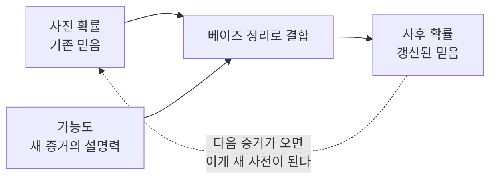

# Bayesian Inference (베이즈 추론)

> **베이즈 추론은 새 증거가 들어올 때마다 "원래 믿음(사전 확률)"을 "갱신된 믿음(사후 확률)"으로 고쳐 나가는 추론 방법이다.**

## 증거를 볼 때마다 믿음의 저울을 다시 맞춘다

의사가 환자를 진단하는 과정을 떠올려 보자. 처음엔 "이 나이대에 이 병일 확률은 대략 이 정도"라는 **막연한 짐작(사전 확률)**에서 출발한다. 검사 결과가 양성으로 나오면 그 짐작을 위로 올리고, 음성이면 내린다. **증거 하나를 볼 때마다 믿음의 정도를 다시 계산하는 것, 이것이 베이즈 추론이다.**

세 가지 값만 알면 된다.

- **사전 확률(prior)** — 증거를 보기 전의 믿음. `P(A)`
- **가능도(likelihood)** — 그 가설이 맞다면 이 증거가 나올 법한 정도. `P(B|A)`
- **사후 확률(posterior)** — 증거를 반영해 갱신한 믿음. `P(A|B)`

이 셋을 잇는 다리가 **베이즈 정리**다.

```
P(A|B) = P(B|A) · P(A) / P(B)
```

`P(B)`는 그 증거가 (어떤 가설이든) 관측될 전체 확률로, 사후 확률의 합이 1이 되게 맞춰 주는 정규화 항이다.

## 사전 × 가능도로 사후를 얻고, 그 사후가 다음번 사전이 된다



이 되먹임이 베이즈 추론의 묘미다. **오늘 계산한 사후 확률은 내일 새 증거를 만나면 그날의 사전 확률이 된다.** 그래서 데이터가 쌓일수록 믿음이 점점 다듬어진다.

> 💡 **참고 — 흔히 어긋나는 직관 (기저율)**
>
> 병에 걸린 사람이 100명 중 1명(사전 1%)이고 검사 정확도가 99%라도, 양성이 나온 사람이 실제 환자일 확률은 99%가 아니라 50% 정도다. 드문 병에서는 건강한 다수에서 나오는 거짓 양성이 많기 때문이다. **낮은 사전 확률(기저율)을 무시하면 사후 확률을 크게 착각한다.**

## 흔한 오해

> ⚠️ **흔한 오해 — "가능도 `P(B|A)`와 사후 확률 `P(A|B)`는 같은 값이다."**
>
> 방향이 다른 별개의 값이다. `P(B|A)`는 "병이 있을 때 검사가 양성일 확률", `P(A|B)`는 "검사가 양성일 때 병이 있을 확률"이다. 베이즈 정리가 하는 일이 바로 이 둘을 사전 확률로 이어 **가능도를 사후 확률로 뒤집는 것**이다.

## 정리하면

- 베이즈 추론은 **사전 확률을 증거로 갱신해 사후 확률을 얻는** 추론이다.
- 핵심 공식은 `P(A|B) = P(B|A)·P(A) / P(B)`.
- 오늘의 사후가 내일의 사전이 되어, 데이터가 쌓일수록 믿음이 다듬어진다.
- 낮은 사전 확률(기저율)을 무시하면 결론을 크게 착각한다.

## 함께 읽기

- [Bayesian Probability](Bayesian_Probability.md) — 확률을 "믿음의 정도"로 보는, 베이즈 추론의 철학적 토대.
- [Bayesian Network](Bayesian_Network.md) — 여러 변수의 베이즈 추론을 그래프로 확장한 모델.
- [Naive Bayesian Classification](Naive_Bayesian_Classification.md) — 베이즈 정리를 분류에 적용한 대표 알고리즘.
- [Probabilistic Reasoning](Probabilistic_Reasoning.md) — 불확실성을 확률로 다루는 더 넓은 틀.
