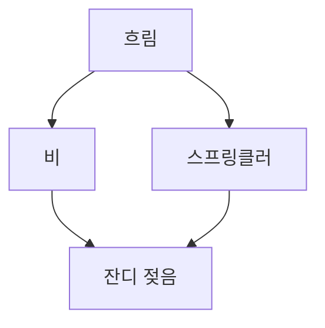

# Bayesian Network (베이즈 네트워크)

> **베이즈 네트워크는 여러 확률 변수의 인과·의존 관계를 화살표 그래프로 그리고, 각 변수에 조건부 확률표를 붙여 "무엇이 무엇에 영향을 주는가"를 통째로 다루는 확률 모델이다.**

## 원인과 결과를 화살표로 이은 지도다

"잔디가 젖은" 원인을 생각해 보자. 비가 왔거나, 스프링클러가 돌았거나 둘 다일 수 있다. 그리고 비가 올지 말지는 흐린 날씨에 달렸다. 이런 관계를 화살표로 그리면 하나의 지도가 된다.



**베이즈 네트워크는 이렇게 변수를 노드로, "직접 영향을 준다"는 관계를 화살표로 그린 그래프다.** 화살표는 방향이 있고 순환하지 않는다(**DAG**, 방향 비순환 그래프). 각 노드에는 **조건부 확률표(CPT)**가 붙어, "부모 변수들이 이런 값일 때 나는 이럴 확률"을 적어 둔다. 예컨대 "비가 왔고 스프링클러도 돌았다면 잔디가 젖을 확률 99%"처럼.

## 그래프 구조가 계산을 획기적으로 줄여 준다

변수가 많으면 모든 조합의 확률(결합확률)을 그대로 적는 건 폭발적으로 커진다. 베이즈 네트워크의 힘은 **"각 변수는 자기 부모만 알면 된다(조건부 독립)"**는 구조를 이용해 이 거대한 표를 작은 조건부 확률표들의 곱으로 쪼갠다는 데 있다.

```
P(흐림, 비, 스프링클러, 젖음)
  = P(흐림) · P(비|흐림) · P(스프링클러|흐림) · P(젖음|비, 스프링클러)
```

이 구조 위에서 **추론(inference)**을 한다. 두 방향 모두 가능하다.

- **예측(원인 → 결과)** — "비가 온다면 잔디가 젖을 확률은?"
- **진단(결과 → 원인)** — "잔디가 젖었다. 그렇다면 비가 왔을 확률은?"

진단 방향은 결국 [베이즈 추론](Bayesian_Inference.md)으로 결과에서 원인의 사후 확률을 거슬러 계산하는 것이다.

## 흔한 오해

> ⚠️ **흔한 오해 — "화살표는 곧 시간 순서이거나 반드시 인과관계다."**
>
> 화살표는 **확률적 의존 관계**를 나타낼 뿐, 반드시 물리적 인과나 시간 순서를 뜻하지는 않는다. 같은 확률 분포를 화살표 방향이 다른 여러 네트워크로 표현할 수도 있다. 다만 인과 구조를 반영해 그리면 사람이 이해하기 쉽고 조건부 확률표도 간결해진다.

## 정리하면

- 베이즈 네트워크는 변수 간 의존 관계를 **DAG + 조건부 확률표**로 표현한 확률 모델이다.
- 조건부 독립 구조 덕에 거대한 결합확률을 작은 표들의 곱으로 쪼개 계산량을 줄인다.
- 예측(원인→결과)과 진단(결과→원인) 추론을 모두 할 수 있다.
- 화살표는 확률적 의존이지 반드시 인과·시간 순서는 아니다.

## 함께 읽기

- [Bayesian Inference](Bayesian_Inference.md) — 네트워크 위에서 결과로부터 원인을 거슬러 계산하는 추론의 원리.
- [Bayesian Probability](Bayesian_Probability.md) — 노드마다 붙는 확률을 "믿음의 정도"로 보는 관점.
- [Graph Theory](Graph_Theory.md) — 베이즈 네트워크의 뼈대인 방향 그래프의 이론적 토대.
- [Hidden Markov Model](Hidden_Markov_Model.md) — 시간에 따라 펼쳐지는 베이즈 네트워크의 특수한 형태로 볼 수 있다.
