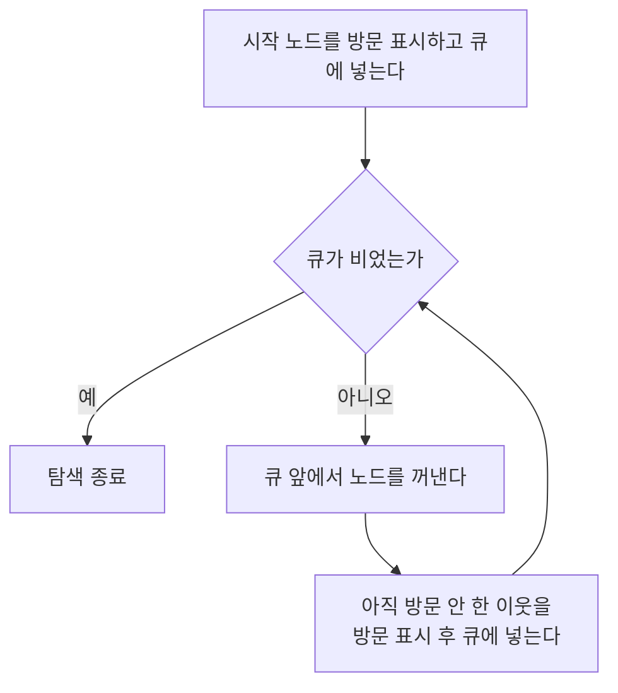

# Breadth First Search (너비우선 탐색)

> **너비 우선 탐색(BFS)은 시작점에서 가까운 노드부터 한 겹씩 물결처럼 넓혀 가며 그래프를 훑어, 간선 개수 기준 최단 경로를 찾아내는 탐색이다.**

## 연못에 돌을 던진 물결처럼 퍼진다

연못에 돌을 떨어뜨리면 파문이 동심원을 그리며 바깥으로 퍼진다. **BFS가 바로 이 방식이다.** 시작 노드에서 한 걸음 거리의 이웃을 전부 방문하고, 그다음 두 걸음 거리를 전부, 이어 세 걸음 거리를 전부 방문한다. 한 길을 끝까지 파고드는 [깊이 우선 탐색](Depth_First_Search.md)과 정반대로, **모든 방향을 같은 깊이만큼 고르게 넓힌다.**

이 "가까운 곳부터" 성질 덕분에 BFS는 값진 보장을 준다. **간선 하나하나의 비용이 같은(가중치 없는) 그래프에서, 시작점에서 어떤 노드에 처음 도달한 경로가 곧 최단 경로다.** 미로에서 최소 걸음 수를 찾는 문제가 대표적이다.

## 큐로 방문 순서를 관리하고, 방문 표시로 재방문을 막는다

BFS의 핵심 자료구조는 **큐(FIFO)**다. 먼저 넣은 노드를 먼저 꺼내므로, 가까운 노드가 자연히 먼저 처리된다.

여기서 **방문 표시가 필수다.** 이미 방문했거나 큐에 넣은 노드를 다시 넣지 않아야 순환이 있는 그래프에서 무한 반복과 중복 작업을 피할 수 있다. 노드 수 `V`, 간선 수 `E`일 때 시간 복잡도는 `O(V + E)`다.

> ⚠️ **흔한 오해 — "BFS는 어떤 그래프에서든 최단 경로를 준다."**
>
> BFS의 최단 경로 보장은 **간선 비용이 모두 같은** 경우에만 성립한다. 간선마다 거리·요금이 다른 가중 그래프에서는 걸음 수가 적은 경로가 실제로는 더 비쌀 수 있다. 그럴 땐 [다익스트라](A_Algorithm.md)나 [A*](A_Algorithm.md)를 써야 한다.

## 정리하면

- BFS는 시작점에서 **가까운 노드부터 층별로** 넓혀 가는 탐색이다.
- **큐(FIFO)**로 순서를 관리하고 **방문 표시**로 재방문을 막는다.
- 가중치 없는 그래프에서 **최단 경로**를 보장한다.
- 미로 최소 걸음, 웹 크롤링, 소셜 네트워크 거리 계산 등에 쓰인다.

## 함께 읽기

- [Depth First Search](Depth_First_Search.md) — 한 길을 끝까지 파는 정반대 순회 방식.
- [A* Algorithm](A_Algorithm.md) — 가중 그래프에서 휴리스틱으로 BFS를 확장한 최단 경로 탐색.
- [Graph Theory](Graph_Theory.md) — 노드와 간선으로 이뤄진, BFS가 훑는 구조.
- [State Space](State_Space.md) — 탐색이 펼쳐지는 상태들의 공간.
- [Problem Solving](Problem_Solving.md) — 탐색을 문제 해결의 도구로 보는 상위 관점.
