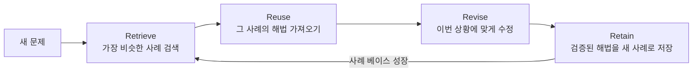

# Case-Based Reasoning (사례기반 추론)

> **사례기반 추론은 문제를 규칙으로 풀지 않고, 과거에 겪은 비슷한 사례를 꺼내 와 이번 상황에 맞게 고쳐 쓰는 문제 해결 방식이다.**

## 판례를 찾는 변호사처럼 푼다

경험 많은 변호사는 새 사건을 만나면 법조문을 처음부터 유도하지 않는다. **가장 비슷한 과거 판례를 떠올리고, 이번 사건의 차이만큼만 논리를 손본다.** 사례기반 추론(CBR)이 하는 일이 바로 이것이다. 의사가 예전에 봤던 비슷한 환자를 떠올려 진단하고, 정비공이 전에 고쳤던 비슷한 고장을 기억해 손보는 것과 같은 사고방식이다.

이 점에서 CBR은 [전문가 시스템](Expert_System.md)과 대비된다. 규칙기반 전문가 시스템이 "만약 A면 B다" 같은 규칙을 모아 지식을 표현한다면, **CBR은 규칙 대신 구체적인 경험 덩어리(사례)를 그대로 저장해 두고 필요할 때 꺼낸다.** 규칙을 명시적으로 뽑아내기 어려운 분야에서 특히 힘을 발휘한다.

## 검색·재사용·수정·저장의 4단계로 돈다

CBR은 흔히 **4R 순환**으로 정리한다. 사례 하나를 풀고 나면 그 결과가 다시 사례로 쌓여, 시스템이 쓸수록 똑똑해진다.

- **Retrieve(검색)** — 새 문제와 저장된 사례들의 **유사도**를 재어 가장 가까운 사례를 찾는다. 특징(feature)마다 거리를 재고 가중합하는 방식이 흔하다.
- **Reuse(재사용)** — 찾아낸 사례의 해법을 후보로 삼는다.
- **Revise(수정)** — 두 상황의 차이만큼 해법을 고친다. 이 단계가 CBR의 핵심 난제다.
- **Retain(저장)** — 잘 통한 해법을 새 사례로 베이스에 넣어 다음 문제에 대비한다.

> 💡 **참고 — 가장 가까운 이웃을 찾는다는 점에서 [K-최근린 분류](KNearest_Neighbor_Classification.md)와 뿌리가 같다.** 다만 KNN이 "가장 가까운 이웃의 라벨을 그대로 예측값으로 쓰는" 분류 기법이라면, CBR은 찾은 사례를 **수정해서 재사용**하고 결과를 다시 학습한다는 점에서 더 넓은 문제 해결 틀이다.

## 흔한 오해

> ⚠️ **흔한 오해 — "사례를 많이 모아두기만 하면 잘 된다."**
>
> 사례의 양보다 **유사도를 어떻게 정의하느냐**와 **찾은 해법을 어떻게 수정하느냐**가 성패를 가른다. 유사도 척도가 엉성하면 엉뚱한 사례를 꺼내 오고, 수정 규칙이 없으면 상황이 조금만 달라도 해법이 어긋난다.

## 정리하면

- CBR은 규칙을 유도하는 대신 **과거 사례를 검색해 이번 문제에 맞게 고쳐 쓰는** 추론 방식이다.
- **Retrieve → Reuse → Revise → Retain**의 4단계로 돌며, 쓸수록 사례가 쌓여 성능이 는다.
- 규칙을 뽑아내기 어렵지만 경험은 풍부한 분야(의료 진단, 법률 자문, 고객 지원, 설계)에 잘 맞는다.
- 유사도 정의와 해법 수정이 핵심이고, 여기가 약하면 사례가 많아도 소용없다.

## 함께 읽기

- [Expert System](Expert_System.md) — 규칙으로 지식을 표현하는 대조적 접근. CBR은 규칙 대신 사례를 쓴다.
- [K-Nearest Neighbor Classification](KNearest_Neighbor_Classification.md) — "가장 비슷한 것을 찾는다"는 아이디어를 공유하는 분류 기법.
- [Knowledge Engineering](Knowledge_Engineering.md) — 사례와 지식을 어떻게 표현하고 관리할지 다루는 분야.
- [Pattern Recognition](Pattern_Recognition.md) — 유사도 측정과 특징 비교의 밑바탕이 되는 기술.
