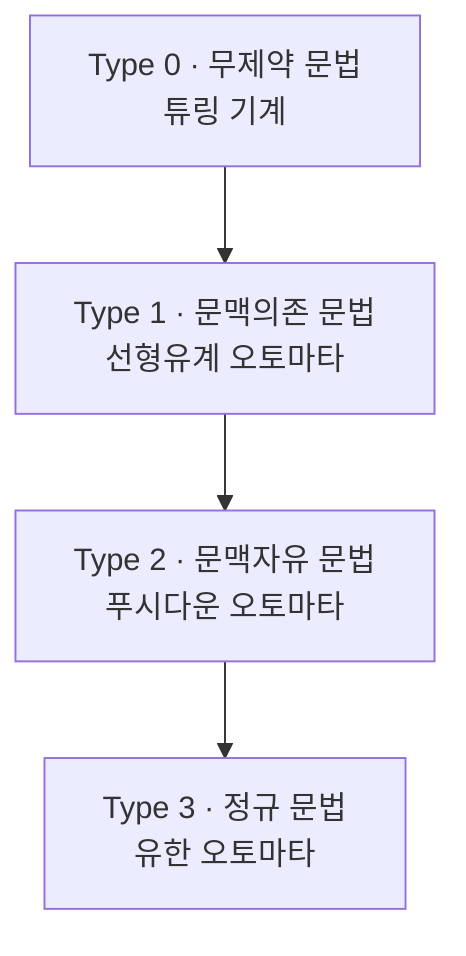

# Chomsky Hierarchy (촘스키계층)

> **촘스키계층은 형식 문법을 규칙이 얼마나 자유로운지에 따라 네 등급으로 나눈 분류로, 각 등급은 그 언어를 알아보는 데 필요한 계산 기계의 힘과 정확히 짝지어진다.**

## 언어의 복잡함에 등급을 매긴 사다리다

노엄 촘스키가 1950년대에 제시한 이 계층은 **"어떤 규칙으로 문장을 만들 수 있느냐"**로 언어(형식 언어)를 줄 세운다. 규칙이 헐거울수록 표현할 수 있는 언어는 넓어지지만, 그것을 판별하려면 더 강력한 기계가 필요하다. 사다리의 네 칸은 서로 포개진 러시아 인형 같은 관계다. **위 등급은 아래 등급을 모두 포함한다.**

> ⚠️ **흔한 오해 — 촘스키계층은 심층구조·표층구조·보편문법 이야기다?**
>
> 그것은 촘스키의 다른 이론인 **변형생성문법**이다. 촘스키계층은 그것과 별개로, [오토마타](Automata.md)와 형식 언어 이론에 속하는 **형식 문법의 4단계 분류**다. 이 글은 후자를 다룬다.

## 네 등급과 그에 대응하는 기계

| 유형 | 문법 이름 | 인식하는 기계 | 대표 예 |
|------|-----------|----------------|---------|
| Type 3 | 정규 문법(Regular) | 유한 오토마타 | 정규표현식, `a*b*` |
| Type 2 | 문맥자유 문법(Context-free) | 푸시다운 오토마타(스택 1개) | 괄호 짝 맞추기, 대부분 프로그래밍 언어 구문 |
| Type 1 | 문맥의존 문법(Context-sensitive) | 선형유계 오토마타 | `aⁿbⁿcⁿ` |
| Type 0 | 무제약 문법(Unrestricted) | [튜링 기계](Turing_Machine.md) | 계산 가능한 모든 언어 |

포함 관계는 `Type 3 ⊂ Type 2 ⊂ Type 1 ⊂ Type 0`이다.

핵심은 **문법의 생성 규칙 형태가 그것을 알아보는 데 필요한 기계의 기억 구조를 결정한다**는 점이다. 정규 문법은 유한한 상태만으로 충분하고, 문맥자유 문법은 스택 하나가 더 필요하며(그래서 중첩 괄호를 셀 수 있다), 무제약 문법에 이르면 튜링 기계의 무한 테이프가 있어야 한다.

## 왜 컴퓨터과학에 중요한가

이 계층은 컴파일러와 언어 처리의 뼈대다. **프로그래밍 언어의 어휘 분석(토큰 쪼개기)은 대개 정규 문법(Type 3)으로, 구문 분석(문장 구조 파악)은 문맥자유 문법(Type 2)으로 처리한다.** 어떤 문법을 쓰느냐가 곧 필요한 파서의 복잡도와 성능을 정한다. 상위 등급으로 갈수록 표현력은 세지지만 판별 비용도 커진다.

## 정리하면

- 촘스키계층은 형식 문법을 **Type 0 ~ Type 3** 네 등급으로 나눈 포함 관계 분류다.
- 각 등급은 이를 인식하는 기계(유한 오토마타 → 푸시다운 오토마타 → 선형유계 오토마타 → 튜링 기계)와 정확히 대응한다.
- 규칙이 자유로울수록 표현력은 커지고, 판별에 필요한 기계도 강력해진다.
- 컴파일러의 어휘·구문 분석 등 언어 처리 이론의 토대다. 변형생성문법과 혼동하지 말 것.

## 함께 읽기

- [Automata](Automata.md) — 각 문법 등급에 짝지어지는 계산 기계들의 계층.
- [Turing Machine](Turing_Machine.md) — 사다리 맨 위 Type 0에 대응하는 범용 계산 모델.
- [Halting Problem](Halting_Problem.md) — 튜링 기계(Type 0)의 한계를 보여주는 결정 불가능 문제.
