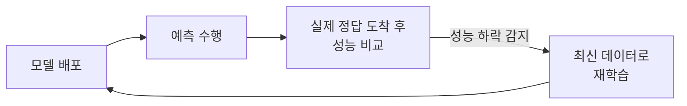

# Concept Drift (개념 드리프트)

> **개념 드리프트는 입력과 정답 사이의 "규칙" 자체가 시간이 지나며 바뀌어, 배포된 모델이 배운 관계가 더 이상 맞지 않게 되는 현상이다.**

## 룰이 바뀐 게임을 옛 전략으로 계속 두는 것과 같다

바둑을 열심히 익혔는데 어느 날 규칙이 슬쩍 바뀌었다고 하자. 돌은 똑같이 놓지만 이기는 수가 달라졌다. 옛 전략을 고집하면 질 수밖에 없다. **개념 드리프트가 바로 이것이다.** 모델이 보는 입력 데이터의 겉모습은 그대로여도, 그 입력이 어떤 정답으로 이어지는지의 **관계(개념)**가 바뀌었다.

확률로 말하면 개념 드리프트는 **조건부 분포 `P(y|X)`가 변하는 것**이다. 같은 특성값 `X`가 예전과 다른 정답 `y`로 이어진다. 이것이 [데이터 드리프트](Data_Drift.md)와의 결정적 차이다. 데이터 드리프트는 입력 분포 `P(X)` 자체가 바뀌는 것이고, 개념 드리프트는 입력이 그대로여도 입력-정답 관계가 바뀐다.

| 구분 | 무엇이 바뀌나 | 예시 |
|------|-------------|------|
| [데이터 드리프트](Data_Drift.md) | 입력 분포 `P(X)` | 신규 고객층 유입으로 연령대 분포가 달라짐 |
| **개념 드리프트** | 입력-정답 관계 `P(y \| X)` | 같은 소비 패턴이라도 "이탈 고객"의 기준이 달라짐 |

## 규칙이 바뀌는 속도에 따라 모습이 다르다

개념 드리프트는 변화가 밀려오는 양상에 따라 나뉜다.

- **급격한(sudden) 드리프트** — 규칙이 어느 시점에 확 바뀐다. 코로나 발생으로 소비 패턴이 하루아침에 달라진 경우.
- **점진적(gradual) 드리프트** — 옛 규칙과 새 규칙이 한동안 섞이며 서서히 넘어간다.
- **점증적(incremental) 드리프트** — 규칙이 조금씩 연속적으로 이동한다.
- **반복적(recurring) 드리프트** — 계절처럼 옛 규칙이 주기적으로 돌아온다.

## 정답을 알기 전까지는 성능 저하로만 드러난다

개념 드리프트의 까다로운 점은 **입력만 봐서는 알아채기 어렵다**는 것이다. 입력 분포가 그대로일 수 있으니 입력 통계 감시로는 안 잡히고, 실제 정답(레이블)이 도착해 예측과 비교되어야 성능 하락으로 드러난다. 그래서 대응은 [모델 모니터링](Model_Monitoring.md)으로 성능·오차를 지속 추적하다가, 저하가 감지되면 최신 데이터로 **재학습**하는 흐름이 기본이다.

새 데이터를 계속 반영해 모델을 갱신하는 온라인 학습이나, 오래된 데이터의 가중치를 낮추는 방식도 대응책이다. 어느 쪽이든 "모델은 한 번 배우면 끝"이 아니라 **환경 변화를 전제로 계속 돌본다**는 발상이 핵심이다.

## 정리하면

- 개념 드리프트는 **입력-정답 관계 `P(y|X)`가 시간에 따라 바뀌는** 현상이다.
- 입력 분포가 바뀌는 [데이터 드리프트](Data_Drift.md)와 구별된다.
- 급격·점진·점증·반복 등 변화 속도에 따라 유형이 나뉜다.
- 입력만으로는 감지하기 어렵고, 성능 모니터링과 재학습으로 대응한다.

## 함께 읽기

- [Data Drift](Data_Drift.md) — 입력 분포가 바뀌는, 헷갈리기 쉬운 이웃 개념.
- [Model Monitoring](Model_Monitoring.md) — 드리프트로 인한 성능 저하를 감지하는 수단.
- [MLOps](MLOps.md) — 재학습·배포를 자동화해 드리프트에 대응하는 운영 체계.
