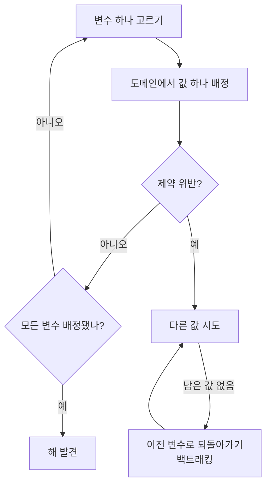

# Constraint Satisfaction Problem (제약조건 만족 문제)

> **제약조건 만족 문제는 여러 변수에 값을 채워 넣되, 변수들 사이에 걸린 제약을 하나도 어기지 않는 조합을 찾는 문제다.**

## 스도쿠가 바로 제약조건 만족 문제다

스도쿠를 떠올려 보자. **빈 칸(변수)마다 1~9 중 하나(값)를 넣되, 같은 줄·열·박스에 숫자가 겹치면 안 된다(제약).** 모든 제약을 만족하는 칸 채우기가 곧 답이다. 제약조건 만족 문제(Constraint Satisfaction Problem, CSP)는 이 구조를 그대로 일반화한 것이다. 지도 색칠(인접한 나라는 다른 색), N-퀸(퀸끼리 공격 금지), 시간표 짜기(같은 강의실·시간 중복 금지)가 전부 같은 틀이다.

CSP는 세 부품으로 정의된다.

| 부품 | 뜻 | 스도쿠에서 |
|------|-----|-----------|
| 변수(Variables) | 값을 정해야 할 대상 | 빈 칸 각각 |
| 도메인(Domains) | 각 변수가 가질 수 있는 값의 집합 | `{1,…,9}` |
| 제약(Constraints) | 변수들의 값 조합에 걸린 규칙 | 줄·열·박스 내 중복 금지 |

**목표는 모든 변수에 도메인 안의 값을 배정하되 제약을 전부 만족시키는 것**이다. "최선의 답"이 아니라 "규칙을 어기지 않는 답"을 찾는다는 점이 최적화 문제와 다르다.

## 백트래킹으로 넣어보고, 막히면 되돌린다

CSP는 보통 [역추적(백트래킹)](Backtracking.md)으로 푼다. 흐름은 이렇다.

핵심은 **막다른 길에 들어서면 값을 다 시도해 보기 전에 되돌아간다**는 것이다. 그냥 모든 조합을 나열하면 경우의 수가 폭발하므로, 실전에서는 탐색 공간을 줄이는 기법을 얹는다.

- **제약 전파(constraint propagation)** — 한 변수의 값이 정해지면 이웃 변수의 도메인에서 불가능해진 값을 미리 지운다. **아크 일관성(arc consistency)**이 대표적이다.
- **변수·값 선택 휴리스틱** — 남은 후보가 가장 적은 변수를 먼저 고르는(MRV) 등, 어디부터 손댈지 영리하게 정한다.

> ⚠️ **흔한 오해 — "CSP는 최적해를 찾는 문제다."**
>
> 기본 CSP는 **제약을 만족하는 아무 해나** 찾으면 된다. 값마다 비용을 매겨 "제약을 만족하면서 비용이 최소인 해"를 찾는 것은 제약 최적화 문제로, 별도의 확장이다. 많은 CSP는 [NP-완전](NPcomplete__NPhard.md)이라 최악의 경우 탐색이 지수적으로 커진다.

## 정리하면

- CSP는 **변수·도메인·제약** 세 부품으로 정의되며, 제약을 모두 만족하는 값 배정을 찾는 문제다.
- 스도쿠, 지도 색칠, N-퀸, 스케줄링이 모두 같은 틀로 표현된다.
- **백트래킹**이 기본 해법이고, **제약 전파**와 **선택 휴리스틱**으로 탐색 공간을 줄인다.
- 최적화가 아니라 "규칙을 어기지 않는 해 찾기"이며, 다수가 NP-완전이다.

## 함께 읽기

- [Backtracking](Backtracking.md) — CSP를 푸는 기본 탐색 전략. 막히면 되돌아간다.
- [State Space](State_Space.md) — 부분 배정들을 상태로 보면 CSP는 상태공간 탐색이 된다.
- [Heuristic](Heuristic.md) — 어떤 변수·값을 먼저 시도할지 정해 탐색을 줄이는 요령.
- [NP-complete / NP-hard](NPcomplete__NPhard.md) — 많은 CSP가 속하는 계산 난이도 등급.
- [Problem Solving](Problem_Solving.md) — 탐색으로 문제를 푸는 더 넓은 관점.
