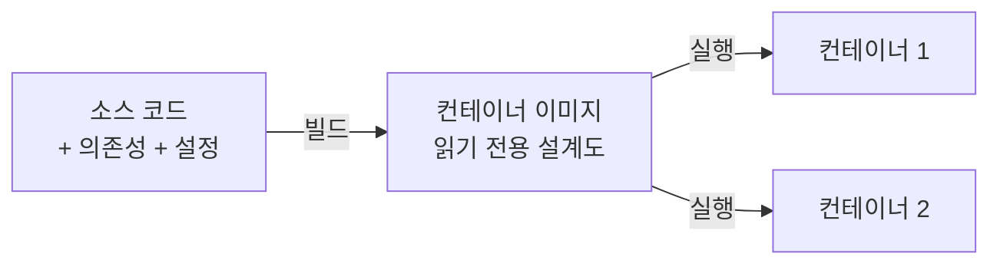

# Containerization (컨테이너화)

> **컨테이너화는 애플리케이션과 그것을 돌리는 데 필요한 모든 것(코드·라이브러리·설정)을 하나의 표준 상자에 담아, 어디서 실행하든 똑같이 동작하게 만드는 기술이다.**

## "내 컴퓨터에선 되는데"를 없애는 표준 화물 상자다

배로 물건을 실어 나를 때, 형태가 제각각인 짐을 규격화된 컨테이너에 담기로 정하면서 물류가 폭발적으로 편해졌다. 상자 안에 뭐가 들었든 배·트럭·크레인은 상자만 다루면 된다. **소프트웨어 컨테이너도 같은 발상이다.** 애플리케이션을 표준 상자에 담아두면, 개발자 노트북이든 테스트 서버든 클라우드든 상자만 옮겨 실행하면 똑같이 돈다. "내 컴퓨터에선 되는데 서버에선 안 된다"는 고질병이 사라진다.

## 이미지를 찍어 컨테이너로 실행한다

컨테이너화의 흐름은 이미지와 컨테이너 두 개념으로 이해된다.

- **컨테이너 이미지** — 실행에 필요한 모든 것을 담은 읽기 전용 **설계도**다. 여러 **레이어**로 쌓이며, 공통 레이어는 이미지끼리 공유해 저장 공간과 빌드 시간을 아낀다.
- **컨테이너** — 그 이미지를 실제로 실행한 **인스턴스**다. 하나의 이미지에서 컨테이너를 여러 개 띄울 수 있다.

이미지를 실행·관리하는 소프트웨어가 **컨테이너 런타임**(대표적으로 Docker)이고, 수많은 컨테이너를 여러 서버에 걸쳐 배포·확장·복구하는 도구가 **컨테이너 오케스트레이션**(대표적으로 Kubernetes)이다.

## 가상 머신보다 가볍다 — OS 커널을 공유하기 때문이다

컨테이너를 가상 머신(VM)과 혼동하기 쉽지만 격리 방식이 다르다.

| 구분 | 가상 머신(VM) | 컨테이너 |
|------|--------------|---------|
| 격리 단위 | 하드웨어를 가상화, 게스트 OS 통째로 | OS 커널을 공유, 프로세스 수준 격리 |
| 무게 | 게스트 OS 포함, 수 GB | OS 없이 앱+의존성, 수십~수백 MB |
| 부팅 | 수십 초~분 | 초 단위 |
| 격리 강도 | 강함 | VM보다 약함 |

> ⚠️ **흔한 오해 — "컨테이너는 초경량 가상 머신이다."**
>
> 컨테이너는 자기 OS를 따로 갖지 않고 호스트의 **커널을 공유**한다. 그래서 가볍고 빠르지만, 커널을 공유하는 만큼 격리 강도는 VM보다 약하다. 가상 머신을 작게 줄인 것이 아니라 격리의 층위 자체가 다르다.

이 가벼움 덕에 컨테이너화는 [마이크로서비스](Distributed_Computing.md), 클라우드 네이티브 애플리케이션, CI/CD 파이프라인의 기반이 됐다. AI 쪽에서는 모델과 추론 환경을 하나의 이미지로 묶어 재현 가능하게 배포하는 [모델 서빙](Model_Serving.md)·[MLOps](MLOps.md)의 표준 수단이다.

## 정리하면

- 컨테이너화는 앱과 실행 환경을 **표준 상자**에 담아 어디서든 동일하게 실행하는 기술이다.
- **이미지**(설계도)를 찍어 **컨테이너**(실행 인스턴스)로 돌리며, 런타임(Docker)과 오케스트레이션(Kubernetes)이 이를 관리한다.
- 가상 머신과 달리 **호스트 OS 커널을 공유**해 가볍고 빠르지만 격리는 다소 약하다.
- 마이크로서비스·CI/CD·모델 서빙 등 현대 배포의 기반이다.

## 함께 읽기

- [Model Serving](Model_Serving.md) — 학습된 모델을 컨테이너로 묶어 배포하는 대표 활용처.
- [MLOps](MLOps.md) — 컨테이너 기반 배포를 자동화하는 운영 체계.
- [Distributed Computing](Distributed_Computing.md) — 여러 컨테이너를 여러 노드에 나눠 돌리는 큰 그림.
