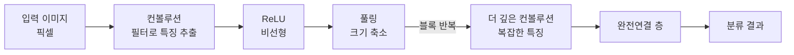

# Convolutional Neural Network - CNN (컨볼루션 신경망)

> **CNN은 작은 필터를 이미지 위로 미끄러뜨리며 국소적인 패턴을 훑어, 위치가 조금 바뀌어도 같은 특징을 잡아내도록 설계된 신경망이다.**

## 이미지를 작은 창으로 훑으며 특징을 찾는 스캐너와 같다

사진에서 고양이를 찾을 때 우리는 사진 전체를 한 픽셀씩 통째로 외우지 않는다. "뾰족한 귀", "수염", "동그란 눈" 같은 **국소적 특징**을 여기저기서 찾고 그것들을 조합한다. **CNN이 하는 일이 이 방식이다.** 작은 필터가 이미지를 훑으며 모서리·색 변화 같은 조각 패턴을 찾고, 층이 깊어질수록 그 조각들을 모아 "귀", 나아가 "고양이 얼굴" 같은 복잡한 특징으로 쌓아 올린다.

일반 완전연결 신경망으로 이미지를 다루면 문제가 크다. 픽셀을 전부 펼쳐 이으면 파라미터가 폭발하고, 고양이가 사진 왼쪽에 있는지 오른쪽에 있는지에 따라 완전히 다른 입력으로 취급된다. **CNN은 필터를 이미지 전역에서 공유해, 파라미터를 줄이면서 "위치가 달라도 같은 패턴"을 인식한다.**

## 컨볼루션 → 풀링을 쌓고, 끝에서 분류한다

CNN의 층은 대개 세 종류가 반복·결합된다.

| 층 | 하는 일 |
|------|---------|
| 컨볼루션 층 | 필터(커널)를 미끄러뜨리며 특징 맵을 만든다. 하나의 필터가 하나의 패턴을 담당한다 |
| 풀링 층 | 특징 맵을 축소해 계산량을 줄이고, 작은 위치 변화에 둔감하게 만든다 ([Max Pooling](Max_Pooling.md)) |
| 완전연결 층 | 추출된 특징을 모아 최종 분류·예측을 낸다 |

컨볼루션 뒤에는 보통 [ReLU](ReLU.md) 같은 활성화 함수로 비선형성을 넣는다. 필터의 값 자체는 사람이 정하지 않는다. **어떤 패턴을 잡을지는 [역전파](Backpropagation.md)로 데이터에서 스스로 학습**된다.

## 흔한 오해

> ⚠️ **흔한 오해 — "필터의 값은 사람이 직접 설계해 넣는다."**
>
> 초기 영상처리에서는 모서리 검출 같은 필터를 손으로 설계했지만, CNN의 필터 값은 **학습으로 정해진다.** 무작위로 시작해 역전파로 갱신되며, 데이터에 가장 유용한 패턴 검출기로 스스로 수렴한다. 사람이 정하는 건 필터의 크기·개수 같은 구조뿐이다.

## 정리하면

- CNN은 **필터를 공유·이동**시켜 국소 패턴을 훑고, 위치 변화에 강하다.
- **컨볼루션(특징 추출) → 풀링(축소) → 완전연결(분류)**의 흐름으로 쌓인다.
- 필터 값은 손설계가 아니라 **역전파로 학습**된다.
- 깊어질수록 단순 특징에서 복잡한 특징으로 조합해 올라간다.

## 함께 읽기

- [Max Pooling](Max_Pooling.md) — 특징 맵을 줄이는 대표 풀링 방식.
- [Backpropagation](Backpropagation.md) — 필터 값을 학습시키는 알고리즘.
- [ReLU](ReLU.md) — 컨볼루션 뒤 비선형성을 넣는 활성화 함수.
- [Deep Learning](Deep_Learning.md) — CNN이 속한 큰 갈래.
- [Data Augmentation](Data_Augmentation.md) — 이미지 데이터를 늘려 CNN의 일반화를 돕는 기법.
