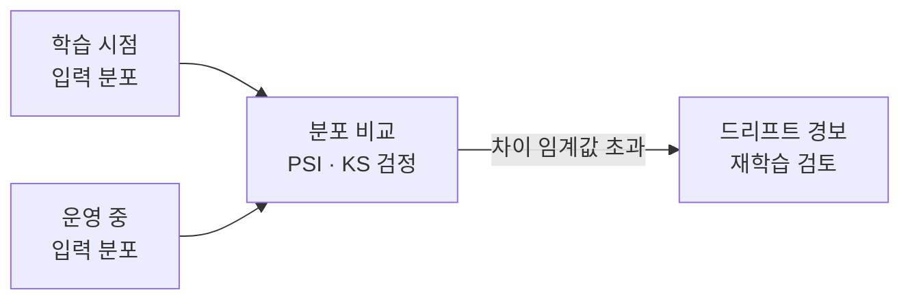

# Data Drift (데이터 드리프트)

> **데이터 드리프트는 모델에 들어오는 입력 데이터의 분포가 학습 때와 달라지는 현상이다. 정답과의 관계는 그대로여도 입력의 "생김새"가 바뀐다.**

## 겨울옷 데이터로 배운 모델에 여름옷이 들어오는 격이다

겨울 매장 데이터로만 학습한 추천 모델에 여름이 되어 반팔·샌들 주문이 쏟아진다고 하자. 판매의 논리(무엇이 잘 팔리는가의 관계)는 그대로여도, 모델이 마주하는 입력의 분포가 학습 때와 딴판이다. **데이터 드리프트는 이렇게 입력의 통계적 분포 `P(X)`가 시간이 지나며 이동하는 것**이다. 공변량 변화(covariate shift)라고도 부른다.

핵심은 바뀌는 대상이 **입력**이라는 점이다. 입력과 정답의 관계 `P(y|X)`가 바뀌는 [개념 드리프트](Concept_Drift.md)와는 다르다. 데이터 드리프트에서는 규칙은 여전히 유효하지만, 모델이 학습 때 거의 보지 못한 영역의 입력이 많아져 예측이 부정확해진다.

| 구분 | 바뀌는 것 | 한마디로 |
|------|----------|---------|
| **데이터 드리프트** | 입력 분포 `P(X)` | "들어오는 데이터의 생김새가 달라졌다" |
| [개념 드리프트](Concept_Drift.md) | 입력-정답 관계 `P(y \| X)` | "같은 입력에 대한 정답이 달라졌다" |

## 입력만 봐도 감지할 수 있다는 것이 장점이다

데이터 드리프트의 실용적 이점은 **정답(레이블) 없이도 감지 가능**하다는 것이다. 학습 때 입력 분포와 운영 중 입력 분포를 통계적으로 비교하기만 하면 된다. 정답이 도착해야만 드러나는 개념 드리프트와 다른 지점이다.

- **분포 비교** — 특성별로 학습 시점과 현재의 분포를 겹쳐 본다.
- **거리·검정 지표** — PSI(Population Stability Index), KL 발산, KS 검정 같은 지표로 분포 차이를 수치화한다.
- **임계값 알람** — 지표가 기준을 넘으면 경보를 울린다.

## 데이터 파이프라인 버그와 진짜 변화를 구분해야 한다

> ⚠️ **흔한 오해 — "분포가 달라졌으면 무조건 세상이 변한 것이다."**
>
> 분포 변화의 상당수는 세상의 변화가 아니라 **파이프라인 사고**다. 단위가 원에서 달러로 바뀌거나, 센서가 고장 나 결측이 늘거나, 인코딩이 어긋난 경우가 흔하다. 재학습에 앞서 [데이터 전처리](Data_Preprocessing.md) 단계에 문제가 없는지부터 점검해야 한다.

진짜 드리프트로 판단되면 대응은 최신 데이터를 반영한 **재학습**이 기본이다. 이 감시-대응 순환은 [모델 모니터링](Model_Monitoring.md)과 [MLOps](MLOps.md) 파이프라인의 핵심 업무다.

## 정리하면

- 데이터 드리프트는 **입력 분포 `P(X)`가 학습 때와 달라지는** 현상이다.
- 입력-정답 관계가 바뀌는 [개념 드리프트](Concept_Drift.md)와 구별된다.
- 정답 없이 **입력 분포만 비교**해 감지할 수 있는 것이 장점이다(PSI·KS 검정 등).
- 세상의 변화인지 파이프라인 버그인지 먼저 가려낸 뒤 재학습으로 대응한다.

## 함께 읽기

- [Concept Drift](Concept_Drift.md) — 입력-정답 관계가 바뀌는, 짝을 이루는 개념.
- [Model Monitoring](Model_Monitoring.md) — 드리프트를 상시 감시하는 활동.
- [MLOps](MLOps.md) — 감지에서 재학습·재배포까지 자동화하는 운영 체계.
- [Data Preprocessing](Data_Preprocessing.md) — 가짜 드리프트를 걸러내는 첫 점검 지점.
