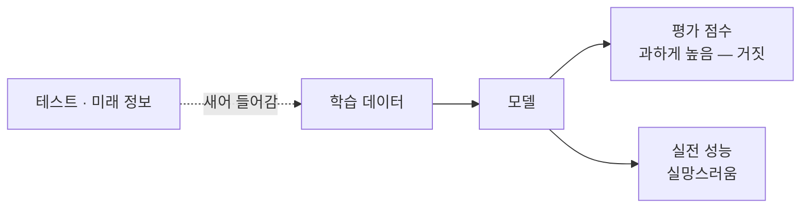

# Data Leakage (데이터 누수)

> **데이터 누수는 학습 때 원래 알 수 없어야 할 정보(정답의 흔적이나 미래 정보)가 모델에 새어 들어가, 평가 점수는 화려한데 실제로는 쓸모없는 모델이 되는 함정이다.**

## 시험 문제를 미리 훔쳐본 학생과 같다

모의고사에서 만점을 받았는데 정작 실전에서 무너지는 학생이 있다. 알고 보니 **모의고사 문제와 답을 미리 봤던 것이다.** 데이터 누수가 딱 이 상황이다. 모델이 평가 데이터의 정보를 학습 단계에서 몰래 엿봤기 때문에, 평가 점수는 놀랍게 높지만 진짜 처음 보는 데이터 앞에서는 형편없다.

이것은 정보보안에서 말하는 "기밀 유출"과는 **전혀 다른 개념**이다. 여기서 "누수"는 나쁜 사람이 데이터를 훔치는 게 아니라, **평가 파이프라인 안에서 정보가 잘못된 방향으로 흘러 성능을 부풀리는 것**을 뜻한다.

## 정답의 흔적이나 미래 정보가 특징으로 스며들 때 생긴다

누수는 은근하게 파고들어 잡아내기 어렵다. 대표적인 통로는 이렇다.

| 유형 | 예시 |
|------|------|
| 타깃 누수 | 예측하려는 정답이 사실상 특징 안에 들어 있음. 예: "환자가 항암제를 처방받았는가"로 암 진단을 예측 — 진단 결과가 처방을 결정하므로 사실상 정답을 본 셈 |
| 미래 정보 누수 | 예측 시점에는 알 수 없는 미래 값을 특징으로 씀. 시계열에서 흔함 |
| 전처리 누수 | 정규화·결측치 대치의 통계를 전체 데이터로 계산한 뒤 분할. 테스트의 평균·분산이 학습에 스며듦 |
| 중복·분할 누수 | 같은 개체가 학습과 테스트에 나뉘어 들어감. 예: 같은 환자의 사진이 양쪽에 존재 |

막는 원칙은 하나다. **테스트 데이터는 평가 순간까지 완전히 격리한다.** [학습/테스트 분할](TrainTest_Split.md)을 가장 먼저 하고, 정규화 같은 전처리는 **학습 데이터에서 구한 통계를 테스트에 그대로 적용**한다. [교차 검증](CrossValidation.md)에서도 전처리를 각 폴드 안쪽에서 수행해야 한다.

> ⚠️ **흔한 오해 — "검증 점수가 아주 높으면 모델이 훌륭한 것이다."**
>
> 지나치게 완벽한 점수(예: 정확도 99.9%)는 오히려 누수를 의심할 신호다. 실제 문제가 그렇게 쉬운 경우는 드물다. 점수가 비현실적으로 좋으면 축하하기 전에 **어디선가 정답을 미리 본 것은 아닌지** 파이프라인을 되짚어야 한다.

## 정리하면

- 데이터 누수는 **알 수 없어야 할 정보가 학습에 새어 들어가** 평가 점수를 거짓으로 부풀리는 문제다.
- 정보보안의 기밀 유출이 아니라, **평가 파이프라인 안의 정보 흐름 오류**다.
- 타깃 누수, 미래 정보, 전처리 통계 공유, 개체 중복이 주요 통로다.
- 막으려면 **테스트를 먼저 격리하고**, 모든 전처리 통계는 학습 데이터에서만 구해 적용한다.

## 함께 읽기

- [Train/Test Split](TrainTest_Split.md) — 누수를 막는 첫 단추, 데이터를 먼저 갈라 두기.
- [Cross-Validation](CrossValidation.md) — 폴드 안에서 전처리를 해야 누수가 없다.
- [Validation Set](Validation_Set.md) — 격리된 데이터로 정직하게 성능을 재는 도구.
- [Overfitting](Overfitting.md) — 둘 다 평가 점수를 오해하게 만들지만 원인이 다르다.
- [Feature Engineering](Feature_Engineering.md) — 특징을 만들 때 정답의 흔적이 섞이지 않게 조심해야 한다.
