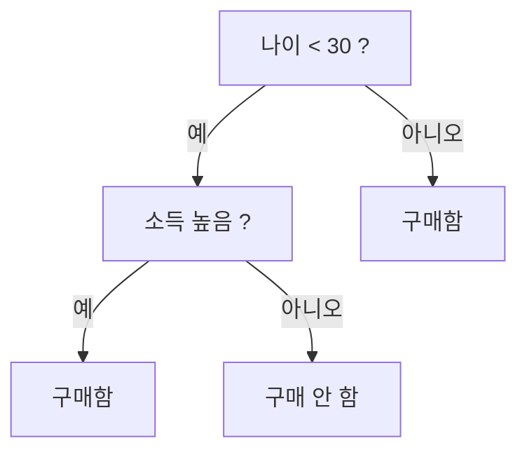

# Decision Tree (의사결정 트리)

> **의사결정 트리는 "예/아니오" 질문을 계단처럼 이어가며 데이터를 갈라, 마지막 잎에서 답을 내리는 모델이다.**

## 스무고개와 똑같다

"동물인가?" → "네" → "다리가 넷인가?" → "네" → "짖는가?" → "개". 이렇게 **질문을 던질 때마다 후보가 좁혀지는 스무고개**가 곧 의사결정 트리다. 각 질문이 노드, 답에 따라 갈라지는 길이 가지, 최종 결론이 잎(leaf)이다.

가장 큰 장점은 **사람이 그대로 읽을 수 있다**는 것이다. "소득이 X 이상이고 근속이 Y 이상이면 대출 승인" 같은 규칙이 그림에서 바로 보인다. [설명가능성](Explainable_AI___XAI.md)이 중요한 곳에서 사랑받는 이유다.

## 좋은 질문을 고르는 기준

트리는 매 단계에서 데이터를 가장 깔끔하게 갈라주는 질문을 고른다. "깔끔함"은 [엔트로피](Entropy.md)나 지니 불순도로 재며, 이 값을 가장 많이 낮추는 질문(정보 이득이 큰 질문)을 먼저 던진다.

## 흔한 오해

> ⚠️ **흔한 오해 — "트리는 깊게 키울수록 똑똑해진다."**
>
> 깊이 키우면 학습 데이터의 잡음까지 다 외워 [과적합](Overfitting.md)된다. 그래서 가지치기(pruning)로 깊이를 제한하거나, 여러 트리를 모아 쓰는 [랜덤 포레스트](Random_Forest.md)·[그래디언트 부스팅](Gradient_Boosting.md)으로 보완한다.

## 정리하면

- 의사결정 트리는 **질문을 이어 데이터를 가르는** 스무고개식 모델이다.
- 규칙이 그대로 보여 **해석이 쉽다.**
- 정보 이득이 큰 질문을 먼저 고르고, 너무 깊으면 과적합한다.
- 앙상블([랜덤 포레스트]·부스팅)로 약점을 메운다.

## 함께 읽기

- [Random Forest](Random_Forest.md) — 트리 여러 그루를 모은 앙상블.
- [Gradient Boosting](Gradient_Boosting.md) — 트리를 순차로 쌓아 오차를 줄이는 방법.
- [Entropy](Entropy.md) — 어떤 질문이 좋은지 재는 기준.
- [Overfitting](Overfitting.md) — 트리를 깊게 키울 때 생기는 문제.
