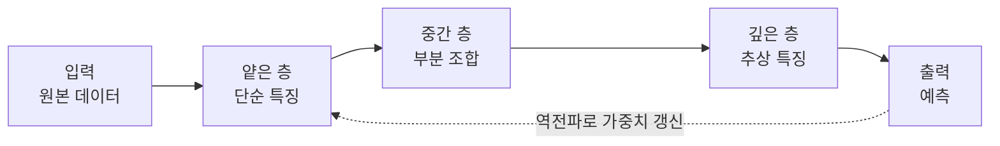

# Deep Learning (딥 러닝)

> **딥 러닝은 여러 층을 쌓은 신경망으로, 사람이 특징을 일일이 설계하지 않아도 데이터에서 단순한 특징부터 복잡한 특징까지 스스로 층층이 학습하는 머신러닝의 한 갈래다.**

## 특징을 직접 알려 주는 대신, 층을 쌓아 스스로 발견하게 한다

고양이 사진을 구분하는 프로그램을 짠다고 하자. 전통적인 방식은 사람이 "귀 모양은 이렇고 수염은 저렇다"를 직접 규칙으로 짜 넣어야 했다. **딥 러닝은 이 특징 설계 자체를 기계에 맡긴다.** 층을 깊게 쌓으면, 앞쪽 층은 모서리·색 같은 단순한 특징을, 뒤쪽 층은 그것들을 조합한 눈·얼굴 같은 복잡한 특징을 자동으로 잡아낸다. **"깊다(deep)"는 말은 바로 이 층이 여러 겹이라는 뜻이다.**

딥 러닝은 [머신러닝](Machine_Learning.md)의 부분집합이고, 머신러닝은 다시 인공지능의 부분집합이다. 딥 러닝을 특별하게 만든 건 이 **특징을 손으로 뽑는 단계(feature engineering)를 대체**한 점이다.

## 층으로 표현을 쌓고, 역전파로 학습한다

동작의 뼈대는 [신경망](Neural_Network.md)과 같되, 층이 깊다.

1. 입력이 층을 지나며 점점 추상적인 특징으로 변환된다.
2. 마지막 층이 예측을 낸다.
3. 예측과 정답의 차이를 [손실 함수](Loss_Function.md)로 잰다.
4. [역전파](Backpropagation.md)로 각 가중치의 기울기를 구하고, 옵티마이저가 가중치를 갱신한다.
5. 이 과정을 대량의 데이터로 반복한다.

딥 러닝이 2010년대 들어 꽃핀 데는 세 가지가 맞물렸다. **대규모 데이터, GPU 같은 병렬 연산 하드웨어, 그리고 [ReLU](ReLU.md)·[Batch Normalization](Batch_Normalization.md) 같은 깊은 망 학습 기법**이다. 이론은 오래됐지만, 이 셋이 갖춰지고서야 실용화됐다.

## 흔한 오해

> ⚠️ **흔한 오해 — "딥 러닝은 층만 깊으면 항상 머신러닝보다 낫다."**
>
> 그렇지 않다. 딥 러닝은 데이터가 많고 이미지·음성·언어처럼 특징이 복잡할 때 진가를 낸다. 데이터가 적거나 표 형태의 정형 데이터에서는 [Random Forest](Random_Forest.md)·[Gradient Boosting](Gradient_Boosting.md) 같은 전통 기법이 더 정확하고 빠른 경우가 흔하다. 깊이는 목적이 아니라 도구다.

## 정리하면

- 딥 러닝은 **여러 층으로 특징을 자동 학습**하는 머신러닝의 한 갈래다.
- 사람이 특징을 설계하던 단계를 층의 깊이로 대체한 것이 핵심 차별점이다.
- 학습 엔진은 다른 신경망과 같은 **손실 → 역전파 → 갱신**이다.
- 데이터·연산·학습 기법이 함께 갖춰지면서 실용화됐고, 만능은 아니다.

## 함께 읽기

- [Neural Network](Neural_Network.md) — 딥 러닝의 기본 단위.
- [Machine Learning](Machine_Learning.md) — 딥 러닝을 포함하는 상위 분야.
- [Backpropagation](Backpropagation.md) — 깊은 망을 학습시키는 핵심 알고리즘.
- [Convolutional Neural Network - CNN](Convolutional_Neural_Network___CNN.md) — 이미지에 특화된 대표 딥 러닝 구조.
- [Overfitting](Overfitting.md) — 표현력이 큰 딥 러닝이 특히 조심해야 할 함정.
