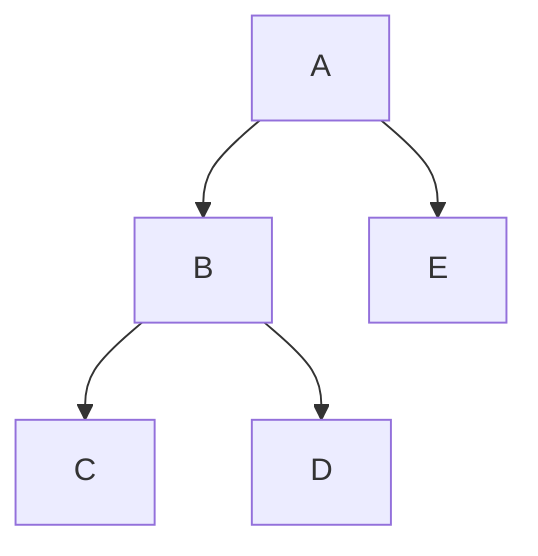

# Depth First Search (깊이우선 탐색)

> **깊이우선 탐색(DFS)은 갈림길에서 한 길을 골라 끝까지 파고들고, 막히면 되돌아와 다른 길을 파는 그래프·트리 탐색법이다.**

## 미로에서 한 손을 벽에 붙이고 끝까지 간다

미로를 탐험할 때 "일단 한 방향으로 갈 수 있는 데까지 가고, 막다른 골목이면 마지막 갈림길로 되돌아온다." 이 전략이 DFS다. 넓게 두리번거리지 않고 **깊이부터 파고드는 것**이 핵심이다.

되돌아오는 동작이 [역추적(백트래킹)](Backtracking.md)이고, "어디까지 왔는지"를 기억하는 도구가 **스택**이다. 재귀 함수로 짜면 호출 스택이 그 역할을 대신한다.

위 트리에서 DFS 방문 순서는 `A → B → C → D → E`다. B의 밑(C, D)을 먼저 다 파고 나서야 E로 넘어간다.

## 흔한 오해

> ⚠️ **흔한 오해 — "DFS로 찾은 경로가 최단 경로다."**
>
> 아니다. DFS는 먼저 닿는 길을 반환할 뿐 **최단을 보장하지 않는다.** 최단 경로가 필요하면 층별로 훑는 [너비우선 탐색(BFS)](Breadth_First_Search.md)이나 [A* 알고리즘](A_Algorithm.md)을 쓴다. 또 그래프에 사이클이 있으면 방문 표시를 안 할 경우 무한 루프에 빠진다.

## DFS vs BFS

| | DFS | [BFS](Breadth_First_Search.md) |
|---|-----|-----|
| 자료구조 | 스택(재귀) | 큐 |
| 성향 | 깊이 먼저 | 너비 먼저 |
| 최단 경로 | 보장 안 함 | 가중치 없으면 보장 |
| 메모리 | 대체로 적음 | 넓은 층에서 많이 씀 |

## 정리하면

- DFS는 **한 길을 끝까지 파고, 막히면 되돌아오는** 탐색이다.
- 스택(또는 재귀)과 백트래킹으로 동작한다.
- 최단 경로는 보장하지 않으니 그럴 땐 BFS·A*를 쓴다.

## 함께 읽기

- [Breadth First Search](Breadth_First_Search.md) — 너비부터 훑는 짝 알고리즘.
- [Backtracking](Backtracking.md) — 막히면 되돌아오는 DFS의 핵심 동작.
- [A* Algorithm](A_Algorithm.md) — 휴리스틱으로 최단 경로를 노리는 탐색.
- [State Space](State_Space.md) — 탐색이 훑는 상태들의 공간.
