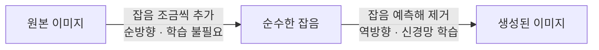

# Diffusion Model (확산 모델)

> **확산 모델은 데이터에 잡음을 조금씩 더해 완전한 잡음으로 망가뜨리는 과정을 거꾸로 되돌리도록 학습해, 순수한 잡음에서 이미지를 만들어내는 생성 모델이다.**

## 잡음 속에서 그림을 되살리는 복원가와 같다

TV 화면 가득한 지지직거리는 노이즈를 떠올려 보자. 여기서 잡음을 아주 조금 걷어내면 흐릿한 형체가 비치고, 또 걷어내면 조금 더 또렷해진다. 이 걷어내기를 수십 번 반복하면 결국 선명한 그림이 나타난다. **확산 모델이 바로 이 복원가다.** 무의미한 잡음에서 시작해, 학습해 둔 "잡음 걷어내는 법"을 여러 단계 적용하며 이미지를 서서히 떠오르게 한다.

똑똑한 점은 **학습 문제를 뒤집어 만든 것**이다. 깨끗한 이미지를 점점 망가뜨리는 일(잡음 추가)은 쉽고 규칙이 명확하다. 그렇다면 그 반대 방향, 즉 망가진 것을 되돌리는 법을 배우게 하면 결국 무에서 그림을 그리는 능력이 된다.

## 순방향으로 망가뜨리고, 역방향으로 되살린다

확산 모델은 두 방향의 과정으로 이뤄진다.

- **순방향 과정 (forward)** — 원본 이미지에 가우시안 잡음을 조금씩, 여러 단계에 걸쳐 더한다. 마지막에는 순수한 잡음만 남는다. 여기엔 학습할 게 없다. 정해진 규칙일 뿐이다.
- **역방향 과정 (reverse)** — 각 단계에서 **"지금 이 이미지에 섞인 잡음이 무엇인지"**를 예측하도록 신경망을 학습시킨다. 이 예측을 써서 잡음을 한 겹씩 벗겨 나간다.

생성할 때는 순수한 잡음에서 출발해 이 **역방향 단계를 수십~수백 번 반복**한다. 텍스트로 이미지를 만들 때는 "고양이 그림"이라는 문장의 [임베딩](Embedding.md)을 조건으로 넣어, 잡음 제거가 그 방향을 향하도록 이끈다.

Stable Diffusion으로 대표되는 **잠재 확산(latent diffusion)**은 여기서 한 걸음 더 나간다. 픽셀이 아니라 [오토인코더](Autoencoder.md)로 압축한 작은 잠재 공간에서 확산을 돌려 계산량을 크게 줄인다.

## 흔한 오해

> ⚠️ **흔한 오해 — "확산 모델은 잡음을 넣었다 빼면서 원본을 그대로 복원하는 것이다."**
>
> 목표는 특정 원본의 복원이 아니라 **잡음을 걷어내는 일반 능력**을 배우는 것이다. 그 능력이 생기면 어떤 잡음에서 출발하든 그럴듯한 새 이미지를 만들어낸다. 복원이 아니라 창작이다.

## GAN과 견주면

한때 이미지 생성을 지배하던 [GAN](Generative_Adversarial_Network___GAN.md)과 자주 비교된다.

| | Diffusion Model | GAN |
|---|---|---|
| 학습 안정성 | 상대적으로 안정적 | 두 신경망의 균형이 무너지기 쉬움 |
| 생성 품질·다양성 | 높은 품질과 다양성 | 품질은 높으나 다양성 붕괴(mode collapse) 위험 |
| 생성 속도 | 여러 단계라 느림 | 한 번에 생성해 빠름 |

## 정리하면

- 확산 모델은 **잡음 추가를 되돌리는 법**을 배워, 순수 잡음에서 이미지를 만든다.
- 순방향(망가뜨리기)은 규칙이고, 역방향(되살리기)만 신경망이 학습한다.
- 생성은 잡음 제거를 여러 단계 반복하는 것이며, 텍스트 조건으로 방향을 잡는다.
- GAN보다 학습이 안정적이고 품질·다양성이 좋은 대신 느리다.

## 함께 읽기

- [Generative Adversarial Network - GAN](Generative_Adversarial_Network___GAN.md) — 확산 모델 이전의 대표 이미지 생성 방식. 장단점이 뚜렷이 대비된다.
- [Autoencoder](Autoencoder.md) — 잠재 확산이 확산을 돌리는 압축된 잠재 공간을 만든다.
- [Multimodal AI](Multimodal_AI.md) — 텍스트를 조건으로 이미지를 만드는 멀티모달 생성의 핵심 엔진.
- [Embedding](Embedding.md) — 텍스트 조건을 벡터로 바꿔 생성 방향을 이끄는 재료.
