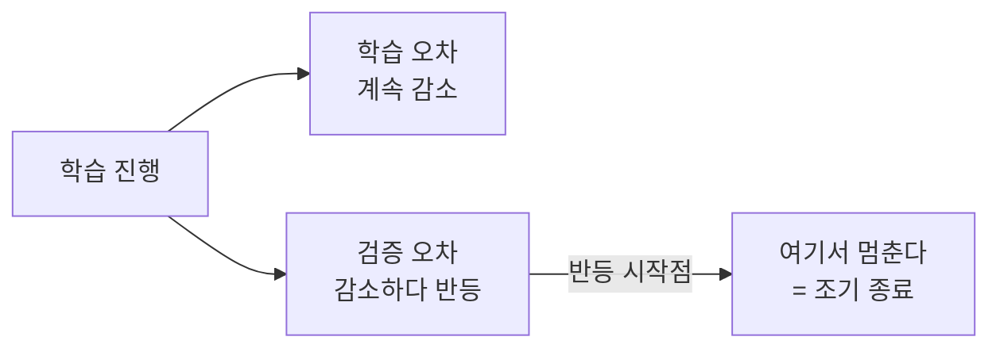

# Early Stopping (조기 종료)

> **조기 종료는 검증 성능이 더는 좋아지지 않는 순간 학습을 멈춰, 모델이 데이터를 외우기 시작하기 직전에 손을 떼는 기법이다.**

## 라면을 딱 알맞게 끓이고 불을 끄는 것과 같다

라면은 너무 덜 끓여도, 너무 오래 끓여도 맛이 없다. 가장 맛있는 순간에 불을 꺼야 한다. **모델 학습도 마찬가지다.** 학습을 오래 할수록 학습 데이터에 대한 오차는 계속 줄지만, 어느 지점을 지나면 처음 보는 데이터에 대한 성능([검증 오차](Validation_Set.md))은 오히려 나빠지기 시작한다. 이 지점이 모델이 규칙 대신 잡음을 외우기 시작하는, 즉 [과적합](Overfitting.md)이 시작되는 곳이다. 조기 종료는 바로 그 직전에 불을 끄는 것이다.

## 검증 성능이 개선을 멈추면 멈춘다

작동 방식은 단순하다.

1. 매 [에포크](Epoch.md)마다 학습에 쓰지 않은 [검증 데이터](Validation_Set.md)로 성능(손실이나 정확도)을 잰다.
2. 검증 성능이 갱신될 때마다 그 시점의 모델 가중치를 따로 저장해 둔다.
3. 검증 성능이 정해둔 횟수(**patience**, 인내 횟수) 동안 나아지지 않으면 학습을 멈춘다.
4. 마지막 상태가 아니라 **가장 좋았던 시점의 가중치를 복원**해 최종 모델로 쓴다.

검증 성능은 매 에포크 출렁이기 때문에 곧바로 멈추지 않고 patience만큼 기다린다. "몇 에포크째 나아지지 않으면 포기한다"는 이 여유값이 조기 종료의 핵심 하이퍼파라미터다.

## 흔한 오해

> ⚠️ **흔한 오해 — "검증 성능이 한 번 떨어지면 바로 멈춰야 한다."**
>
> 검증 곡선은 잔물결처럼 흔들린다. 한 번 나빠졌다고 멈추면 우연한 출렁임에 속아 너무 일찍 그만두게 된다. 그래서 patience를 두고 여러 에포크를 지켜본 뒤 판단한다.

> 💡 **참고 — 조기 종료는 검증셋으로 성능을 재므로, 최종 성능 보고는 테스트셋으로 따로 해야 한다.**
>
> 멈출 시점을 검증셋으로 정한 이상, 검증 점수는 더 이상 순수한 미지의 데이터 성능이 아니다. 진짜 성능은 학습에도 검증에도 안 쓴 테스트셋으로 재야 한다.

## 정리하면

- 조기 종료는 **검증 성능이 정점을 찍는 시점**에서 학습을 멈추는 [과적합](Overfitting.md) 방지 기법이다.
- patience(인내 횟수)만큼 기다린 뒤, **가장 좋았던 가중치로 되돌려** 최종 모델로 쓴다.
- 학습 비용도 아끼는 일석이조지만, 멈출 시점을 검증셋으로 정하므로 최종 평가는 테스트셋으로 한다.

## 함께 읽기

- [Overfitting](Overfitting.md) — 조기 종료가 막으려는 바로 그 현상.
- [Validation Set](Validation_Set.md) — 멈출 시점을 판단하는 근거가 되는 데이터.
- [Epoch](Epoch.md) — 조기 종료가 세는 단위.
- [Regularization](Regularization.md) — 조기 종료와 함께 쓰는 대표적 과적합 억제 기법.
- [Learning Rate Scheduler](Learning_Rate_Scheduler.md) — 멈추는 대신 학습률을 줄여 수렴을 다듬는 접근.
