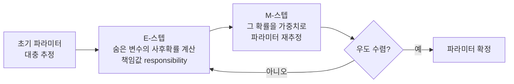

# Expectation Maximization Algorithm (기대치최대화 알고리즘)

> **EM 알고리즘은 정답(숨은 변수)을 모르는 채로, "지금 정답을 추정하고 → 그 추정으로 모델을 개선하기"를 번갈아 반복해 파라미터를 찾아내는 방법이다.**

## 닭이 먼저냐 달걀이 먼저냐를 번갈아 푼다

키만 적힌 사람들의 명단이 있는데, 남녀 성별은 지워졌다고 하자. 남녀 각각의 평균 키를 알고 싶다. 문제는 **성별(숨은 변수)을 알면 평균을 쉽게 구하고, 평균을 알면 성별을 추정하기 쉬운데, 둘 다 모른다**는 것이다. EM은 이 순환 고리를 이렇게 끊는다. 먼저 평균을 대충 찍는다 → 그 평균으로 각 사람이 남자일/여자일 **확률**을 매긴다(E) → 그 확률을 가중치로 평균을 다시 계산한다(M) → 다시 확률을 매긴다… 이 왕복을 반복하면 값이 안정된 지점으로 수렴한다.

여기서 지워진 성별 같은 것을 **잠재 변수(latent variable)** 라 부른다. 관측되지 않지만 데이터를 설명하는 숨은 요소다.

## E-스텝과 M-스텝을 번갈아 밟는다

- **E-스텝 (Expectation)**: 현재 파라미터를 고정한 채, 각 데이터가 어느 잠재 상태에 속할지 **사후확률(책임값)** 을 계산한다. 앞의 예에서 "이 사람이 남자일 확률 0.7" 같은 값이다.
- **M-스텝 (Maximization)**: E-스텝에서 얻은 책임값을 가중치로 삼아, **완전 데이터 로그우도의 기댓값을 최대화**하도록 파라미터(평균·분산·혼합 비율 등)를 다시 계산한다.

EM은 반복할 때마다 데이터의 우도(likelihood)가 **절대 감소하지 않음이 수학적으로 보장**된다. 그래서 반드시 수렴하지만, 도달점은 전역 최적이 아니라 **국소 최적**일 수 있다. 초기값에 따라 결과가 달라지는 이유다.

## 흔한 오해

> ⚠️ **흔한 오해 — "EM은 전역 최적해를 찾아 준다."**
>
> 아니다. EM은 우도를 매 단계 올려 주지만 국소 최적에 갇힐 수 있다. 그래서 초기값을 여러 번 바꿔 실행한 뒤 가장 좋은 결과를 고르는 방식을 흔히 쓴다. 또한 [K-means](Kmeans_Algorithm.md)는 각 점을 하나의 군집에 딱 잘라 배정하는 "하드" 방식인데, 이는 가우시안 혼합 모델에 EM을 적용한 것의 특수한 극한(hard-assignment) 경우로 볼 수 있다.

## 대표적으로 어디에 쓰나

- **가우시안 혼합 모델(GMM)**: EM의 가장 전형적인 예. 데이터가 여러 정규분포의 혼합이라 보고 각 분포를 추정한다(소프트 군집화).
- **[은닉 마르코프 모델](Hidden_Markov_Model.md)**: 파라미터 학습에 쓰이는 Baum-Welch가 EM의 한 형태다.
- **결측치 처리**: 빠진 값을 잠재 변수로 두고 추정한다.

## 정리하면

- EM은 잠재 변수가 있는 모델에서 **E-스텝(숨은 변수 추정)과 M-스텝(파라미터 재추정)을 번갈아** 반복해 최대우도 파라미터를 찾는다.
- 매 반복마다 우도가 줄지 않아 수렴이 보장되지만, **국소 최적**에 그칠 수 있어 초기값에 민감하다.
- GMM·HMM·결측치 추정 등 "정답을 모른 채 학습"해야 하는 문제의 핵심 도구다.

## 함께 읽기

- [K-means Algorithm](Kmeans_Algorithm.md) — EM의 하드-배정 특수 경우로 볼 수 있는 군집화.
- [Hidden Markov Model](Hidden_Markov_Model.md) — 파라미터 학습(Baum-Welch)이 EM으로 이뤄진다.
- [Clustering](Clustering.md) — EM으로 하는 소프트 군집화가 속하는 큰 갈래.
- [Bayesian Inference](Bayesian_Inference.md) — 사후확률로 숨은 변수를 다루는 확률적 추론의 뿌리.
