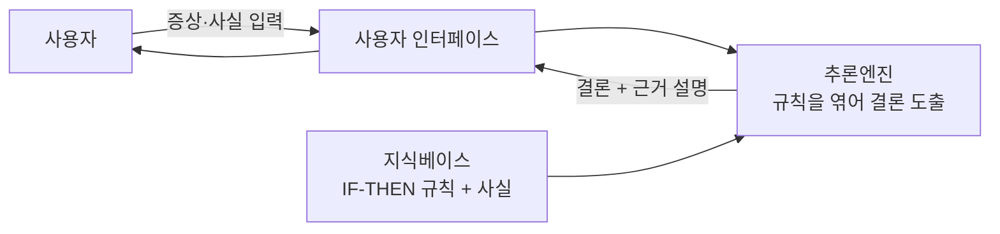

# Expert System (전문가 시스템)

> **전문가 시스템은 특정 분야 전문가의 지식을 `IF-THEN` 규칙 더미로 옮겨 담고, 추론엔진이 그 규칙을 엮어 전문가처럼 결론을 내리는 프로그램이다.**

## 사람 대신 규칙집을 뒤지는 상담사다

숙련된 의사는 머릿속에 "열이 나고 목이 부었으면 이런 병을 의심한다" 같은 경험칙 수천 개를 갖고 있다. **전문가 시스템은 이 경험칙을 컴퓨터가 읽을 수 있는 규칙으로 뽑아내 저장해 두고, 사용자의 상황에 맞는 규칙들을 자동으로 이어 붙여 답을 낸다.** 1970~80년대 AI의 대표 성과로, 혈액 감염을 진단한 **MYCIN**과 유기화합물 구조를 추정한 **DENDRAL**이 유명하다.

머신러닝이 데이터에서 스스로 규칙을 학습하는 것과 달리, **전문가 시스템의 지식은 사람이 손으로 넣는다.** 그래서 "왜 그런 결론인지"를 규칙을 되짚어 설명할 수 있다는 강점이 있다.

## 지식베이스와 추론엔진, 두 심장으로 돈다

전문가 시스템의 구조는 지식과 추론을 분리한 데 핵심이 있다.

| 구성 요소 | 하는 일 |
|-----------|---------|
| 지식베이스(Knowledge Base) | 전문가 지식을 `IF 조건 THEN 결론` 규칙과 사실로 담는다 |
| [추론엔진](Inference_Engine.md) | 규칙과 입력 사실을 맞물려 새 사실·결론을 끌어낸다 |
| 사용자 인터페이스 | 질문을 던지고, 결론과 그 근거를 되돌려 준다 |

추론엔진이 규칙을 엮는 방식은 크게 둘이다. 사실에서 출발해 규칙을 계속 발화시켜 결론으로 나아가는 **전방향 추론**, 그리고 목표 결론을 놓고 그것을 뒷받침할 규칙을 거꾸로 찾아가는 [역방향 추론](Backward_Chaining_Inference.md)이다. 규칙마다 [확신도](Certainty_Factor.md)를 달아 불확실한 판단도 다룬다.

> ⚠️ **흔한 오해 — "전문가 시스템도 데이터로 학습하는 AI다."**
>
> 아니다. 전문가 시스템은 **학습하지 않는다.** 지식은 사람이 규칙으로 넣어 주고, 시스템은 그 규칙을 적용할 뿐이다. 그래서 지식을 넣는 일(지식공학)이 병목이고, 규칙이 없는 상황엔 무력하다. 데이터에서 규칙을 스스로 찾는 머신러닝과는 대척점에 있다.

## 정리하면

- 전문가 시스템은 사람이 넣은 `IF-THEN` 규칙으로 전문가의 판단을 흉내 내는 프로그램이다.
- **지식베이스(규칙·사실) + 추론엔진 + 인터페이스**로 구성되며 지식과 추론을 분리한다.
- 추론엔진은 전방향·역방향으로 규칙을 엮고, 확신도로 불확실성을 다룬다.
- 스스로 학습하지 않으며, 결론의 근거를 규칙으로 설명할 수 있다는 것이 큰 장점이다.

## 함께 읽기

- [Inference Engine](Inference_Engine.md) — 규칙과 사실을 엮어 결론을 끌어내는 전문가 시스템의 엔진.
- [Rule-base Expert System](Rulebase_Expert_System.md) — 규칙 기반이라는 대표 유형을 더 자세히 다룬다.
- [Backward Chaining Inference](Backward_Chaining_Inference.md) — 목표에서 거꾸로 규칙을 찾는 추론 방식.
- [Certainty Factor](Certainty_Factor.md) — 규칙에 불확실성을 매기는 장치.
- [Knowledge Engineering](Knowledge_Engineering.md) — 전문가 지식을 규칙으로 뽑아내 넣는 작업.
