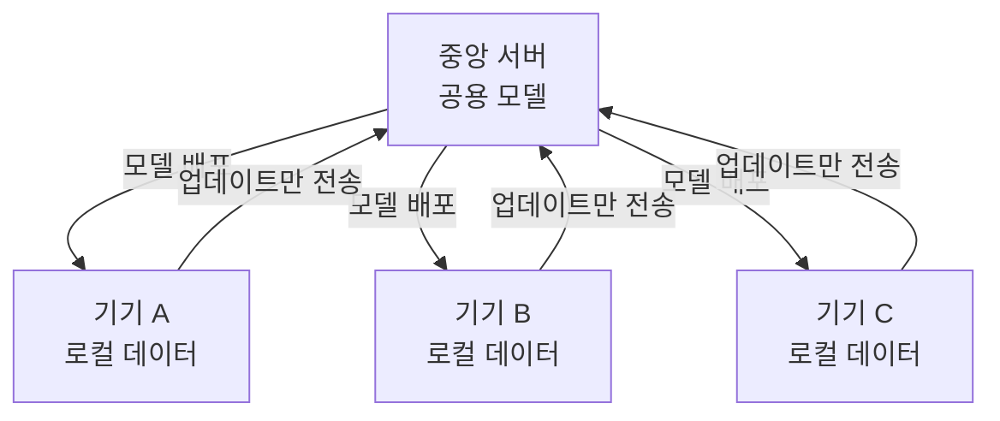

# Federated Learning (연합 학습)

> **연합 학습은 데이터를 중앙 서버로 모으지 않고, 각 기기에서 로컬로 학습한 모델 업데이트만 모아 하나의 공용 모델을 키우는 분산 학습 방식이다.**

## 데이터는 각자 두고, 배운 요약만 모으는 스터디 그룹과 같다

여러 병원이 각자의 환자 데이터로 공동 진단 모델을 만들고 싶지만, 환자 기록을 서로 넘겨줄 수는 없다. 이럴 때 **데이터는 각 병원에 그대로 두고, 그 데이터로 배운 "학습 결과(모델 가중치 변화)"만 중앙에 모아 합친다.** 원본은 병원 밖으로 한 발짝도 나가지 않는다. 연합 학습의 뼈대가 이것이다. 스마트폰 키보드가 사용자 입력을 서버로 보내지 않고도 자동완성을 개선하는 것이 대표 사례다.

**핵심 전환은 "데이터를 모델로 보내는" 대신 "모델을 데이터로 보내는" 것이다.** 이 뒤집기가 프라이버시를 지키는 열쇠다.

## 배포 → 로컬 학습 → 업데이트 집계를 반복한다

한 라운드는 다음 흐름이다.

1. **배포** — 서버가 현재 공용 모델을 각 클라이언트(기기)에 보낸다.
2. **로컬 학습** — 각 기기가 자기 데이터로 모델을 몇 스텝 학습한다.
3. **업데이트 전송** — 원본 데이터가 아니라 **가중치 변화(업데이트)만** 서버로 올린다.
4. **집계** — 서버가 업데이트들을 평균 내(FedAvg 등) 공용 모델을 갱신한다.
5. 개선된 모델로 다시 1번부터 반복한다.

> 💡 **참고 — 기기마다 데이터가 다르다 (non-IID)**
>
> 각 기기의 데이터는 사용자마다 분포가 제각각이라, 전체를 한데 섞은 것과 통계가 다르다(non-IID). 이 불균형은 학습을 어렵게 만드는 난점이자, 다양한 사용 맥락을 반영하는 자산이기도 하다. 연합 학습 연구의 상당 부분이 이 문제를 다룬다.

## 흔한 오해

> ⚠️ **흔한 오해 — "데이터를 안 보내니 프라이버시가 완벽하다."**
>
> 원본 데이터는 남지만, 올린 가중치 업데이트에서 일부 정보가 역으로 추정될 수 있다. 그래서 실제 시스템은 차등 프라이버시나 보안 집계(secure aggregation) 같은 장치를 덧붙인다. 연합 학습은 프라이버시의 완성이 아니라 강력한 출발점이다.

## 정리하면

- 연합 학습은 **데이터를 모으지 않고 모델 업데이트만 모아** 공용 모델을 학습한다.
- "데이터를 모델로" 대신 **"모델을 데이터로"** 보내는 뒤집기가 핵심이다.
- 배포 → 로컬 학습 → 업데이트 집계를 반복한다.
- 프라이버시에 유리하지만 완벽하진 않아, 추가 보호 장치와 함께 쓴다.

## 함께 읽기

- [Distributed Computing](Distributed_Computing.md) — 여러 기기에 학습을 나누는 기반 개념.
- [Privacy Preservation](Privacy_Preservation.md) — 연합 학습이 추구하는 목표이자 함께 쓰는 기법군.
- [Machine Learning](Machine_Learning.md) — 연합 학습이 분산 방식으로 수행하는 대상.
- [Transfer Learning](Transfer_Learning.md) — 한 곳에서 배운 지식을 다른 곳에 옮긴다는 인접 발상.
