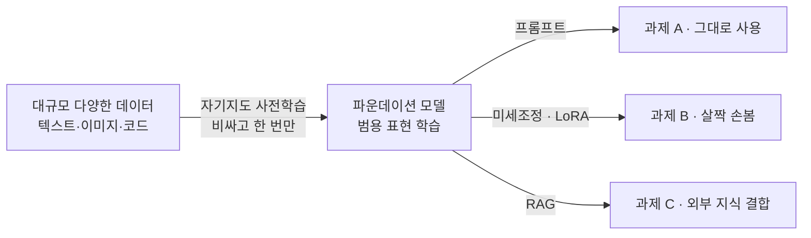

# Foundation Model (파운데이션 모델)

> **파운데이션 모델은 방대한 데이터로 한 번 크게 사전학습해 두면, 이후 온갖 하위 과제에 조금씩 손봐서 재활용하는 범용 토대 모델이다.**

## 특정 요리가 아니라 육수를 먼저 끓여두는 것이다

식당 주방을 떠올려 보자. 손님이 올 때마다 국물을 처음부터 끓이지 않는다. **진한 육수를 큰 솥에 한 번 끓여 두고, 주문에 따라 국수도 말고 찌개도 끓인다.** 파운데이션 모델이 바로 이 육수다. 엄청난 비용을 들여 한 번 잘 끓여두면, 번역·요약·분류·챗봇 같은 각각의 "요리"는 그 육수를 조금 손봐서 빠르게 만들 수 있다.

이 이름은 2021년 스탠퍼드 연구진이 붙였다. 핵심은 **"넓은 데이터로 대규모 자기지도 학습을 한 뒤, 다양한 하위 과제에 적응(adaptation)시킬 수 있는 모델"**이라는 점이다. 과거처럼 과제마다 모델을 처음부터 새로 학습하는 방식과 정반대다.

## 사전학습과 적응, 두 단계로 나뉜다

파운데이션 모델의 힘은 학습을 두 단계로 쪼갠 데서 온다.

- **사전학습(pretraining)**: 사람이 레이블을 붙이지 않은 방대한 데이터로 [자기지도 학습](SelfSupervised_Learning.md)한다. 비용이 막대하지만 한 번만 하면 된다.
- **적응(adaptation)**: 이렇게 얻은 범용 능력을 [Fine-tuning](Fine_Tuning.md), [LoRA](LoRA.md), [프롬프트 엔지니어링](Prompt_Engineering.md) 등으로 각 과제에 맞춘다. 값싸고 빠르다.

이 구조 덕분에 [소수 예제 학습](Fewshot_Learning.md)이나 [제로샷 학습](Zeroshot_Learning.md), 즉 예시 몇 개나 지시문만으로 새 과제를 푸는 일이 가능해졌다.

## 흔한 오해

> ⚠️ **흔한 오해 — "파운데이션 모델은 곧 LLM이다."**
>
> LLM은 파운데이션 모델의 한 종류일 뿐이다. 파운데이션 모델은 텍스트뿐 아니라 이미지, 오디오, 코드, 단백질 구조까지 어떤 데이터로든 만들 수 있다. 이미지 생성의 [확산 모델](Diffusion_Model.md), 이미지·텍스트를 함께 다루는 [멀티모달 AI](Multimodal_AI.md)도 파운데이션 모델 계열이다. **"텍스트로 만든 파운데이션 모델 = LLM"** 정도로 이해하면 맞다.

## 무엇이 달라졌나

| | 과거 방식 | 파운데이션 모델 방식 |
|--|----------|---------------------|
| 학습 단위 | 과제마다 모델 새로 학습 | 한 번 사전학습 후 재활용 |
| 필요한 레이블 데이터 | 과제마다 많이 | 적응 단계에서 조금 |
| 새 과제 대응 | 처음부터 다시 | 프롬프트·미세조정으로 즉시 |

이는 [전이 학습](Transfer_Learning.md)의 아이디어를 극한까지 밀어붙인 것이다. 한 번 배운 표현을 여러 과제로 옮겨 쓴다는 발상 자체는 전이 학습에서 왔다.

## 정리하면

- 파운데이션 모델은 **한 번 크게 사전학습해 여러 과제에 재활용하는 범용 토대**다.
- 학습은 비싼 **사전학습** 한 번과 값싼 **적응** 여러 번으로 나뉜다.
- LLM은 텍스트 영역의 파운데이션 모델이며, 이미지·멀티모달 등 다른 영역도 있다.
- 전이 학습 발상을 초거대 규모로 실현한 것이 핵심이다.

## 함께 읽기

- [Large Language Model - LLM](Large_Language_Model___LLM.md) — 텍스트로 만든 대표적 파운데이션 모델.
- [Transfer Learning](Transfer_Learning.md) — 파운데이션 모델이 딛고 선 "재활용" 발상.
- [Self-Supervised Learning](SelfSupervised_Learning.md) — 레이블 없이 방대한 데이터를 학습하는 사전학습의 원리.
- [Fine-tuning](Fine_Tuning.md) — 사전학습된 모델을 특정 과제에 적응시키는 대표 방법.
- [Multimodal AI](Multimodal_AI.md) — 여러 종류의 데이터를 함께 다루는 파운데이션 모델.
