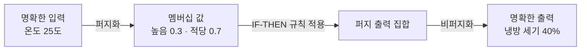

# Fuzzy Logic (퍼지 논리)

> **퍼지 논리는 참(1)과 거짓(0) 사이의 "어느 정도 참"을 0과 1 사이의 값으로 다루는 논리 체계다.**

## "덥다"와 "안 덥다" 사이에는 넓은 회색지대가 있다

기온이 30도면 "덥다", 29.9도면 "안 덥다"고 딱 잘라 말하는 사람은 없다. 사람은 "좀 덥다", "꽤 덥다"처럼 **정도**로 느낀다. 그런데 고전 논리는 모든 명제를 참 아니면 거짓, 딱 두 값으로만 본다. **퍼지 논리는 이 이분법을 늘려, 참의 정도를 0과 1 사이 연속값으로 표현한다.** "덥다가 0.7만큼 참"처럼 말할 수 있게 된다.

퍼지 논리는 1965년 로트피 자데(Lotfi Zadeh)가 [퍼지 집합](Fuzzy_Set.md) 개념과 함께 제안했다. 핵심 도구는 원소가 집합에 "얼마나" 속하는지를 0~1로 돌려주는 **멤버십 함수(membership function)**다. 예컨대 온도 25도가 "높음" 집합에 0.3, "적당함" 집합에 0.7만큼 속할 수 있다.

## 퍼지 제어는 퍼지화 → 규칙 → 비퍼지화의 3단계로 돈다

퍼지 논리가 실제로 쓰이는 전형은 **퍼지 제어기**다. 흐름은 다음과 같다.

1. **퍼지화(fuzzification)** — 센서가 준 명확한 숫자를 멤버십 값으로 바꾼다.
2. **규칙 평가** — "IF 온도가 높으면 THEN 냉방을 세게"처럼 사람 말에 가까운 규칙을 적용한다. 여러 규칙의 결과를 퍼지 AND(최솟값)·OR(최댓값) 같은 연산으로 합친다.
3. **비퍼지화(defuzzification)** — 합쳐진 퍼지 출력을 다시 하나의 명확한 숫자(예: 냉방 세기 40%)로 바꾼다. 무게중심법이 흔히 쓰인다.

규칙을 사람 언어로 적을 수 있어, 수식 모델을 세우기 어려운 대상(에어컨·세탁기·엘리베이터 제어 등)에 강하다.

## 흔한 오해

> ⚠️ **흔한 오해 — "퍼지 논리는 확률이다."**
>
> 아니다. 확률은 "이 사건이 일어날 가능성"을 다루고, 퍼지 멤버십은 "이 대상이 어떤 개념에 속하는 정도"를 다룬다. "물이 신선할 확률 0.8"과 "물이 신선한 정도 0.8"은 다른 이야기다. 퍼지 값은 불확실성이 아니라 **경계의 모호함**을 표현한다. 확률적 불확실성을 다루려면 [베이즈 추론](Bayesian_Inference.md)이 맞다.

## 정리하면

- 퍼지 논리는 참/거짓 이분법을 **0~1 사이 참의 정도**로 확장한 논리다.
- 원소가 집합에 속하는 정도는 **멤버십 함수**로 정한다.
- 실제 응용은 **퍼지화 → 규칙 평가 → 비퍼지화**의 3단계 제어로 돈다.
- 확률과 다르다. 퍼지는 **가능성이 아니라 경계의 모호함**을 다룬다.

## 함께 읽기

- [Fuzzy Set](Fuzzy_Set.md) — 퍼지 논리의 토대가 되는 집합 개념.
- [Fuzzy Inference](Fuzzy_Inference.md) — 퍼지 규칙으로 결론을 끌어내는 추론 과정.
- [Bayesian Inference](Bayesian_Inference.md) — 모호함이 아니라 확률적 불확실성을 다루는 대조 개념.
- [Expert System](Expert_System.md) — 퍼지 규칙이 자주 결합되는 규칙 기반 시스템.
