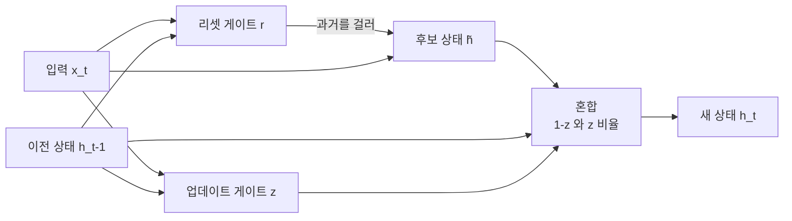

# GRU (Gated Recurrent Unit)

> **GRU는 두 개의 게이트만으로 과거 정보를 얼마나 지우고 얼마나 이어갈지 조절하는, LSTM을 간소화한 순환 신경망 셀이다.**

## 두 개의 다이얼로 기억을 조절하는 LSTM의 경량판

[LSTM](Long_ShortTerm_Memory___LSTM.md)이 게이트 세 개와 별도의 셀 상태로 기억을 정교하게 다뤘다면, GRU는 같은 문제를 **더 적은 부품으로** 푼다. 게이트를 둘로 줄이고 셀 상태와 은닉 상태를 하나로 합쳤다. 부품이 줄어든 만큼 파라미터가 적고 학습이 빠르며, 성능은 많은 과제에서 LSTM에 필적한다.

GRU에는 다이얼이 둘 있다고 생각하면 쉽다. 하나는 "옛 기억을 지금 계산에서 얼마나 무시할까"를 정하고, 다른 하나는 "옛 기억과 새 기억을 어떤 비율로 섞을까"를 정한다.

## 리셋 게이트와 업데이트 게이트가 은닉 상태를 갱신한다

매 시점 `t`에서 GRU는 현재 입력 `x_t`와 이전 은닉 상태 `h_{t-1}`을 받아 다음을 계산한다.

- **리셋 게이트 `r`** — 이전 은닉 상태를 **후보 계산에서 얼마나 무시할지** 정한다. `r`이 0에 가까우면 과거를 거의 버리고 현재 입력에 집중한다.
- **업데이트 게이트 `z`** — 이전 상태 `h_{t-1}`과 새 후보 상태를 **어떤 비율로 섞을지** 정한다. `z`가 1에 가까우면 과거를 거의 그대로 유지하고, 0에 가까우면 새 후보로 갈아 끼운다.

```
r = σ(W_r · [h_{t-1}, x_t])          # 리셋 게이트
z = σ(W_z · [h_{t-1}, x_t])          # 업데이트 게이트
h̃ = tanh(W · [r ⊙ h_{t-1}, x_t])    # 후보 상태 (r로 과거를 걸러서 계산)
h_t = (1 − z) ⊙ h̃ + z ⊙ h_{t-1}     # 과거와 후보의 가중 혼합
```

여기서 `σ`는 [시그모이드](Sigmoid.md)(게이트를 0~1로), `⊙`는 원소별 곱이다. 두 게이트 모두 **입력과 이전 은닉 상태로부터 학습된 가중치로 계산된다.**



## GRU와 LSTM 중 무엇을 쓰나

| 기준 | GRU | LSTM |
|------|-----|------|
| 게이트 수 | 2개 (리셋·업데이트) | 3개 (입력·망각·출력) |
| 상태 | 은닉 상태 하나 | 은닉 상태 + 셀 상태 |
| 파라미터·속도 | 적고 빠름 | 많고 느림 |
| 강점 | 데이터가 적거나 빠른 학습이 필요할 때 | 아주 긴 의존성을 세밀히 다룰 때 |

**어느 쪽이 항상 낫다고 단정할 수 없다.** 과제와 데이터에 따라 실험으로 고르는 것이 정석이다.

## 흔한 오해

> ⚠️ **흔한 오해 — "GRU는 게이트가 적으니 LSTM보다 성능이 떨어진다."**
>
> 게이트 수가 성능 순위를 정하지 않는다. 여러 벤치마크에서 GRU는 LSTM과 비슷하거나 더 나은 결과를 내며, 파라미터가 적어 오히려 과적합에 강하고 학습이 빠른 경우가 많다.

## 정리하면

- GRU는 **리셋·업데이트 두 게이트**로 기억을 조절하는 간소화된 순환 셀이다.
- 리셋 게이트는 후보 계산 시 과거를 걸러내고, 업데이트 게이트는 과거와 후보를 섞는 비율을 정한다.
- LSTM과 달리 셀 상태 없이 **은닉 상태 하나**만 유지한다.
- 파라미터가 적어 빠르지만, LSTM보다 항상 낫거나 못하다고 할 수는 없다.

## 함께 읽기

- [Long Short-Term Memory – LSTM](Long_ShortTerm_Memory___LSTM.md) — GRU가 간소화한 원형. 게이트 구조를 비교하며 읽으면 좋다.
- [Recurrent Neural Network – RNN](Recurrent_Neural_Network___RNN.md) — GRU가 개선하려는 기본 순환 신경망.
- [Sigmoid](Sigmoid.md) — 게이트 값을 0~1로 눌러 주는 활성화 함수.
- [Activation Function](Activation_Function.md) — 후보 상태에 쓰이는 tanh 등 비선형 함수의 큰 틀.
