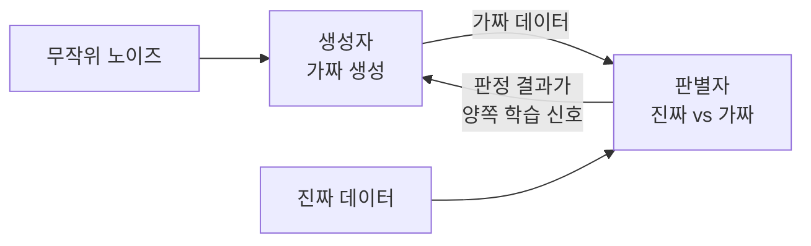

# Generative Adversarial Network - GAN (생성적 적대 신경망)

> **GAN은 가짜를 만드는 생성자와 진짜·가짜를 가려내는 판별자, 두 신경망을 서로 경쟁시켜 점점 진짜 같은 데이터를 만들어 내게 하는 구조다.**

## 위조범과 감정사의 끝없는 대결과 같다

위조지폐범(생성자)은 진짜 같은 위폐를 만들려 하고, 감정사(판별자)는 그것을 가려내려 한다. 감정사가 날카로워질수록 위조범은 더 정교해지고, 위조범이 정교해질수록 감정사도 더 예리해진다. **이 쫓고 쫓기는 경쟁이 계속되면, 위조범이 만든 위폐는 결국 진짜와 구별하기 어려워진다.** GAN은 이 대결을 그대로 두 신경망의 학습으로 옮긴 것이다.

- **생성자(Generator)** — 무작위 노이즈를 받아 가짜 데이터를 만든다.
- **판별자(Discriminator)** — 입력이 진짜 데이터인지 생성자의 가짜인지 판정한다.

두 망의 목표는 정반대다. 생성자는 판별자를 속이려 하고, 판별자는 안 속으려 한다. 이 **적대적(adversarial)** 긴장이 학습의 동력이다.

## 판별자가 채점하고, 그 신호가 생성자를 키운다

한 스텝의 흐름이다.

1. 생성자가 노이즈로 가짜 배치를 만든다.
2. 판별자에게 진짜 데이터와 가짜 데이터를 함께 보여 준다.
3. 판별자는 각각을 진짜/가짜로 판정하고, 틀린 만큼 벌점을 받아 학습한다.
4. 생성자는 **판별자가 가짜를 진짜로 착각하도록** 만드는 방향으로 학습한다. 즉 판별자의 판정 결과가 곧 생성자의 학습 신호가 된다.
5. 두 망을 번갈아 갱신하며 반복한다.

이 과정이 잘 수렴하면, 생성자는 진짜 데이터 분포를 흉내 낸 표본을 만들고 판별자는 반반 확률로밖에 못 맞히는 균형에 이른다.

## 흔한 오해

> ⚠️ **흔한 오해 — "학습이 오래될수록 GAN은 안정적으로 좋아진다."**
>
> GAN 학습은 두 망의 균형 잡기라 오히려 불안정하기로 악명 높다. 생성자가 몇 가지 그럴듯한 출력만 반복 생성하는 **모드 붕괴(mode collapse)**, 두 망의 힘이 안 맞아 학습이 무너지는 경우가 흔하다. 안정화를 위한 여러 변형(WGAN 등)이 나온 이유다.

## 정리하면

- GAN은 **생성자와 판별자의 경쟁**으로 진짜 같은 데이터를 만든다.
- 판별자의 판정이 생성자의 학습 신호가 되어, 서로를 밀어 올린다.
- 이미지 생성·데이터 증강 등에 강하지만, 학습이 불안정하고 모드 붕괴에 취약하다.
- 노이즈를 넣는 잠재 공간(latent space)을 탐색하면 다양한 출력을 얻는다.

## 함께 읽기

- [Autoencoder](Autoencoder.md) — 다른 계열의 생성/표현 모델. 목적과 방식이 대비된다.
- [Diffusion Model](Diffusion_Model.md) — GAN을 상당 부분 대체한 최신 생성 모델.
- [Neural Network](Neural_Network.md) — 생성자와 판별자의 기본 재료.
- [Data Augmentation](Data_Augmentation.md) — GAN이 새 표본으로 데이터를 늘리는 활용처.
- [Loss Function](Loss_Function.md) — 두 망의 경쟁을 수치로 정의하는 장치.
