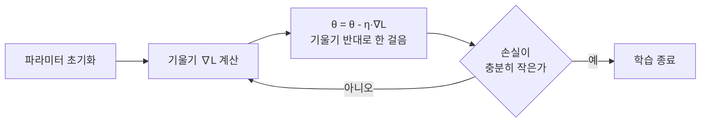

# Gradient Descent (기울기 하강)

> **기울기 하강법은 손실이 줄어드는 방향으로 파라미터를 조금씩 옮겨 가며 최솟값을 찾아가는 최적화 알고리즘이다.**

## 안개 낀 산에서 발밑 경사만 보고 내려가는 것과 같다

짙은 안개 속 산에 서 있다고 하자. 정상에서 골짜기로 내려가고 싶은데 시야가 발밑밖에 없다. 이때 할 수 있는 최선은 **지금 서 있는 자리에서 가장 가파르게 내려가는 방향을 골라 한 걸음 딛는 것**이다. 그 자리에서 다시 경사를 재고, 또 한 걸음. 이 단순한 반복이 기울기 하강법이다.

여기서 산의 높이가 **손실(loss)**이고, 내가 서 있는 위치가 **모델 파라미터**다. 손실이 낮은 골짜기에 도착하면 그 파라미터가 좋은 모델이 된다.

## 기울기의 반대 방향으로 학습률만큼 이동한다

기울기(gradient)는 손실이 **가장 빠르게 증가하는 방향**을 가리키는 벡터다. 그래서 손실을 줄이려면 그 반대 방향으로 가야 한다. 이걸 한 줄로 쓰면 이렇다.

```
θ = θ - η · ∇L(θ)
```

- `θ` — 파라미터(가중치·편향)
- `∇L(θ)` — 현재 파라미터에서의 손실 기울기
- `η`(에타) — **학습률(learning rate)**, 한 걸음의 보폭

핵심은 보폭인 학습률이다. **너무 크면 골짜기를 건너뛰며 발산하고, 너무 작으면 수렴이 한없이 느리다.** 적당한 값을 찾는 것이 학습의 기본기다.



## 한 걸음에 데이터를 얼마나 쓰느냐로 갈린다

기울기를 계산할 때 데이터를 얼마나 쓰는지에 따라 세 갈래로 나뉜다.

| 방식 | 한 번 업데이트에 쓰는 데이터 | 특징 |
|------|--------------------------|------|
| 배치 경사 하강 | 전체 데이터 | 방향이 정확하지만 한 걸음이 무겁고 느리다 |
| 확률적 경사 하강 ([SGD](SGD.md)) | 샘플 1개 | 걸음이 빠르고 요동치지만 지역 최소에서 잘 빠져나온다 |
| 미니배치 경사 하강 | 작은 묶음(예: 32·64개) | 둘의 절충. 실무의 표준이다 |

## 흔한 오해

> ⚠️ **흔한 오해 — "기울기 하강법은 항상 전역 최솟값을 찾는다."**
>
> 손실 곡면이 볼록(convex)할 때만 전역 최솟값이 보장된다. 신경망의 손실 곡면은 울퉁불퉁해서 **지역 최소나 안장점(saddle point)에 머물 수 있다.** 실무에서는 그런 지점도 대개 성능이 쓸 만해서 문제가 되지 않을 뿐, 이론적 보장이 있는 것은 아니다.

## 정리하면

- 기울기 하강법은 **기울기의 반대 방향으로 학습률만큼** 파라미터를 옮기는 반복 알고리즘이다.
- 갱신 규칙은 `θ = θ - η·∇L(θ)` 한 줄로 압축된다.
- 학습률이 보폭을 정한다. 크면 발산, 작으면 굼뜨다.
- 데이터를 얼마나 쓰느냐로 배치·SGD·미니배치로 나뉜다.
- 볼록하지 않은 곡면에서는 전역 최솟값이 보장되지 않는다.

## 함께 읽기

- [Backpropagation](Backpropagation.md) — 신경망에서 기울기 `∇L`를 실제로 계산하는 방법.
- [Loss Function](Loss_Function.md) — 하강시키려는 대상인 손실을 정의한다.
- [SGD](SGD.md) — 샘플 하나씩 쓰는 기울기 하강의 대표 변형.
- [Optimizer](Optimizer.md) — 기울기 하강을 개선한 갱신 규칙들의 총칭.
- [Learning Rate Scheduler](Learning_Rate_Scheduler.md) — 학습 도중 보폭을 조절하는 기법.
