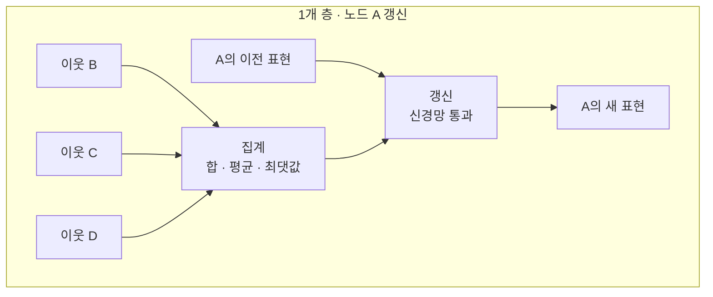

# Graph Neural Network – GNN (그래프 신경망)

> **그래프 신경망은 노드와 엣지로 이어진 그래프 위에서, 각 노드가 이웃의 정보를 주고받으며 자신의 표현을 학습하는 신경망이다.**

## 이웃에게 소문을 들으며 나를 다시 정의한다

이미지는 격자, 문장은 한 줄로 늘어선 시퀀스다. 하지만 세상의 많은 데이터는 그렇게 반듯하지 않다. 소셜 네트워크의 친구 관계, 분자의 원자 결합, 도로망은 모두 **불규칙하게 연결된 그래프**다. 이런 데이터를 격자나 시퀀스로 억지로 펴면 정작 중요한 "누가 누구와 연결됐는지"가 뭉개진다.

그래프 신경망(GNN)의 발상은 단순하다. **한 사람을 이해하려면 그 친구들을 보라.** 각 노드는 이웃 노드들의 정보를 모아 자신을 다시 정의한다. 이 과정을 여러 번 반복하면 한 노드의 표현에 점점 더 넓은 범위의 이웃 정보가 스며든다.

## 메시지 전달 — 모으고, 합치고, 갱신한다

GNN의 한 층은 모든 노드에서 동시에 **메시지 전달(message passing)** 세 단계를 수행한다.

1. **모으기(message)** — 각 노드가 엣지로 연결된 이웃들의 특징 벡터를 가져온다.
2. **합치기(aggregate)** — 가져온 이웃 벡터들을 순서에 무관한 방식(합·평균·최댓값 등)으로 하나로 합친다. 이웃에는 정해진 순서가 없으므로 **순서에 상관없는 집계**가 핵심이다.
3. **갱신(update)** — 합친 이웃 정보와 자신의 기존 벡터를 신경망에 통과시켜 새 표현으로 바꾼다.

**층을 K번 쌓으면 각 노드는 K단계 떨어진 이웃까지의 정보를 담는다.** 1층이면 직접 친구, 2층이면 친구의 친구까지 반영되는 식이다.

## 학습된 표현으로 세 가지를 예측한다

집계로 얻은 노드 표현을 어디에 쓰느냐에 따라 과제가 갈린다.

| 과제 | 무엇을 예측하나 | 예시 |
|------|---------------|------|
| 노드 분류 | 개별 노드의 레이블 | 소셜 그래프에서 봇 계정 탐지 |
| 링크 예측 | 두 노드가 연결될지 | 추천 시스템에서 살 만한 상품 |
| 그래프 분류 | 그래프 전체의 성질 | 분자 그래프로 독성 여부 판정 |

## 흔한 오해

> ⚠️ **흔한 오해 — "층을 깊게 쌓을수록 좋다."**
>
> GNN은 층을 너무 많이 쌓으면 모든 노드의 표현이 서로 비슷해지는 **과평활화(over-smoothing)**가 일어난다. 반복 집계로 이웃 정보가 계속 섞이다 보면 결국 노드들이 구별되지 않게 된다. 그래서 실무의 GNN은 대개 2~3층 정도로 얕게 쓴다.

## 정리하면

- GNN은 **불규칙하게 연결된 그래프**를 직접 다루는 신경망이다.
- 핵심 연산은 이웃을 모으고·합치고·갱신하는 **메시지 전달**이다.
- 이웃에는 순서가 없으므로 **순서에 무관한 집계**를 쓴다.
- 노드 분류·링크 예측·그래프 분류에 두루 쓰인다.
- 층을 지나치게 쌓으면 과평활화로 표현이 뭉개진다.

## 함께 읽기

- [Neural Network](Neural_Network.md) — GNN의 각 노드 갱신에 쓰이는 기본 신경망.
- [Graph Theory](Graph_Theory.md) — 노드·엣지·인접 관계 등 그래프의 수학적 토대.
- [Attention](Attention.md) — 이웃마다 다른 중요도를 학습하는 그래프 어텐션의 바탕 개념.
- [Deep Learning](Deep_Learning.md) — GNN이 속한 다층 신경망 학습의 큰 틀.
