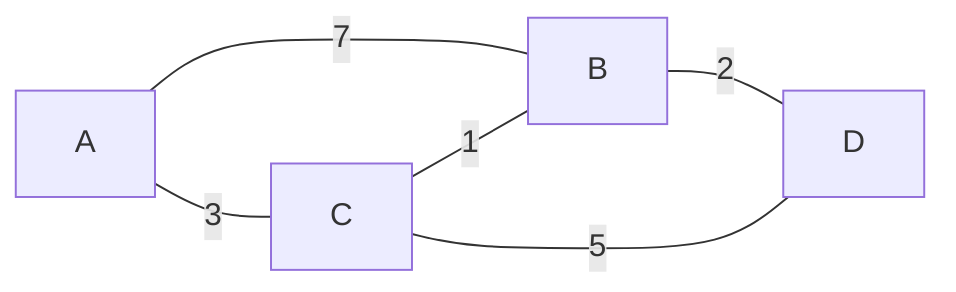

# Graph Theory (그래프 이론)

> **그래프 이론은 대상들을 점(정점)으로, 그 사이의 관계를 선(간선)으로 나타내 관계 구조를 연구하는 수학 분야다.**

## 지하철 노선도가 곧 그래프다

지하철 노선도를 떠올려 보자. 역이 **정점(vertex)**, 역과 역을 잇는 선로가 **간선(edge)**이다. 노선도에는 역 사이의 실제 거리나 방향은 정확하지 않지만, "어느 역이 어느 역과 연결되는가"라는 **관계**만은 정확히 담겨 있다. **그래프 이론은 바로 이 '무엇이 무엇과 연결되어 있는가'를 다룬다.** 대상 자체보다 대상들 사이의 연결 구조가 관심사다.

이 학문의 출발점은 1736년 오일러가 푼 "쾨니히스베르크 다리 문제"다. 도시의 다리들을 한 번씩만 건너 모두 지날 수 있는가 하는 문제를, 오일러는 땅을 정점, 다리를 간선으로 추상화해 "불가능하다"고 증명했다. 대상을 점과 선으로 추상화하는 발상 자체가 그래프 이론의 씨앗이었다.

## 그래프는 방향·가중치 유무로 갈린다

기본 용어와 갈래를 정리하면 이렇다.

| 개념 | 뜻 |
|------|-----|
| 정점 (vertex) | 대상. 노드라고도 한다 |
| 간선 (edge) | 두 정점을 잇는 관계 |
| 경로 (path) | 간선을 따라 이어지는 정점의 나열 |
| 사이클 (cycle) | 출발점으로 되돌아오는 경로 |
| 방향 그래프 | 간선에 방향이 있음(팔로우 관계 등) |
| 무방향 그래프 | 간선에 방향이 없음(친구 관계 등) |
| 가중 그래프 | 간선에 값이 붙음(거리·비용 등) |

컴퓨터는 그래프를 **인접 행렬**(정점 수 × 정점 수 표)이나 **인접 리스트**(각 정점의 이웃 목록)로 저장한다. 그 위에서 최단 경로(다익스트라), 연결 여부([너비우선 탐색](Breadth_First_Search.md)·[깊이우선 탐색](Depth_First_Search.md)), 중심성 같은 분석을 돌린다.

## 흔한 오해

> ⚠️ **흔한 오해 — "그래프 이론의 '그래프'는 막대그래프·꺾은선그래프 같은 도표다."**
>
> 전혀 다르다. 여기서 그래프는 **정점과 간선으로 이뤄진 관계 구조**를 뜻한다. 데이터를 시각화하는 차트(chart)와는 이름만 같을 뿐 별개의 개념이다.

## 정리하면

- 그래프 이론은 대상을 **정점**, 관계를 **간선**으로 보고 연결 구조를 연구한다.
- 그래프는 **방향·가중치 유무**로 종류가 갈린다.
- 컴퓨터는 **인접 행렬/리스트**로 저장하고 최단 경로·연결성·중심성을 분석한다.
- 데이터 시각화용 **차트와는 다른** 개념이다.

## 함께 읽기

- [Breadth First Search](Breadth_First_Search.md) — 그래프를 층별로 훑는 대표적 탐색.
- [Depth First Search](Depth_First_Search.md) — 한 갈래를 끝까지 파고드는 탐색.
- [Graph Neural Network - GNN](Graph_Neural_Network___GNN.md) — 그래프 구조를 학습하는 신경망.
- [State Space](State_Space.md) — 문제의 상태와 전이를 그래프로 보는 관점.
