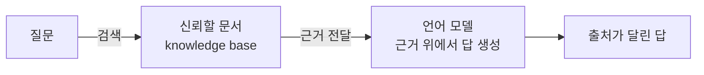

# Hallucination (환각)

> **환각은 언어 모델이 사실이 아닌 내용을, 마치 사실인 양 유창하고 자신 있게 지어내는 현상이다.**

## "모른다"고 말하지 못하는 학생과 같다

모르는 문제를 받았는데도 "모르겠습니다"라고 답하지 못하고, 그럴듯한 답을 술술 지어내는 학생을 떠올려 보자. 문장은 매끄럽고 말투는 확신에 차 있지만 내용은 틀렸다. **[대규모 언어 모델](Large_Language_Model___LLM.md)의 환각이 딱 이 학생이다.** 존재하지 않는 논문을 인용하고, 없는 API 함수를 만들어내고, 사람의 경력을 그럴듯하게 창작한다.

핵심은 모델이 **거짓말을 하려는 의도가 없다**는 점이다. 언어 모델은 "다음에 올 가장 그럴듯한 단어"를 이어 붙이도록 학습됐을 뿐, 문장이 진실인지 검증하는 장치가 애초에 없다. 그럴듯함과 진실함은 대개 겹치지만, 갈라지는 순간 모델은 진실이 아니라 그럴듯함을 택한다.

## 환각은 버그가 아니라 생성 원리의 부산물이다

언어 모델은 방대한 텍스트에서 통계적 패턴을 배워 확률적으로 토큰을 생성한다. 이 구조에는 두 가지 근본 한계가 있다.

- **사실 저장소가 아니다** — 모델의 지식은 개별 사실이 정확히 저장된 데이터베이스가 아니라 파라미터에 뭉개져 압축된 패턴이다. 세부 사실을 되살릴 때 빈틈을 그럴듯한 값으로 메운다.
- **모르는 것을 모른다** — 자기 답의 신뢰도를 스스로 정확히 재지 못한다. 그래서 확신의 어조와 정답 여부가 따로 논다.

환각은 크게 두 종류로 나뉜다.

| 종류 | 무엇이 어긋나나 | 예 |
|------|----------------|-----|
| 사실성 환각 (factuality) | 세상의 사실과 어긋난다 | 없는 사건·수치·인용을 만들어냄 |
| 충실성 환각 (faithfulness) | 주어진 원문·지시와 어긋난다 | 요약이 원문에 없는 내용을 추가함 |

## 흔한 오해

> ⚠️ **흔한 오해 — "모델을 더 키우거나 잘 튜닝하면 환각은 완전히 사라진다."**
>
> 규모를 키우고 [RLHF](RLHF.md)로 다듬으면 빈도는 눈에 띄게 줄지만, **완전히 없앨 수는 없다.** 확률적으로 텍스트를 생성하는 한 그럴듯한 오답을 낼 여지가 남는다. 목표는 "제거"가 아니라 "억제와 검증"이다.

## 어떻게 줄이나

| 방법 | 핵심 아이디어 |
|------|--------------|
| 검색 증강 생성 | 답을 지어내지 말고 검색해 온 실제 문서에 근거를 두게 한다 ([RAG](Retrieval_Augmented_Generation___RAG.md)) |
| 출처 제시 요구 | 근거·인용을 함께 내놓게 해 검증 가능하게 만든다 |
| 프롬프트 설계 | "모르면 모른다고 답하라"처럼 불확실성을 허용한다 ([프롬프트 엔지니어링](Prompt_Engineering.md)) |
| 생성 온도 낮추기 | 무작위성을 줄여 안전한 답으로 수렴시킨다 |
| 사람·검증기 개입 | 사실 검증 단계를 파이프라인에 끼워 넣는다 |

이 중 실무에서 가장 효과가 큰 것은 **모델의 기억이 아니라 외부 지식에 답을 묶어두는 [RAG](Retrieval_Augmented_Generation___RAG.md)**다.

## 정리하면

- 환각은 모델이 **그럴듯하지만 사실이 아닌** 내용을 자신 있게 만들어내는 현상이다.
- 원인은 언어 모델이 진실이 아니라 **확률적 그럴듯함**을 좇는 생성 방식 자체에 있다.
- 사실성 환각과 충실성 환각으로 나뉜다.
- 규모·튜닝으로 줄지만 완전히 없앨 수는 없고, **RAG·출처 요구·검증**으로 억제한다.

## 함께 읽기

- [Large Language Model - LLM](Large_Language_Model___LLM.md) — 환각이 생겨나는 무대. 왜 생성 모델이 이런 실수를 하는지의 뿌리.
- [Retrieval-Augmented Generation - RAG](Retrieval_Augmented_Generation___RAG.md) — 답을 외부 지식에 묶어 환각을 억제하는 대표 처방.
- [RLHF](RLHF.md) — 인간 피드백으로 모델을 다듬어 환각 빈도를 낮추는 정렬 기법.
- [Prompt Engineering](Prompt_Engineering.md) — 불확실성을 허용하도록 지시해 무리한 답을 막는 방법.
