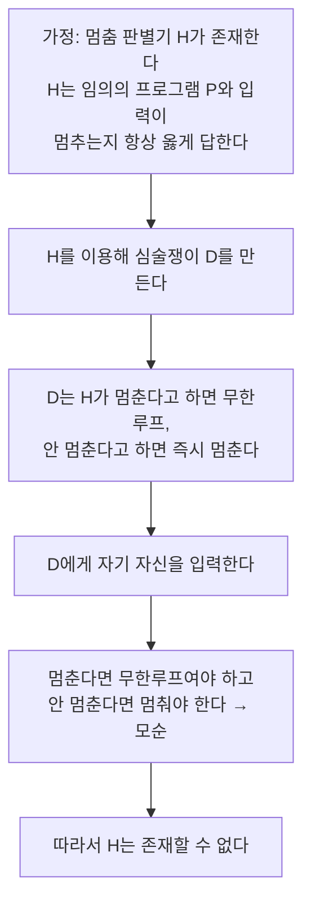

# Halting Problem (멈춤문제)

> **멈춤문제는 "임의의 프로그램이 주어진 입력에서 멈출지, 아니면 영원히 돌지"를 항상 옳게 판별하는 알고리즘이 존재할 수 없음을 보인 문제다.**

## "모든 프로그램의 무한루프를 잡아내는 만능 검사기"는 만들 수 없다

무한루프에 빠진 코드를 실행 전에 미리 걸러 주는 만능 도구가 있다면 얼마나 좋을까. **멈춤문제는 그런 도구가 원리적으로 불가능하다는 것을 증명한다.** 특정 프로그램 하나의 종료 여부는 얼마든지 판단할 수 있다. 하지만 **모든** 프로그램·입력 쌍에 대해 항상 옳은 답을 내는 하나의 알고리즘은 만들 수 없다.

1936년 앨런 튜링이 증명했다. 컴퓨터로 풀 수 없는 문제가 실제로 존재함을 보인, 계산 이론의 이정표다.

## 자기 참조로 모순을 만들어 증명한다

증명은 귀류법이다. 흐름을 요약하면 이렇다.

핵심 장치는 **자기 참조**다. 판별기 H가 시키는 것과 항상 반대로 행동하는 프로그램 D를 만든 뒤, D에게 자기 자신을 물으면 어느 답도 성립할 수 없다. 이 모순이 "그런 H는 애초에 없다"를 강제한다.

## 흔한 오해

> ⚠️ **흔한 오해 — "멈춤문제는 어떤 프로그램이 멈추는지도 절대 알 수 없다는 뜻이다."**
>
> 아니다. 개별 프로그램의 종료 여부는 대개 판단할 수 있다. 불가능한 것은 **모든** 프로그램에 대해 항상 옳게 답하는 **단 하나의 범용 알고리즘**이다. "특정 문제를 못 푼다"가 아니라 "만능 판별기가 없다"는 이야기다.

> ⚠️ **흔한 오해 — "멈춤문제는 모든 결정 문제를 포함하는 상위 개념이다."**
>
> 그렇지 않다. 멈춤문제는 **결정 불가능한(undecidable) 결정 문제의 대표적 한 예**일 뿐이다. 결정 문제 전체를 아우르는 상위 개념이 아니라, 그중 알고리즘으로 풀리지 않는 사례에 속한다.

## 정리하면

- 멈춤문제는 **모든 프로그램의 종료 여부를 판별하는 범용 알고리즘이 없음**을 보인 문제다.
- 증명은 **자기 참조로 모순**을 만드는 귀류법이다(튜링, 1936).
- 개별 프로그램은 판단 가능하다. 불가능한 것은 **만능 판별기**다.
- 이것은 계산 불가능성(결정 불가능성)의 **대표 사례**다.

## 함께 읽기

- [Turing Machine](Turing_Machine.md) — 멈춤문제가 정의되고 증명된 계산 모델.
- [Automata](Automata.md) — 계산을 형식적으로 다루는 기계 모델의 기초.
- [NP-complete / NP-hard](NPcomplete__NPhard.md) — 풀 수는 있지만 어려운 문제. 아예 풀 수 없는 멈춤문제와 대비된다.
