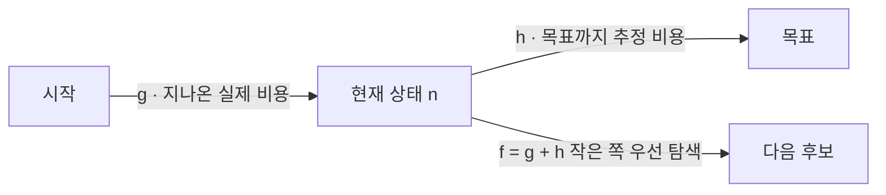

# Heuristic (휴리스틱)

> **휴리스틱은 최적해를 보장하지는 않지만, 적은 계산으로 "충분히 좋은" 답을 빠르게 찾게 해 주는 경험적 어림법이다.**

## 낯선 도시에서 목적지 방향으로 걷는 것과 같다

지도 없이 낯선 도시에서 역을 찾는다고 하자. 모든 골목을 다 뒤지는 건 비현실적이다. 대신 "역은 큰길 쪽에 있겠지" 하고 큰길 방향으로 걷는다. 틀릴 수도 있지만 대개 빨리 가까워진다. **휴리스틱이 바로 이 '방향 감각'이다.** 완벽한 보장 대신, 경험에서 나온 어림짐작으로 탐색을 이끈다.

왜 필요한가. 현실의 많은 문제는 가능한 경우의 수가 폭발적으로 많아 전부 따져 볼 수 없다. **휴리스틱은 유망해 보이는 쪽부터 살펴 탐색 공간을 줄인다.** 그 대가로 최적해를 놓칠 위험을 감수한다.

## 좋은 휴리스틱은 목표까지의 비용을 값싸게 잘 추정한다

탐색에서 휴리스틱은 보통 **휴리스틱 함수 `h(n)`** 으로 구현된다. 현재 상태 `n`에서 목표까지 남은 비용을 추정하는 함수다. 예컨대 길찾기에서 두 지점의 직선거리를 `h(n)`으로 쓴다 — 실제 도로 거리보다 계산이 훨씬 싸면서도 방향을 잘 알려 준다.

[A* 알고리즘](A_Algorithm.md)이 대표 예다. A*는 지금까지 온 실제 비용 `g(n)`과 남은 추정 비용 `h(n)`을 더한 `f(n) = g(n) + h(n)`이 작은 쪽부터 탐색한다.

`h(n)`이 실제 남은 비용을 절대 넘겨 잡지 않으면(**허용성, admissible**) A*는 최적해를 보장한다. 즉 좋은 휴리스틱은 "값싸게, 그러나 과대평가하지 않게" 추정한다.

## 흔한 오해

> ⚠️ **흔한 오해 — "휴리스틱은 대충 하는 거라 늘 부정확한 답을 준다."**
>
> 항상 그런 건 아니다. A*처럼 휴리스틱을 쓰면서도 **최적해를 보장하는** 알고리즘이 있다. 관건은 휴리스틱의 질이다. 목표를 잘 반영하는 어림법은 정확성을 해치지 않으면서 속도만 끌어올린다.

## 정리하면

- 휴리스틱은 **최적해 보장 대신 속도**를 택하는 경험적 어림법이다.
- 방대한 탐색 공간에서 **유망한 쪽부터** 살펴 계산을 줄인다.
- 탐색에서는 남은 비용을 추정하는 **휴리스틱 함수 `h(n)`** 으로 쓰인다.
- 추정이 과대평가하지 않으면(허용성) A*처럼 **최적해를 지킬 수도** 있다.

## 함께 읽기

- [A* Algorithm](A_Algorithm.md) — 휴리스틱을 써서 최단 경로를 찾는 대표 알고리즘.
- [Problem Solving](Problem_Solving.md) — 휴리스틱이 활약하는 탐색 기반 문제 해결의 큰 틀.
- [State Space](State_Space.md) — 휴리스틱이 훑어 나가는 상태들의 공간.
- [Optimization](Optimization.md) — 좋은 해를 찾는 더 넓은 문제. 휴리스틱은 그 실용적 도구다.
