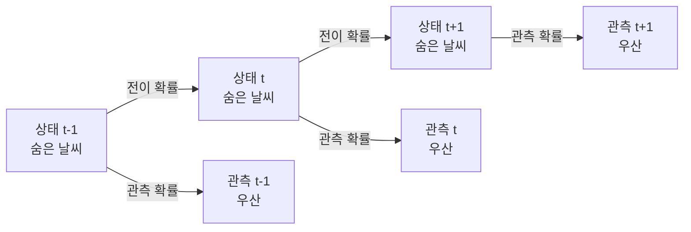

# Hidden Markov Model (은닉 마르코프 모델)

> **은닉 마르코프 모델(HMM)은 직접 볼 수 없는 숨은 상태들이 순서대로 이어지고, 각 상태가 관측 가능한 신호를 흘리는 상황을 확률로 모델링한 것이다.**

## 창밖은 못 보고, 사람들의 우산만 보고 날씨를 맞힌다

지하 사무실에 갇혀 창밖 날씨(맑음/비)를 볼 수 없다고 하자. 대신 출근하는 사람들이 **우산을 들었는지**는 볼 수 있다. 여기서 날씨는 **숨은 상태(hidden state)**, 우산은 **관측(observation)** 이다. 우산만 보고 오늘 날씨를, 나아가 지난 며칠의 날씨 흐름을 추측하는 것 — 이것이 HMM이 푸는 문제다.

HMM은 두 가지 확률 가정 위에 선다.

- **마르코프 가정**: 다음 상태는 **바로 직전 상태에만** 의존한다(어제 날씨로 오늘 날씨를 정한다). 그 이전 역사는 잊는다.
- **관측 독립 가정**: 관측(우산)은 **현재 상태(날씨)에만** 의존한다.

## 세 확률과 세 가지 물음

HMM은 세 종류의 확률로 정의된다.

| 파라미터 | 의미 |
|----------|------|
| 초기 확률 (π) | 첫 상태가 무엇일지의 분포 |
| 전이 확률 (A) | 한 상태에서 다음 상태로 넘어갈 확률 |
| 관측 확률 (B) | 각 상태에서 특정 관측이 나올 확률 |

이 모델로 던지는 대표적 물음 세 가지와, 각각을 푸는 알고리즘이 정해져 있다.

| 물음 | 무엇을 구하나 | 알고리즘 |
|------|----------------|----------|
| 평가 (Evaluation) | 이 관측열이 나올 확률 | 전방(Forward) 알고리즘 |
| 디코딩 (Decoding) | 가장 그럴듯한 숨은 상태열 | 비터비(Viterbi) 알고리즘 |
| 학습 (Learning) | 데이터에 맞는 세 확률 추정 | Baum-Welch (EM의 일종) |

> ⚠️ **흔한 오해 — "상태를 직접 보고 배운다."**
>
> 이름 그대로 상태는 **은닉(hidden)** 이다. 학습 데이터에 상태 정답이 없어도, 관측열만 가지고 Baum-Welch([EM 알고리즘](Expectation_Maximization_Algorithm.md)의 한 형태)로 세 확률을 추정할 수 있다. 상태를 못 보기 때문에 오히려 이 모델이 필요한 것이다.

## 정리하면

- HMM은 **숨은 상태열 + 그 상태가 흘리는 관측열**을 확률로 엮은 시계열 모델이다.
- 다음 상태는 직전 상태에만, 관측은 현재 상태에만 의존한다는 두 가정 위에 선다.
- 초기·전이·관측 세 확률로 정의되고, 평가·디코딩·학습 세 물음에 각각의 알고리즘이 있다.
- 음성 인식, 품사 태깅, 유전자 서열 분석 등 순서가 있는 데이터에 폭넓게 쓰였다.

## 함께 읽기

- [Expectation Maximization Algorithm](Expectation_Maximization_Algorithm.md) — HMM 학습(Baum-Welch)의 바탕이 되는 알고리즘.
- [Bayesian Network](Bayesian_Network.md) — HMM은 시간축으로 펼친 특수한 베이즈 네트워크로 볼 수 있다.
- [Bayesian Inference](Bayesian_Inference.md) — 관측으로 숨은 상태를 추론하는 확률적 사고의 뿌리.
- [Time Series Analysis](Time_Series_Analysis.md) — 순서가 있는 데이터를 다루는 큰 갈래.
