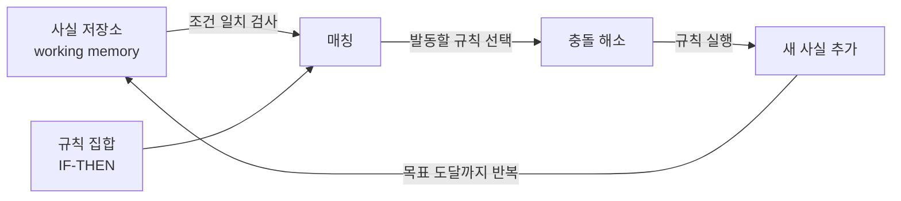

# Inference Engine (추론엔진)

> **추론엔진은 지식 기반에 담긴 규칙과 사실을 조합해 새로운 사실이나 결론을 자동으로 끌어내는 프로그램이다.**

## 지식 기반이 재료라면 추론엔진은 요리사다

[전문가 시스템](Expert_System.md)은 크게 두 부분으로 나뉜다. "IF 열이 나고 기침을 하면 THEN 감기 의심" 같은 규칙과 사실이 쌓인 **지식 기반(knowledge base)**, 그리고 그 규칙을 실제로 굴려 답을 내는 **추론엔진(inference engine)**이다. **지식 기반이 재료와 레시피라면, 추론엔진은 그 레시피를 읽고 요리를 완성하는 요리사다.** 지식과 그것을 쓰는 로직을 분리한 덕에, 규칙만 바꾸면 다른 분야에도 같은 엔진을 재사용할 수 있다.

## 추론엔진은 전향·후향 두 방향으로 규칙을 굴린다

규칙을 적용하는 방향에 따라 두 방식이 있다.

| 방식 | 출발점 | 흐름 | 잘 맞는 상황 |
|------|--------|------|--------------|
| 전향 추론 (forward chaining) | 알려진 사실 | 사실 → 규칙 발동 → 새 사실 → 반복 | 데이터로부터 결론을 넓혀 갈 때 |
| 후향 추론 (backward chaining) | 증명하려는 목표 | 목표 → 필요한 조건 되짚기 → 사실로 확인 | 특정 가설을 검증할 때 |

**전향 추론**은 아는 사실에서 출발해, 조건이 맞는 규칙을 발동시켜 새 사실을 계속 쌓는다. **후향 추론**은 반대로 결론을 먼저 세우고 "이게 참이려면 무엇이 참이어야 하나"를 거꾸로 파고든다.

전향 추론의 한 사이클은 대개 **매칭(조건에 맞는 규칙 찾기) → 충돌 해소(발동할 규칙 하나 고르기) → 실행(결과를 사실에 반영)**으로 돈다. 이 과정을 목표에 이르거나 더 발동할 규칙이 없을 때까지 반복한다.

## 흔한 오해

> ⚠️ **흔한 오해 — "추론엔진이 지식까지 갖고 있는 똑똑한 AI다."**
>
> 아니다. 추론엔진은 **규칙을 적용하는 절차만** 담당한다. 무엇이 참인지(지식)는 별도의 지식 기반에 있다. 엔진 자체는 도메인 지식이 비어 있고, 지식 기반을 갈아 끼우면 의료든 금융이든 같은 엔진으로 굴러간다. 지식과 추론의 분리가 이 구조의 핵심이다.

## 정리하면

- 추론엔진은 **규칙 + 사실 → 새 결론**을 자동으로 끌어내는 프로그램이다.
- **전향 추론**(사실에서 출발)과 **후향 추론**(목표에서 역추적)이 대표 방식이다.
- 전향 추론은 **매칭 → 충돌 해소 → 실행**을 반복한다.
- 지식(지식 기반)과 추론 로직(엔진)이 **분리**되어 재사용성이 높다.

## 함께 읽기

- [Expert System](Expert_System.md) — 추론엔진이 심장 역할을 하는 대표 시스템.
- [Rule-base Expert System](Rulebase_Expert_System.md) — IF-THEN 규칙으로 돌아가는 구체적 형태.
- [Backward Chaining Inference](Backward_Chaining_Inference.md) — 목표에서 거꾸로 파고드는 추론 방식.
- [Knowledge Engineering](Knowledge_Engineering.md) — 엔진이 굴릴 지식을 만들어 넣는 작업.
