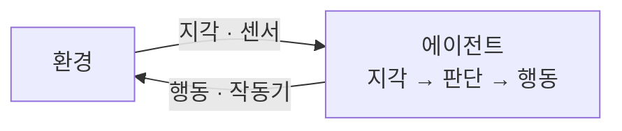

# Intelligent Agent (지능적 에이전트)

> **지능적 에이전트는 센서로 환경을 인지하고, 목표를 위해 스스로 판단해 행동(작동기)으로 환경에 개입하는 자율 시스템이다.**

## 로봇 청소기가 가장 손에 잡히는 예다

로봇 청소기를 떠올려 보자. 범퍼 센서와 카메라로 주변을 **인지**하고, "바닥을 다 치운다"는 **목표**에 따라 스스로 경로를 정해, 바퀴와 흡입기라는 **작동기**로 움직인다. 벽에 부딪히면 방향을 바꾸는 식으로 환경 변화에 **반응**하기도 한다. **지능적 에이전트는 바로 이 인지–판단–행동의 고리를 자율적으로 도는 존재다.**

러셀과 노빅의 표준 정의로 말하면, 에이전트는 **센서(sensor)로 환경을 지각(percept)하고 작동기(actuator)로 행동(action)하는** 무엇이다. "지능적"이 붙으면 여기에 목표 지향성과 합리적 선택 — 주어진 정보로 목표를 가장 잘 이루는 행동을 고르는 성질 — 이 더해진다.

## 에이전트는 지각을 행동으로 잇는 정책으로 정의된다

에이전트의 본질은 **"지각을 받아 행동을 내놓는 함수"**다. 이 함수가 얼마나 정교한지에 따라 단순한 것부터 학습하는 것까지 층이 나뉜다.

| 유형 | 판단 방식 |
|------|-----------|
| 단순 반사 에이전트 | 현재 지각만 보고 규칙대로 반응 |
| 모형 기반 에이전트 | 내부에 세계 모형을 두고 안 보이는 상태도 추정 |
| 목표 기반 에이전트 | 목표에 가까워지는 행동을 탐색·선택 |
| 효용 기반 에이전트 | 목표 달성의 "만족도"까지 저울질 |
| 학습 에이전트 | 경험으로 정책을 스스로 개선 |

학습하는 에이전트는 보통 [강화학습](Reinforcement_Learning.md)으로 보상을 통해 정책을 다듬는다. 그렇다고 모든 에이전트가 학습하는 것은 아니다 — 규칙만으로 도는 단순 반사 에이전트도 엄연한 에이전트다.

## 흔한 오해

> ⚠️ **흔한 오해 — "지능적 에이전트는 반드시 스스로 학습해야 한다."**
>
> 아니다. 학습은 에이전트가 가질 수 있는 한 능력일 뿐, 필수 조건이 아니다. 규칙에 따라 지각을 행동으로 옮기기만 해도 에이전트다. 핵심 조건은 **환경을 지각하고 자율적으로 행동하는 것**이지 학습 여부가 아니다.

## 정리하면

- 지능적 에이전트는 **센서로 인지 → 판단 → 작동기로 행동**하는 자율 시스템이다.
- 본질은 **지각을 행동으로 잇는 정책(함수)**이다.
- 단순 반사부터 **학습 에이전트**까지 판단의 정교함에 따라 층이 나뉜다.
- 학습은 선택 사항이다. **자율적 지각·행동**이 핵심 조건이다.

## 함께 읽기

- [Agent](Agent.md) — 에이전트 개념의 기본 정의.
- [Reinforcement Learning](Reinforcement_Learning.md) — 에이전트가 보상으로 정책을 학습하는 대표 방법.
- [Actuator](Actuator.md) — 에이전트가 환경에 개입하는 출력 장치.
- [Game Theory](Game_Theory.md) — 여러 에이전트가 상호작용할 때의 전략 분석 틀.
