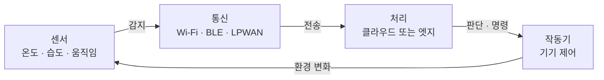

# Internet of Things (사물인터넷)

> **사물인터넷은 일상의 사물에 센서·통신 기능을 심어, 사람 손을 거치지 않고 인터넷으로 데이터를 주고받으며 스스로 반응하게 만드는 기술이다.**

## 사물끼리 대화하는 인터넷이다

지금까지 인터넷은 주로 사람이 쓰는 것이었다 — 사람이 검색하고, 사람이 메시지를 보낸다. **사물인터넷(IoT)은 그 주체를 '사물'로 넓힌다.** 냉장고가 우유가 떨어진 걸 알아 주문을 넣고, 가로등이 사람이 지나갈 때만 켜지고, 손목의 밴드가 심박을 병원 서버로 보낸다. 사람이 일일이 조작하지 않아도 사물들이 데이터를 주고받고 스스로 반응한다.

이걸 가능하게 하는 사물, 즉 **IoT 기기**는 세 가지를 품는다. 환경을 읽는 **센서**, 환경에 개입하는 **작동기(액추에이터)**, 그리고 데이터를 실어 나르는 **통신 모듈**이다.

## 감지 → 전송 → 처리 → 작동의 순환으로 돈다

IoT 시스템은 대체로 네 단계를 반복한다.

1. **감지** — 센서가 온도·습도·움직임 등 물리 세계의 값을 읽는다.
2. **전송** — Wi-Fi, 블루투스, 셀룰러, 또는 저전력 광역망(LPWAN) 등으로 데이터를 보낸다.
3. **처리** — 클라우드에서 모아 분석하거나, 지연을 줄이려 기기 근처에서 처리한다(엣지 컴퓨팅).
4. **작동** — 분석 결과에 따라 기기에 명령을 내려 환경에 개입한다.

데이터를 어디서 처리하느냐가 설계의 갈림길이다. 모든 걸 클라우드로 보내면 관리가 편하지만 지연과 대역폭 부담이 크다. 그래서 빠른 반응이 필요한 처리는 기기 가까이에서 하는 **엣지 컴퓨팅**을 함께 쓴다.

## 흔한 오해

> ⚠️ **흔한 오해 — "인터넷에 연결되기만 하면 다 사물인터넷이다."**
>
> 단순히 연결된 것만으로는 부족하다. IoT의 핵심은 **센서로 데이터를 얻고, 그걸 바탕으로 판단해, 작동기로 다시 환경에 개입하는 자동화 고리**다. 사람이 스마트폰으로 일일이 켜고 끄기만 한다면, 그건 원격 조종이지 사물"인터넷"의 본령은 아니다.

## 정리하면

- 사물인터넷은 사물이 **스스로 데이터를 주고받고 반응**하게 만드는 기술이다.
- IoT 기기는 **센서 · 작동기 · 통신 모듈**을 품는다.
- 시스템은 **감지 → 전송 → 처리 → 작동**의 순환으로 돈다.
- 처리 위치에 따라 **클라우드 vs 엣지 컴퓨팅**으로 설계가 갈린다.

## 함께 읽기

- [Actuator](Actuator.md) — IoT 기기가 환경에 개입하는 출력 장치.
- [Intelligent Agent](Intelligent_Agent.md) — 인지·판단·행동 고리를 도는 자율 시스템. IoT 기기와 구조가 닮았다.
- [Distributed Computing](Distributed_Computing.md) — 수많은 기기의 데이터를 나눠 처리하는 바탕 기술.
