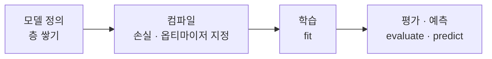

# Keras (케라스)

> **Keras는 신경망을 몇 줄의 코드로 쌓아 올리게 해 주는 고수준 딥러닝 API다. 복잡한 저수준 계산은 뒤의 엔진에 맡기고, 사람은 모델 구조에만 집중하게 한다.**

## 딥러닝계의 레고 블록이다

신경망을 밑바닥부터 짜려면 행렬 곱, 미분, 가중치 갱신을 일일이 다뤄야 한다. **Keras는 이 과정을 레고 블록처럼 바꿔 놓는다.** 층(Dense, Conv2D 등)을 원하는 순서로 끼워 맞추면 모델이 완성된다. 그래서 입문자가 딥러닝을 처음 만질 때 가장 많이 쓰는 도구다.

Keras는 스스로 계산을 하지 않는다. 실제 텐서 연산은 뒤에 붙은 **백엔드 엔진**이 담당한다. 오랫동안 [TensorFlow](TensorFlow.md)와 한 몸으로 `tf.keras` 형태로 쓰였고, Keras 3부터는 TensorFlow·JAX·[PyTorch](PyTorch.md)를 골라 쓸 수 있는 멀티 백엔드로 다시 넓어졌다.

## 정의 → 컴파일 → 학습 → 평가의 네 박자다

Keras로 모델을 만드는 흐름은 거의 항상 같은 네 단계다.



가장 간단한 `Sequential` 모델은 층을 리스트로 쌓기만 하면 된다.

```python
from tensorflow import keras
from tensorflow.keras import layers

# 1) 정의 — 층을 순서대로 쌓는다
model = keras.Sequential([
    layers.Dense(64, activation="relu", input_shape=(28 * 28,)),
    layers.Dense(10, activation="softmax"),
])

# 2) 컴파일 — 손실 함수·옵티마이저·지표를 지정
model.compile(optimizer="adam",
              loss="sparse_categorical_crossentropy",
              metrics=["accuracy"])

# 3) 학습 — 데이터를 흘려보내며 가중치를 맞춘다
model.fit(x_train, y_train, epochs=5, batch_size=32)

# 4) 평가
loss, acc = model.evaluate(x_test, y_test)
```

`compile`에서 무엇으로 오차를 재고([손실 함수](Loss_Function.md)) 어떻게 가중치를 고칠지([옵티마이저](Optimizer.md))를 정하고, `fit`이 [역전파](Backpropagation.md)로 실제 학습을 돌린다.

## 흔한 오해

> ⚠️ **흔한 오해 — "Keras와 TensorFlow는 경쟁 관계다."**
>
> 둘은 경쟁하는 게 아니라 층위가 다르다. TensorFlow가 저수준 계산 엔진이라면 Keras는 그 위에 얹힌 사용하기 쉬운 껍데기다. 실제로 TensorFlow는 Keras를 공식 고수준 API로 품고 있다. "Keras로 짜면 TensorFlow가 돌린다"가 맞는 그림이다.

## 정리하면

- Keras는 신경망을 **블록처럼 쌓게** 해 주는 고수준 API다.
- 계산은 직접 하지 않고 TensorFlow·JAX·PyTorch 같은 **백엔드 엔진**에 맡긴다.
- **정의 → 컴파일 → 학습 → 평가**의 네 박자로 모델을 만든다.
- 간결함 덕에 입문과 빠른 실험에 특히 강하다.

## 함께 읽기

- [TensorFlow](TensorFlow.md) — Keras를 떠받치는 대표 백엔드 엔진.
- [PyTorch](PyTorch.md) — 세밀한 제어를 선호하는 진영의 대안 프레임워크.
- [Neural Network](Neural_Network.md) — Keras로 쌓아 올리는 대상 그 자체.
- [Optimizer](Optimizer.md) — compile 단계에서 지정하는 학습 방법.
