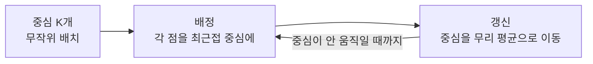

# K‑means Algorithm (K‑means 알고리즘)

> **K-means는 데이터를 K개의 무리로 나누되, "각 점을 가장 가까운 중심에 배정하고 → 중심을 그 무리의 평균으로 옮기기"를 반복해 무리를 스스로 찾아내는 군집 알고리즘이다.**

## 사람들을 K개의 모임으로 자리 배치하기

파티장에 모임 자리 K개를 아무 데나 놓는다. 손님은 가장 가까운 자리로 간다. 그러면 각 자리를 **모여든 사람들의 한가운데로 옮긴다.** 자리가 옮겨졌으니 손님도 다시 가장 가까운 자리로 이동한다. 이걸 자리가 더 안 움직일 때까지 반복하면, 자연스럽게 K개의 무리가 잡힌다. **이 왕복이 K-means의 전부다.**

## 흔한 오해

> ⚠️ **흔한 오해 — "K는 알고리즘이 알아서 정해 준다."**
>
> 아니다. **K(무리 개수)는 사람이 미리 정해 줘야 하는 입력**이다. 적절한 K는 엘보우 기법·실루엣 점수로 가늠한다. 또 시작 중심을 잘못 잡으면 엉뚱한 답에 수렴하므로, 보통 여러 번 돌리거나 K-means++로 초기화한다. 그리고 K-means는 **둥글고 크기 비슷한 무리**를 가정하므로 길쭉하거나 밀도가 다른 무리엔 약하다.

## 정리하면

- K-means는 **배정 → 중심 갱신**을 반복해 K개 무리를 찾는다([비지도 학습](Unsupervised_Learning.md)).
- K는 사람이 정해야 하고, 초기 중심에 민감하다.
- 둥글고 비슷한 크기의 무리에 잘 맞고, 복잡한 모양엔 약하다.

## 함께 읽기

- [Clustering](Clustering.md) — K-means가 속한 군집화 전반.
- [Unsupervised Learning](Unsupervised_Learning.md) — 라벨 없이 구조를 찾는 큰 틀.
- [Dimensionality Reduction](Dimensionality_Reduction.md) — 군집 전에 차원을 줄이면 잘 되기도 한다.
- [K‑Nearest Neighbor Classification](KNearest_Neighbor_Classification.md) — 이름은 비슷하나 지도학습 분류기로 전혀 다르다.
