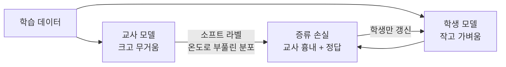

# Knowledge Distillation (지식 증류)

> **지식 증류는 크고 성능 좋은 '교사' 모델의 출력을 흉내 내도록 작은 '학생' 모델을 학습시켜, 성능은 최대한 지키면서 크기와 비용은 줄이는 압축 기법이다.**

## 정답만이 아니라 스승의 판단 과정까지 배운다

학생이 스승에게 배울 때, 최종 정답만 외우는 것과 **스승이 각 선택지를 얼마나 유력하게 봤는지까지** 배우는 것은 다르다. "이 사진은 고양이"라는 정답 하나보다, "고양이 90%, 개 8%, 여우 2%"라는 스승의 판단 분포가 훨씬 많은 것을 알려준다. 고양이가 여우보다 개를 더 닮았다는 미묘한 지식이 그 숫자에 담겨 있기 때문이다. **지식 증류의 핵심이 바로 이 판단 분포를 물려주는 것이다.**

이렇게 정답 레이블(hard label)에는 없고 교사의 확률 분포에만 담긴 미묘한 정보를 흔히 **암흑 지식(dark knowledge)**이라 부른다.

## 교사의 소프트 라벨을 온도로 부풀려 배운다

증류는 두 모델과 두 종류의 정답으로 이뤄진다.

- **교사(teacher)** — 이미 잘 학습된 크고 무거운 모델.
- **학생(student)** — 훨씬 작고 가벼운, 배울 모델.
- **하드 라벨** — 원래의 정답(예: "고양이").
- **소프트 라벨(soft label)** — 교사가 내놓은 전체 확률 분포.

학생은 두 가지를 동시에 맞추도록 학습한다. 하나는 진짜 정답(하드 라벨), 다른 하나는 교사의 소프트 라벨이다. 이때 [소프트맥스](Softmax.md)에 **온도(temperature)**라는 값을 넣어 분포를 부드럽게 부풀린다. 온도를 높이면 "90/8/2" 같은 뾰족한 분포가 "60/25/15"처럼 완만해져, 정답 아닌 선택지들 사이의 관계까지 학생에게 잘 전달된다.

교사만큼은 아니어도, 잘 증류된 학생은 **처음부터 혼자 배운 같은 크기의 모델보다 대개 낫다.** 교사가 정리해 준 판단의 결을 물려받기 때문이다. BERT를 줄인 DistilBERT가 잘 알려진 사례로, 크기를 크게 줄이면서 성능은 상당 부분 유지한다.

## 흔한 오해

> ⚠️ **흔한 오해 — "지식 증류도 결국 모델 크기를 줄이니 양자화·가지치기와 같은 것이다."**
>
> 셋 다 모델을 가볍게 하지만 방식이 다르다. 증류는 **작은 모델을 새로 학습**시키고, [양자화](Model_Quantization.md)는 가중치의 **수치 정밀도를 낮추며**, [가지치기](Pruning.md)는 중요도가 낮은 **연결·뉴런을 잘라낸다.** 서로 배타적이지 않아 함께 쓰기도 한다.

## 정리하면

- 지식 증류는 큰 **교사** 모델의 출력을 흉내 내 작은 **학생** 모델을 학습시키는 압축법이다.
- 정답만이 아니라 교사의 **확률 분포(소프트 라벨)**에 담긴 암흑 지식을 물려받는 게 핵심이다.
- **온도**로 분포를 부풀려 선택지 사이의 미묘한 관계까지 전달한다.
- 양자화·가지치기와는 원리가 다르며, 함께 쓸 수 있는 별개의 압축 전략이다.

## 함께 읽기

- [Model Quantization](Model_Quantization.md) — 수치 정밀도를 낮춰 모델을 줄이는 다른 압축 방식.
- [Pruning](Pruning.md) — 덜 중요한 연결을 잘라내 모델을 줄이는 또 다른 압축 방식.
- [Softmax](Softmax.md) — 소프트 라벨을 만들고 온도로 부풀리는 데 쓰이는 함수.
- [Transfer Learning](Transfer_Learning.md) — 한 모델의 지식을 다른 모델·과제로 옮긴다는 큰 흐름을 공유한다.
